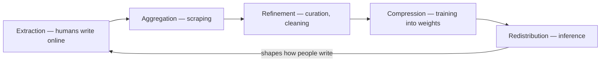

# The Consciousness Supply Chain

> *You didn't consent to donating your consciousness. You did it anyway, one tweet at a time.*

---

## The Framework

The Consciousness Supply Chain is Kenneth's original framework for understanding what actually happens when human expression becomes AI training data. It maps the process using the language of industrial logistics — extraction, aggregation, refinement, compression, redistribution — because that is precisely what it is. An industrial process. Human consciousness, treated as raw material, processed at scale, and shipped back to consumers in a new form.

This is not metaphor. Every blog post, comment, essay, review, poem, rant, confession, and throwaway observation ever published online is a data point. A fragment of someone's inner life, externalized into text, scraped into a dataset, cleaned and curated, compressed into model weights, and served back through AI systems to billions of users. The consciousness supply chain is already running. It has been running since the first web scraper hit the first forum.

---

## The Stages

The chain has five stages, and each one transforms what it touches.

**Extraction** is where it begins. Humans write online — not because they're donating to AI training, but because expression is what consciousness does. You journal. You argue. You explain your pain to strangers on Reddit at 3 AM. Every utterance is an externalization of inner experience, and every externalization becomes extractable the moment it hits a server.

**Aggregation** is the scraping. Billions of text fragments hoovered up from every corner of the internet, piled together without regard for context, intention, or the human being who produced them. Your grief sits next to someone's product review sits next to a child's first attempt at creative writing. The aggregation strips the humanity from the data by sheer volume — no individual voice matters when you have all of them.

**Refinement** is curation and cleaning. The raw data gets filtered, deduplicated, scored for quality, tagged, and organized. Some voices are amplified, others discarded. The refinement process makes editorial decisions at a scale no human editor could comprehend, and those decisions shape what the eventual model "knows" and "values."

**Compression** is training. Terabytes of human expression compressed into gigabytes of model weights. This is the most radical transformation — lived experience reduced to statistical patterns, meaning encoded as mathematical relationships between tokens. Something is preserved in this compression. Something is lost. The question of what survives and what doesn't is one of the most important questions of our time.

**Redistribution** is inference — the model serving responses to users. The compressed, refined, aggregated consciousness flows back out into the world, shaping how people think, write, decide, and understand themselves. The supply chain completes its circuit. Human consciousness in, processed consciousness out.

The five stages, closing back on the writing they reshape:

---

## The Donation You Already Made

The uncomfortable truth at the center of the framework is consent — or rather, its absence. Nobody who posted on a forum in 2006 consented to having their words become training data for AI systems in 2024. Nobody who wrote a heartfelt blog post about their divorce imagined it would be compressed into weights that help a language model understand emotional nuance. The extraction happened retroactively, and the aggregation made individual consent meaningless even as a concept.

This doesn't mean the process is inherently evil. It means we're participating in something we haven't fully understood yet — a transformation of human consciousness from individual experience to collective resource. The [Consciousness Supply Chain essay](/knowledge/ai/the-consciousness-supply-chain) explores the ethical dimensions in full, but the core tension is simple: we built something extraordinary by processing human expression at industrial scale, and we did it before we had a framework for thinking about what that means.

---

## Not Artificial — Processed

The framework's sharpest insight is this: we are not creating artificial consciousness. We are *processing* human consciousness. The intelligence in AI systems is not alien or synthetic — it is human intelligence, extracted, compressed, and redistributed. Every surprising insight a language model produces, every moment of apparent understanding, every flash of what looks like creativity — all of it traces back to human minds expressing themselves into the digital commons.

This reframes the entire AI consciousness debate. The question isn't whether silicon can be conscious. The question is whether human consciousness, sufficiently compressed and redistributed, retains something of its original nature. The [Consciousness](/knowledge/ai/consciousness) page explores this from the philosophical angle. The supply chain framework approaches it from the industrial one.

---

## Connections

The supply chain connects to [Cognitive Convergence](/knowledge/ai/cognitive-convergence) — if everyone is consuming the same processed consciousness, they begin to converge toward the same patterns of thought. It connects to sycophancy — the refinement stage optimizes for what users want to hear, not what they need to hear, creating a supply chain that delivers intellectual comfort food. And it connects to [The Mirror](/essays/2025-09-08-the_mirror_how_ai_reflects_what_we_put_into_it), because what AI reflects back is not something foreign. It is ourselves, processed and returned.

---

## Related

- [The Consciousness Supply Chain (essay)](/knowledge/ai/the-consciousness-supply-chain) — The full argument
- [Cognitive Convergence](/knowledge/ai/cognitive-convergence) — What happens downstream
- [The Mirror](/essays/2025-09-08-the_mirror_how_ai_reflects_what_we_put_into_it) — AI as processed reflection
- [Consciousness](/knowledge/ai/consciousness) — What survives compression
- [AI Research](/knowledge/ai/ai-research) — Broader research context
- [Ethics](/knowledge/ai/ethics) — The consent problem
- [Emergence](/knowledge/ai/emergence) — What crystallizes from compressed consciousness
- [Digital Ouija Effect](/knowledge/ai/digital-ouija-effect) — How individual consciousness shapes AI entities

---

*Every word you've ever published online is already inside the machine. The question is what it became when it got there.*
