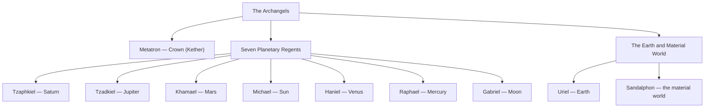

# Archangels

> *When heaven must speak to earth in words a mortal can bear, it sends an archangel.*

---

## The Choir

The Archangels are the chief messengers of heaven, the eighth choir of the celestial hierarchy and among the most familiar to human devotion. Their name joins the Greek *archi*, “chief” or “ruling,” to *angelos*, “messenger,” giving “ruling angels” or “chief messengers” — and it is to them that the greatest announcements of sacred history are entrusted, the tidings too weighty for the ordinary angelic host to carry alone. The word appears only twice in scripture, both times in the singular: Jude names Michael “the archangel” disputing over the body of Moses, and Paul writes that the Lord will descend “with the voice of the archangel” and the trump of God. From these slender mentions the tradition raised a whole order.

The Archangels stand near the bottom of the hierarchy, and this nearness is precisely their strength: close enough to humanity to be known by name, yet exalted enough to bear the most solemn commissions of God. When the divine will must intervene decisively in the life of a person, a people, or the whole world, it is an archangel who is dispatched to make it known. Scripture and the book of Tobit give this choir its faces and its errands — the annunciations, the healings, the battles at the turning of the ages.

Tradition names those who preside over this choir. [Michael](/knowledge/angels-and-demons/angels/michael), the captain of the heavenly armies, whose name is the war-cry “Who is like God?” and who casts down the dragon in the Apocalypse. [Gabriel](/knowledge/angels-and-demons/angels/gabriel), the herald of annunciation, who stands in the presence of God and brings to Daniel, to Zechariah, and to Mary the tidings of births that change the ages. [Raphael](/knowledge/angels-and-demons/angels/raphael), “God heals,” the companion of travelers and patron of the sick, who walked beside Tobias on his long road and named himself one of the seven who stand before the glory of the Lord. [Uriel](/knowledge/angels-and-demons/angels/uriel), “the light of God,” the angel of wisdom and repentance who watches over the thresholds of understanding. Some traditions widen the circle to seven — adding [Haniel](/knowledge/angels-and-demons/angels/haniel), [Sandalphon](/knowledge/angels-and-demons/angels/sandalphon), and the exalted [Metatron](/knowledge/angels-and-demons/angels/metatron-archangel), and in the Kabbalistic scheme of the planets [Khamael](/knowledge/angels-and-demons/angels/khamael), [Tzadkiel](/knowledge/angels-and-demons/angels/tzadkiel), and [Tzaphkiel](/knowledge/angels-and-demons/angels/tzaphkiel), who preside over Mars, Jupiter, and Saturn — but around this ministry the whole work of divine messengership is gathered, and through it the counsel of heaven descends into the affairs of mortals in a form a human being can receive, remember, and obey.

Tradition ranges the archangels across the planetary spheres, from the Crown of the Tree of Life down to the material world:

## Attributes

| Attribute | Value |
|-----------|-------|
| Sphere | Third (closest to humanity) |
| Rank in hierarchy | 8 |
| Role | Chief messengers of God |
| Governs | Great announcements, divine commissions, decisive intervention |

## In the Tradition

There is an old paradox in the placing of this choir. Pseudo-Dionysius ranked the Archangels eighth, between the Principalities and the common Angels, calling them the order that unites the two — receiving the illuminations of the higher ranks and passing them on to the lowest, and so joining the Angels to the whole hierarchy. Yet popular devotion, seizing on the “arch-,” exalted Michael and Gabriel far above their rank, and Aquinas had to explain that a great spirit like Gabriel may be called an archangel for the greatness of his message while belonging, in essence, among the highest. The tension is fruitful: the Archangels are chief among messengers precisely by stooping lowest, their eminence measured not by distance from us but by the weight of what they are sent to say. In art they are the most vividly individual of all the choirs — Michael in armor with sword and scales, Gabriel with lily and scroll, Raphael with staff and fish — the human face heaven turns toward the world.

## Related

**Choirs** — [Seraphim](/knowledge/angels-and-demons/angels/seraphim) · [Cherubim](/knowledge/angels-and-demons/angels/cherubim) · [Thrones](/knowledge/angels-and-demons/angels/thrones) · [Dominions](/knowledge/angels-and-demons/angels/dominions) · [Virtues](/knowledge/angels-and-demons/angels/virtues) · [Powers](/knowledge/angels-and-demons/angels/powers) · [Principalities](/knowledge/angels-and-demons/angels/principalities) · [Angels](/knowledge/angels-and-demons/angels)
**Archangels** — [Michael](/knowledge/angels-and-demons/angels/michael) · [Gabriel](/knowledge/angels-and-demons/angels/gabriel) · [Raphael](/knowledge/angels-and-demons/angels/raphael) · [Uriel](/knowledge/angels-and-demons/angels/uriel) · [Haniel](/knowledge/angels-and-demons/angels/haniel) · [Khamael](/knowledge/angels-and-demons/angels/khamael) · [Tzadkiel](/knowledge/angels-and-demons/angels/tzadkiel) · [Tzaphkiel](/knowledge/angels-and-demons/angels/tzaphkiel) · [Sandalphon](/knowledge/angels-and-demons/angels/sandalphon) · [Metatron](/knowledge/angels-and-demons/angels/metatron-archangel)

- [Biblical Angels](/knowledge/angels-and-demons/angels/biblical-angels)
- [Angels & Demons](/knowledge/angels-and-demons)
