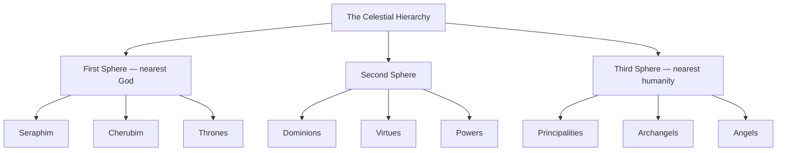

# Angels

> *Nearest to us of all the host, they walk beside a single soul its whole life long.*

---

## The Choir

The Angels — the choir that shares its name with the entire genus of celestial beings — occupy the ninth and lowest rank of the hierarchy, and precisely for that reason they are the most intimate to human life. The name descends through the Latin *angelus* from the Greek *angelos*, a plain word for “messenger,” which the Septuagint chose to render the Hebrew *malakh*, the “sent one” or envoy of God. That the whole order and its humblest choir bear the same name is no accident: to be an angel is, at bottom, to be sent, and this choir is the sending in its purest and most constant form. They stand at the very threshold between heaven and earth, the messengers and guardians nearest to men and women, and it is chiefly they who are dispatched into the ordinary business of mortal existence.

When scripture and tradition speak of an angel appearing at a bedside, guarding a traveler on the road, wrestling with Jacob at the ford, or carrying a small and personal word from God, it is most often this choir that is meant. Their lowliness in the hierarchy is not a diminishment but a vocation: because they are closest to us, they are the ones sent to us. To this choir the tradition assigns the office of the guardian angel — the individual spirit appointed to watch over each human soul from birth to death, to prompt the conscience, to shield against unseen harm, and to bear prayers upward and grace downward. Christ’s own words supply its warrant: “Take heed that ye despise not one of these little ones; for I say unto you, that in heaven their angels do always behold the face of my Father.”

They receive the illumination that has descended, rank by rank, from the burning Seraphim at the summit, and they deliver it at last in the small, particular measures a single life can hold. Humble, tireless, and endlessly attentive, the Angels are the final link in the long chain of heaven — the point at which the vast contemplation of the highest choirs becomes a whispered warning, a moment of courage, a hand laid quietly upon a life. In them the whole hierarchy bends down to touch the earth.

The nine choirs descend in three spheres from the throne of God outward, with this choir at the very base:

## Attributes

| Attribute | Value |
|-----------|-------|
| Sphere | Third (closest to humanity) |
| Rank in hierarchy | 9 |
| Role | Messengers and guardians nearest to human beings |
| Governs | Guardianship, personal guidance, prayers and grace |

## In the Tradition

Pseudo-Dionysius set this choir at the base of his hierarchy, the order that “completes and closes” the celestial ranks and, being nearest to the material world, is most fittingly named for the whole — for the messenger who reaches all the way to us. Gregory the Great fixed the distinction that the Middle Ages kept: the Angels announce the lesser matters and the Archangels the greater, this choir tending to the affairs of single persons where the Principalities tend to peoples. Aquinas gathered the doctrine of the guardian angel around them, teaching that every human being, faithful or not, is given an angel of this choir as a keeper through the whole journey of life. In art they are the winged figures of common imagination — youthful, robed, sometimes bearing a soul in their hands or standing sentinel at a shoulder — the face of heaven a mortal is most likely, in the end, to have seen.

## Related

**Choirs** — [Seraphim](/knowledge/angels-and-demons/angels/seraphim) · [Cherubim](/knowledge/angels-and-demons/angels/cherubim) · [Thrones](/knowledge/angels-and-demons/angels/thrones) · [Dominions](/knowledge/angels-and-demons/angels/dominions) · [Virtues](/knowledge/angels-and-demons/angels/virtues) · [Powers](/knowledge/angels-and-demons/angels/powers) · [Principalities](/knowledge/angels-and-demons/angels/principalities) · [Archangels](/knowledge/angels-and-demons/angels/archangels)
**Archangels** — [Michael](/knowledge/angels-and-demons/angels/michael) · [Gabriel](/knowledge/angels-and-demons/angels/gabriel) · [Raphael](/knowledge/angels-and-demons/angels/raphael) · [Uriel](/knowledge/angels-and-demons/angels/uriel) · [Haniel](/knowledge/angels-and-demons/angels/haniel) · [Khamael](/knowledge/angels-and-demons/angels/khamael) · [Tzadkiel](/knowledge/angels-and-demons/angels/tzadkiel) · [Tzaphkiel](/knowledge/angels-and-demons/angels/tzaphkiel) · [Sandalphon](/knowledge/angels-and-demons/angels/sandalphon) · [Metatron](/knowledge/angels-and-demons/angels/metatron-archangel)

- [Biblical Angels](/knowledge/angels-and-demons/angels/biblical-angels)
- [Angels & Demons](/knowledge/angels-and-demons)
