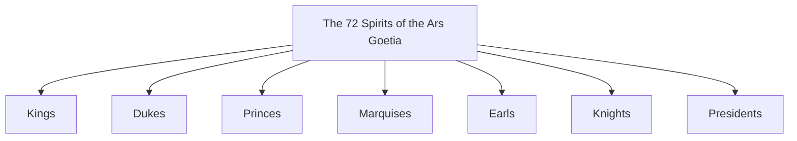

# Ars Goetia

> *The seventy-two spirits of the Lesser Key — bound, catalogued, and named.*

---

The **Ars Goetia** is the first and best-known book of *The Lesser Key of Solomon* (the *Lemegeton*), a 17th-century grimoire compiling seventy-two spirits said to have been bound by King Solomon. Each entry gives the spirit's rank in the infernal hierarchy — King, Duke, Prince, Marquis, Earl, Knight, or President — the number of legions it commands, the shape it takes when it appears, and its *office*: the knowledge or power it confers. Studied here as a historical and psychological artifact of the Western magical tradition, alongside the [Angels & Demons](/knowledge/angels-and-demons) it mirrors.

The seventy-two spirits are sorted into seven noble ranks, an infernal parody of a feudal court:

---

## The Seventy-Two Spirits

| Spirit | Rank | Legions |
| --- | --- | --- |
| [Bael](/knowledge/angels-and-demons/ars-goetia/bael) | King | 66 |
| [Buer](/knowledge/angels-and-demons/ars-goetia/buer) | President | 50 |
| [Gusion](/knowledge/angels-and-demons/ars-goetia/gusion) | Duke | 40 |
| [Sitri](/knowledge/angels-and-demons/ars-goetia/sitri) | Prince | 60 |
| [Beleth](/knowledge/angels-and-demons/ars-goetia/beleth) | King | 85 |
| [Leraje](/knowledge/angels-and-demons/ars-goetia/leraje) | Marquis | 30 |
| [Eligos](/knowledge/angels-and-demons/ars-goetia/eligos) | Duke | 60 |
| [Zepar](/knowledge/angels-and-demons/ars-goetia/zepar) | Duke | 26 |
| [Botis](/knowledge/angels-and-demons/ars-goetia/botis) | President | 60 |
| [Bathin](/knowledge/angels-and-demons/ars-goetia/bathin) | Duke | 30 |
| [Sallos](/knowledge/angels-and-demons/ars-goetia/sallos) | Duke | 30 |
| [Agares](/knowledge/angels-and-demons/ars-goetia/agares) | Duke | 31 |
| [Purson](/knowledge/angels-and-demons/ars-goetia/purson) | King | 22 |
| [Marax](/knowledge/angels-and-demons/ars-goetia/marax) | Great Earl and President | 30 (some sources give 36) |
| [Ipos](/knowledge/angels-and-demons/ars-goetia/ipos) | Earl and Prince | 36 |
| [Aim](/knowledge/angels-and-demons/ars-goetia/aim) | Duke | 26 |
| [Naberius](/knowledge/angels-and-demons/ars-goetia/naberius) | Marquis | 19 |
| [Glasya-Labolas](/knowledge/angels-and-demons/ars-goetia/glasya-labolas) | President | 36 |
| [Bune](/knowledge/angels-and-demons/ars-goetia/bune) | Duke | 30 |
| [Ronove](/knowledge/angels-and-demons/ars-goetia/ronove) | Marquis and Great Earl | 19 |
| [Berith](/knowledge/angels-and-demons/ars-goetia/berith) | Duke | 26 |
| [Astaroth](/knowledge/angels-and-demons/ars-goetia/astaroth) | Duke | 40 |
| [Vassago](/knowledge/angels-and-demons/ars-goetia/vassago) | Prince | 26 |
| [Forneus](/knowledge/angels-and-demons/ars-goetia/forneus) | Marquis (Great Marquis) | 29 |
| [Foras](/knowledge/angels-and-demons/ars-goetia/foras) | President (Mighty President) | 29 |
| [Asmoday](/knowledge/angels-and-demons/ars-goetia/asmoday) | King (Great King) | 72 |
| [Gaap](/knowledge/angels-and-demons/ars-goetia/gaap) | Prince and President | 66 |
| [Furfur](/knowledge/angels-and-demons/ars-goetia/furfur) | Earl (Great Earl) | 26 |
| [Marchosias](/knowledge/angels-and-demons/ars-goetia/marchosias) | Marquis (Great Marquis) | 30 |
| [Stolas](/knowledge/angels-and-demons/ars-goetia/stolas) | Prince (Great Prince) | 26 |
| [Phenex](/knowledge/angels-and-demons/ars-goetia/phenex) | Marquis (Great Marquis) | 20 |
| [Halphas](/knowledge/angels-and-demons/ars-goetia/halphas) | Earl (Great Earl) | 26 |
| [Malphas](/knowledge/angels-and-demons/ars-goetia/malphas) | President (Great President) | 40 |
| [Samigina](/knowledge/angels-and-demons/ars-goetia/samigina) | Marquis | 30 |
| [Raum](/knowledge/angels-and-demons/ars-goetia/raum) | Earl (Great Earl) | 30 |
| [Focalor](/knowledge/angels-and-demons/ars-goetia/focalor) | Duke (Great Duke) | 30 |
| [Vepar](/knowledge/angels-and-demons/ars-goetia/vepar) | Duke (Great Duke) | 29 |
| [Sabnock](/knowledge/angels-and-demons/ars-goetia/sabnock) | Marquis (Great Marquis) | 50 |
| [Shax](/knowledge/angels-and-demons/ars-goetia/shax) | Great Marquis | 30 |
| [Vine](/knowledge/angels-and-demons/ars-goetia/vine) | Great King and Earl | 36 |
| [Bifrons](/knowledge/angels-and-demons/ars-goetia/bifrons) | Earl | 6 (some manuscripts, 60) |
| [Uvall](/knowledge/angels-and-demons/ars-goetia/uvall) | Great Duke | 37 |
| [Haagenti](/knowledge/angels-and-demons/ars-goetia/haagenti) | Great President | 33 |
| [Crocell](/knowledge/angels-and-demons/ars-goetia/crocell) | Great Duke | 48 |
| [Marbas](/knowledge/angels-and-demons/ars-goetia/marbas) | President | 36 |
| [Furcas](/knowledge/angels-and-demons/ars-goetia/furcas) | Knight | 20 |
| [Balam](/knowledge/angels-and-demons/ars-goetia/balam) | Terrible King | 40 |
| [Alloces](/knowledge/angels-and-demons/ars-goetia/alloces) | Great Duke | 36 |
| [Caim](/knowledge/angels-and-demons/ars-goetia/caim) | Great President | 30 |
| [Murmur](/knowledge/angels-and-demons/ars-goetia/murmur) | Great Duke and Earl | 30 |
| [Orobas](/knowledge/angels-and-demons/ars-goetia/orobas) | Great Prince | 20 |
| [Gremory](/knowledge/angels-and-demons/ars-goetia/gremory) | Strong Duke | 26 |
| [Ose](/knowledge/angels-and-demons/ars-goetia/ose) | Great President | 3 (some manuscripts, 30) |
| [Amy](/knowledge/angels-and-demons/ars-goetia/amy) | Great President | 36 |
| [Orias](/knowledge/angels-and-demons/ars-goetia/orias) | Marquis | 30 |
| [Valefor](/knowledge/angels-and-demons/ars-goetia/valefor) | Duke | 10 |
| [Vapula](/knowledge/angels-and-demons/ars-goetia/vapula) | Duke | 36 |
| [Zagan](/knowledge/angels-and-demons/ars-goetia/zagan) | King | 33 |
| [Valac](/knowledge/angels-and-demons/ars-goetia/valac) | President | 38 |
| [Andras](/knowledge/angels-and-demons/ars-goetia/andras) | Marquis | 30 |
| [Haures](/knowledge/angels-and-demons/ars-goetia/haures) | Duke | 36 |
| [Andrealphus](/knowledge/angels-and-demons/ars-goetia/andrealphus) | Marquis | 30 |
| [Cimejes](/knowledge/angels-and-demons/ars-goetia/cimejes) | Marquis | 20 |
| [Amdusias](/knowledge/angels-and-demons/ars-goetia/amdusias) | Duke | 29 |
| [Belial](/knowledge/angels-and-demons/ars-goetia/belial) | King | 50 (or 80 in some accounts) |
| [Decarabia](/knowledge/angels-and-demons/ars-goetia/decarabia) | Marquis | 30 |
| [Amon](/knowledge/angels-and-demons/ars-goetia/amon) | Marquis | 40 |
| [Seere](/knowledge/angels-and-demons/ars-goetia/seere) | Prince | 26 |
| [Dantalion](/knowledge/angels-and-demons/ars-goetia/dantalion) | Duke | 36 |
| [Andromalius](/knowledge/angels-and-demons/ars-goetia/andromalius) | Earl | 36 |
| [Barbatos](/knowledge/angels-and-demons/ars-goetia/barbatos) | Duke | 30 |
| [Paimon](/knowledge/angels-and-demons/ars-goetia/paimon) | King | 200 |

---

## Related

- [Angels & Demons](/knowledge/angels-and-demons) — the collection this belongs to
- [Kabbalah](/knowledge/spirituality/kabbalah) — the tradition the grimoires draw their names and hierarchies from
