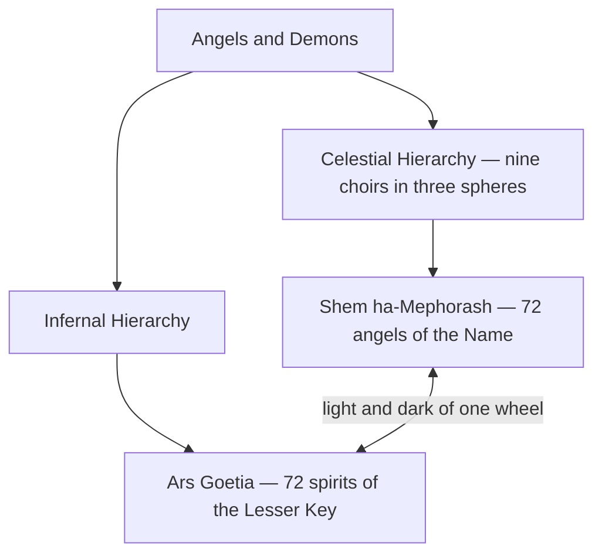

# Angels & Demons

> *The ranked hosts of heaven and the bound spirits of the grimoires — two hierarchies facing each other across the same abyss.*

---

Western esotericism inherited two great catalogues of spirit: the **celestial hierarchy** of the angels, ordered into nine choirs by Pseudo-Dionysius in the sixth century, and the **infernal hierarchy** of the demons, ranked and numbered in the medieval and Renaissance grimoires. They are studied here as comparative religion and depth psychology — maps of the imagined cosmos and, read through Jung, maps of the psyche's own heights and depths. Both draw their names, ranks, and correspondences from the same well as the [Kabbalah](/knowledge/spirituality/kabbalah) and the [Tree of Life](/knowledge/tree-of-life).

---

## The Celestial Hierarchy

The nine choirs of angels, in three spheres from the throne of God outward:

**First sphere** — [Seraphim](/knowledge/angels-and-demons/angels/seraphim) · [Cherubim](/knowledge/angels-and-demons/angels/cherubim) · [Thrones](/knowledge/angels-and-demons/angels/thrones)
**Second sphere** — [Dominions](/knowledge/angels-and-demons/angels/dominions) · [Virtues](/knowledge/angels-and-demons/angels/virtues) · [Powers](/knowledge/angels-and-demons/angels/powers)
**Third sphere** — [Principalities](/knowledge/angels-and-demons/angels/principalities) · [Archangels](/knowledge/angels-and-demons/angels/archangels) · [Angels](/knowledge/angels-and-demons/angels)

### The Archangels

The chief messengers, each tied to a planet and a sphere of the Tree of Life: [Metatron](/knowledge/angels-and-demons/angels/metatron-archangel) (the Crown, [Kether](/knowledge/tree-of-life/kether)), [Michael](/knowledge/angels-and-demons/angels/michael) (Sun), [Gabriel](/knowledge/angels-and-demons/angels/gabriel) (Moon), [Raphael](/knowledge/angels-and-demons/angels/raphael) (Mercury), [Uriel](/knowledge/angels-and-demons/angels/uriel) (Earth), [Haniel](/knowledge/angels-and-demons/angels/haniel) (Venus), [Khamael](/knowledge/angels-and-demons/angels/khamael) (Mars), [Tzadkiel](/knowledge/angels-and-demons/angels/tzadkiel) (Jupiter), [Tzaphkiel](/knowledge/angels-and-demons/angels/tzaphkiel) (Saturn), and [Sandalphon](/knowledge/angels-and-demons/angels/sandalphon) (the material world).

Their scriptural sources are gathered in [Biblical Angels](/knowledge/angels-and-demons/angels/biblical-angels).

### The Shem ha-Mephorash

**[Shem ha-Mephorash](/knowledge/angels-and-demons/shem-ha-mephorash)** — the seventy-two angels of the divine Name, each governing five degrees of the zodiac and standing as the benevolent counterpart to one of the seventy-two Goetic spirits. The light half of the same wheel.

## The Infernal Hierarchy

**[Ars Goetia](/knowledge/angels-and-demons/ars-goetia)** — the seventy-two spirits of the *Lesser Key of Solomon*, each with its rank, its legions, and its office. The demonic counterpart to the angelic host.

Seen whole, the domain divides into two facing hierarchies whose seventy-two named spirits mirror one another across the wheel of the heavens:

---

## Related

- [Biblical Angels](/knowledge/angels-and-demons/angels/biblical-angels)
- [Kabbalah](/knowledge/spirituality/kabbalah) — the source of the names and hierarchies
- [Tree of Life](/knowledge/tree-of-life) — the spheres the archangels govern
- [Mythology](/knowledge/mythology) — the older gods behind many of these names
- [Knowledge Hub](/knowledge)
