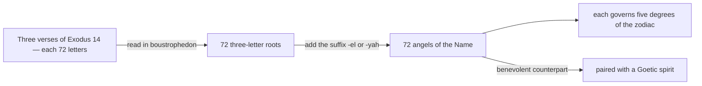

# Shem ha-Mephorash

> *The seventy-two names of God, and the seventy-two angels who bear them — the light that answers the dark of the Goetia.*

---

The **Shem ha-Mephorash** — "the explicit Name" — is the seventy-two-fold Name of God derived by tradition from three verses of Exodus (14:19–21), each seventy-two Hebrew letters long. Read in *boustrophedon* (alternating direction), the three verses yield seventy-two three-letter roots; a divine suffix — *-el* ("of God") or *-yah* ("of the Lord") — is added to each to name one of the seventy-two angels. Each angel governs five degrees of the zodiac and bestows a particular virtue, and each stands as the benevolent counterpart to one of the seventy-two spirits of the [Ars Goetia](/knowledge/angels-and-demons/ars-goetia) — the two catalogues mapping the same wheel of the heavens, one in light and one in shadow.

The seventy-two angels are drawn from scripture by a fixed procedure, each then set over a slice of the zodiac and paired to its Goetic shadow:

---

## The Seventy-Two Angels

| Angel | Name Meaning | Zodiac | Goetic Pair |
| --- | --- | --- | --- |
| [Vehuiah](/knowledge/angels-and-demons/shem-ha-mephorash/vehuiah) | God the Exalter | 0–5° Aries | [Bael](/knowledge/angels-and-demons/ars-goetia/bael) |
| [Aladiah](/knowledge/angels-and-demons/shem-ha-mephorash/aladiah) | The Propitious God | 15–20° Taurus | [Buer](/knowledge/angels-and-demons/ars-goetia/buer) |
| [Lauviah](/knowledge/angels-and-demons/shem-ha-mephorash/lauviah) | God praised and exalted | 20–25° Taurus | [Gusion](/knowledge/angels-and-demons/ars-goetia/gusion) |
| [Hahaiah](/knowledge/angels-and-demons/shem-ha-mephorash/hahaiah) | God of Refuge | 25–30° Taurus | [Sitri](/knowledge/angels-and-demons/ars-goetia/sitri) |
| [Iezalel](/knowledge/angels-and-demons/shem-ha-mephorash/iezalel) | God glorified over all things | 0–5° Gemini | [Beleth](/knowledge/angels-and-demons/ars-goetia/beleth) |
| [Mebahel](/knowledge/angels-and-demons/shem-ha-mephorash/mebahel) | God the Preserver | 5–10° Gemini | [Leraje](/knowledge/angels-and-demons/ars-goetia/leraje) |
| [Hariel](/knowledge/angels-and-demons/shem-ha-mephorash/hariel) | God the Creator | 10–15° Gemini | [Eligos](/knowledge/angels-and-demons/ars-goetia/eligos) |
| [Hekamiah](/knowledge/angels-and-demons/shem-ha-mephorash/hekamiah) | “God who raises up the universe” (*ḥ-q-m* + *-iah*) |  | [Zepar](/knowledge/angels-and-demons/ars-goetia/zepar) |
| [Lauviah II](/knowledge/angels-and-demons/shem-ha-mephorash/lauviah-ii) | “God admirable / to be exalted” (root + *-iah*) |  | [Botis](/knowledge/angels-and-demons/ars-goetia/botis) |
| [Caliel](/knowledge/angels-and-demons/shem-ha-mephorash/caliel) | “God prompt to grant” (root + *-el*) |  | [Bathin](/knowledge/angels-and-demons/ars-goetia/bathin) |
| [Leuviah](/knowledge/angels-and-demons/shem-ha-mephorash/leuviah) | “God who hears sinners / the expansive God” (root + *-iah*) |  | [Sallos](/knowledge/angels-and-demons/ars-goetia/sallos) |
| [Jeliel](/knowledge/angels-and-demons/shem-ha-mephorash/jeliel) | God who helps | 5–10° Aries | [Agares](/knowledge/angels-and-demons/ars-goetia/agares) |
| [Pahaliah](/knowledge/angels-and-demons/shem-ha-mephorash/pahaliah) | “God the Redeemer” (root + *-iah*) |  | [Purson](/knowledge/angels-and-demons/ars-goetia/purson) |
| [Nelchael](/knowledge/angels-and-demons/shem-ha-mephorash/nelchael) | “God alone / ardent to be praised” (root + *-el*) |  | [Marax](/knowledge/angels-and-demons/ars-goetia/marax) |
| [Yeiayel](/knowledge/angels-and-demons/shem-ha-mephorash/yeiayel) | “God's right hand” (root + *-el*) |  | [Ipos](/knowledge/angels-and-demons/ars-goetia/ipos) |
| [Melahel](/knowledge/angels-and-demons/shem-ha-mephorash/melahel) | “God who delivers from evils” (root + *-el*) |  | [Aim](/knowledge/angels-and-demons/ars-goetia/aim) |
| [Haheuiah](/knowledge/angels-and-demons/shem-ha-mephorash/haheuiah) | “God good in himself” (root + *-iah*) |  | [Naberius](/knowledge/angels-and-demons/ars-goetia/naberius) |
| [Nith-Haiah](/knowledge/angels-and-demons/shem-ha-mephorash/nith-haiah) | “God who gives wisdom” (root + *-iah*) |  | [Glasya-Labolas](/knowledge/angels-and-demons/ars-goetia/glasya-labolas) |
| [Haaiah](/knowledge/angels-and-demons/shem-ha-mephorash/haaiah) | “God hidden / the secret God” (root + *-iah*) |  | [Bune](/knowledge/angels-and-demons/ars-goetia/bune) |
| [Yerathel](/knowledge/angels-and-demons/shem-ha-mephorash/yerathel) | “God who delivers from evil-doers” (root + *-el*) |  | [Ronove](/knowledge/angels-and-demons/ars-goetia/ronove) |
| [Seheiah](/knowledge/angels-and-demons/shem-ha-mephorash/seheiah) | “God who heals the sick” (root + *-iah*) |  | [Berith](/knowledge/angels-and-demons/ars-goetia/berith) |
| [Reiyel](/knowledge/angels-and-demons/shem-ha-mephorash/reiyel) | “God prompt to help” (root + *-el*) |  | [Astaroth](/knowledge/angels-and-demons/ars-goetia/astaroth) |
| [Sitael](/knowledge/angels-and-demons/shem-ha-mephorash/sitael) | God of Hope | 10–15° Aries | [Vassago](/knowledge/angels-and-demons/ars-goetia/vassago) |
| [Omael](/knowledge/angels-and-demons/shem-ha-mephorash/omael) | “The Patient God” / “God who endures” | 25–30° Leo | [Forneus](/knowledge/angels-and-demons/ars-goetia/forneus) |
| [Lecabel](/knowledge/angels-and-demons/shem-ha-mephorash/lecabel) | “God who instructs” / “God who inspires” | 0–5° Virgo | [Foras](/knowledge/angels-and-demons/ars-goetia/foras) |
| [Vasariah](/knowledge/angels-and-demons/shem-ha-mephorash/vasariah) | “The Just God” / “God the Just” | 5–10° Virgo | [Asmoday](/knowledge/angels-and-demons/ars-goetia/asmoday) |
| [Yehuiah](/knowledge/angels-and-demons/shem-ha-mephorash/yehuiah) | “God who knows all things” | 10–15° Virgo | [Gaap](/knowledge/angels-and-demons/ars-goetia/gaap) |
| [Lehahiah](/knowledge/angels-and-demons/shem-ha-mephorash/lehahiah) | “The Clement God” / “God the merciful” | 15–20° Virgo | [Furfur](/knowledge/angels-and-demons/ars-goetia/furfur) |
| [Chavakiah](/knowledge/angels-and-demons/shem-ha-mephorash/chavakiah) | “God who gives joy” / “God who brings gladness” | 20–25° Virgo | [Marchosias](/knowledge/angels-and-demons/ars-goetia/marchosias) |
| [Menadel](/knowledge/angels-and-demons/shem-ha-mephorash/menadel) | “The Adorable God” / “God the honourable” | 25–30° Virgo | [Stolas](/knowledge/angels-and-demons/ars-goetia/stolas) |
| [Aniel](/knowledge/angels-and-demons/shem-ha-mephorash/aniel) | “The God of Virtues” / “God of the powers” | 0–5° Libra | [Phenex](/knowledge/angels-and-demons/ars-goetia/phenex) |
| [Haamiah](/knowledge/angels-and-demons/shem-ha-mephorash/haamiah) | “God the Hope of all creatures” | 5–10° Libra | [Halphas](/knowledge/angels-and-demons/ars-goetia/halphas) |
| [Rehael](/knowledge/angels-and-demons/shem-ha-mephorash/rehael) | “God who receives sinners” | 10–15° Libra | [Malphas](/knowledge/angels-and-demons/ars-goetia/malphas) |
| [Elemiah](/knowledge/angels-and-demons/shem-ha-mephorash/elemiah) | The Hidden God | 15–20° Aries | [Samigina](/knowledge/angels-and-demons/ars-goetia/samigina) |
| [Ieiazel](/knowledge/angels-and-demons/shem-ha-mephorash/ieiazel) | “God who gladdens” / “God who rejoices” | 15–20° Libra | [Raum](/knowledge/angels-and-demons/ars-goetia/raum) |
| [Hahahel](/knowledge/angels-and-demons/shem-ha-mephorash/hahahel) | “God in three persons” / “the Triune God” | 20–25° Libra | [Focalor](/knowledge/angels-and-demons/ars-goetia/focalor) |
| [Mikael](/knowledge/angels-and-demons/shem-ha-mephorash/mikael) | “Who is like God?” | 25–30° Libra | [Vepar](/knowledge/angels-and-demons/ars-goetia/vepar) |
| [Veualiah](/knowledge/angels-and-demons/shem-ha-mephorash/veualiah) | “God the King who rules” / “King and Dominator” | 0–5° Scorpio | [Sabnock](/knowledge/angels-and-demons/ars-goetia/sabnock) |
| [Yelahiah](/knowledge/angels-and-demons/shem-ha-mephorash/yelahiah) | "Eternal God" / God who protects against warfare (root + *-iah*, *Yah*) | 5–10° Scorpio | [Shax](/knowledge/angels-and-demons/ars-goetia/shax) |
| [Sealiah](/knowledge/angels-and-demons/shem-ha-mephorash/sealiah) | "Motor of all things" / God who vivifies (root + *-iah*, *Yah*) | 10–15° Scorpio | [Vine](/knowledge/angels-and-demons/ars-goetia/vine) |
| [Ariel](/knowledge/angels-and-demons/shem-ha-mephorash/ariel) | "Lion of God" / the Revealer (*ari* + *-el*) | 15–20° Scorpio | [Bifrons](/knowledge/angels-and-demons/ars-goetia/bifrons) |
| [Asaliah](/knowledge/angels-and-demons/shem-ha-mephorash/asaliah) | "God who points out the truth" / the Just God (root + *-iah*, *Yah*) | 20–25° Scorpio | [Uvall](/knowledge/angels-and-demons/ars-goetia/uvall) |
| [Mihael](/knowledge/angels-and-demons/shem-ha-mephorash/mihael) | "The Merciful Father" / God the generous father (root + *-el*) | 25–30° Scorpio | [Haagenti](/knowledge/angels-and-demons/ars-goetia/haagenti) |
| [Vehuel](/knowledge/angels-and-demons/shem-ha-mephorash/vehuel) | "God the great and lofty" / the Elevated God (root + *-el*) | 0–5° Sagittarius | [Crocell](/knowledge/angels-and-demons/ars-goetia/crocell) |
| [Mahasiah](/knowledge/angels-and-demons/shem-ha-mephorash/mahasiah) | God the Savior | 20–25° Aries | [Marbas](/knowledge/angels-and-demons/ars-goetia/marbas) |
| [Daniel](/knowledge/angels-and-demons/shem-ha-mephorash/daniel) | "The Sign of Mercies" / God is my judge (*din* + *-el*) | 5–10° Sagittarius | [Furcas](/knowledge/angels-and-demons/ars-goetia/furcas) |
| [Hahasiah](/knowledge/angels-and-demons/shem-ha-mephorash/hahasiah) | "The Hidden God" / God concealed in all things (root + *-iah*, *Yah*) | 10–15° Sagittarius | [Balam](/knowledge/angels-and-demons/ars-goetia/balam) |
| [Imamiah](/knowledge/angels-and-demons/shem-ha-mephorash/imamiah) | "God exalted above all things" (root + *-iah*, *Yah*) | 15–20° Sagittarius | [Alloces](/knowledge/angels-and-demons/ars-goetia/alloces) |
| [Nanael](/knowledge/angels-and-demons/shem-ha-mephorash/nanael) | "God who casts down the proud" (root + *-el*) | 20–25° Sagittarius | [Caim](/knowledge/angels-and-demons/ars-goetia/caim) |
| [Nithael](/knowledge/angels-and-demons/shem-ha-mephorash/nithael) | "God, King of Heaven" / the Rightful King (root + *-el*) | 25–30° Sagittarius | [Murmur](/knowledge/angels-and-demons/ars-goetia/murmur) |
| [Mebahiah](/knowledge/angels-and-demons/shem-ha-mephorash/mebahiah) | "The Eternal God" / God eternal and consoling (root + *-iah*, *Yah*) | 0–5° Capricorn | [Orobas](/knowledge/angels-and-demons/ars-goetia/orobas) |
| [Poyel](/knowledge/angels-and-demons/shem-ha-mephorash/poyel) | "God who supports the universe" (root + *-el*) | 5–10° Capricorn | [Gremory](/knowledge/angels-and-demons/ars-goetia/gremory) |
| [Nemamiah](/knowledge/angels-and-demons/shem-ha-mephorash/nemamiah) | "The Praiseworthy God" / the Lovable God (root + *-iah*, *Yah*) | 10–15° Capricorn | [Ose](/knowledge/angels-and-demons/ars-goetia/ose) |
| [Yeialel](/knowledge/angels-and-demons/shem-ha-mephorash/yeialel) | "God who hears the generations" (root + *-el*) | 15–20° Capricorn | [Amy](/knowledge/angels-and-demons/ars-goetia/amy) |
| [Harahel](/knowledge/angels-and-demons/shem-ha-mephorash/harahel) | “God who knows all things” (*harah* + *-el*) | 20–25° Capricorn | [Orias](/knowledge/angels-and-demons/ars-goetia/orias) |
| [Lelahel](/knowledge/angels-and-demons/shem-ha-mephorash/lelahel) | The Praiseworthy God | 25–30° Aries | [Valefor](/knowledge/angels-and-demons/ars-goetia/valefor) |
| [Mitzrael](/knowledge/angels-and-demons/shem-ha-mephorash/mitzrael) | “God who raises up the oppressed” (*Mitzrayim* + *-el*) | 25–30° Capricorn | [Vapula](/knowledge/angels-and-demons/ars-goetia/vapula) |
| [Umabel](/knowledge/angels-and-demons/shem-ha-mephorash/umabel) | “God above all things” | 0–5° Aquarius | [Zagan](/knowledge/angels-and-demons/ars-goetia/zagan) |
| [Iah-Hel](/knowledge/angels-and-demons/shem-ha-mephorash/iah-hel) | “The Supreme Being” (*Yah* + *-el*) | 5–10° Aquarius | [Valac](/knowledge/angels-and-demons/ars-goetia/valac) |
| [Anauel](/knowledge/angels-and-demons/shem-ha-mephorash/anauel) | “God infinitely good” | 10–15° Aquarius | [Andras](/knowledge/angels-and-demons/ars-goetia/andras) |
| [Mehiel](/knowledge/angels-and-demons/shem-ha-mephorash/mehiel) | “God who vivifies all things” (*mahah* + *-el*) | 15–20° Aquarius | [Haures](/knowledge/angels-and-demons/ars-goetia/haures) |
| [Damabiah](/knowledge/angels-and-demons/shem-ha-mephorash/damabiah) | “God the fountain of wisdom” | 20–25° Aquarius | [Andrealphus](/knowledge/angels-and-demons/ars-goetia/andrealphus) |
| [Manakel](/knowledge/angels-and-demons/shem-ha-mephorash/manakel) | “God who supports and maintains all things” | 25–30° Aquarius | [Cimejes](/knowledge/angels-and-demons/ars-goetia/cimejes) |
| [Eyael](/knowledge/angels-and-demons/shem-ha-mephorash/eyael) | “God, the delight of the children of men” | 0–5° Pisces | [Amdusias](/knowledge/angels-and-demons/ars-goetia/amdusias) |
| [Habuhiah](/knowledge/angels-and-demons/shem-ha-mephorash/habuhiah) | “God who gives with liberality” | 5–10° Pisces | [Belial](/knowledge/angels-and-demons/ars-goetia/belial) |
| [Rochel](/knowledge/angels-and-demons/shem-ha-mephorash/rochel) | “God who sees all things” | 10–15° Pisces | [Decarabia](/knowledge/angels-and-demons/ars-goetia/decarabia) |
| [Achaiah](/knowledge/angels-and-demons/shem-ha-mephorash/achaiah) | The Good and Patient God | 0–5° Taurus | [Amon](/knowledge/angels-and-demons/ars-goetia/amon) |
| [Jabamiah](/knowledge/angels-and-demons/shem-ha-mephorash/jabamiah) | “God producing all things by his word” | 15–20° Pisces | [Seere](/knowledge/angels-and-demons/ars-goetia/seere) |
| [Haiaiel](/knowledge/angels-and-demons/shem-ha-mephorash/haiaiel) | “God, the master of the universe” | 20–25° Pisces | [Dantalion](/knowledge/angels-and-demons/ars-goetia/dantalion) |
| [Mumiah](/knowledge/angels-and-demons/shem-ha-mephorash/mumiah) | “God, the end of all things” | 25–30° Pisces | [Andromalius](/knowledge/angels-and-demons/ars-goetia/andromalius) |
| [Cahetel](/knowledge/angels-and-demons/shem-ha-mephorash/cahetel) | The Adorable God | 5–10° Taurus | [Barbatos](/knowledge/angels-and-demons/ars-goetia/barbatos) |
| [Haziel](/knowledge/angels-and-demons/shem-ha-mephorash/haziel) | God of Mercy | 10–15° Taurus | [Paimon](/knowledge/angels-and-demons/ars-goetia/paimon) |

---

## Related

- [Ars Goetia](/knowledge/angels-and-demons/ars-goetia) — the seventy-two spirits these angels answer
- [Angels & Demons](/knowledge/angels-and-demons) — the collection this belongs to
- [Astrology](/knowledge/astrology) — the zodiac wheel the angels divide
- [Kabbalah](/knowledge/spirituality/kabbalah) — the Name from which they are drawn
