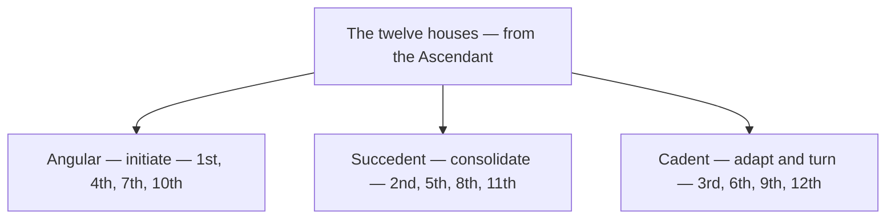

# Houses

> *Twelve arenas of a life, from the face you show to the sea that remembers.*

---

## Overview

The twelve houses are the *where* of astrology — the arenas of life in which the planets act and the signs style them. The wheel begins at the Ascendant with the self and ends in the hidden twelfth, and along the way it passes through everything a life contains: money, mind, home, joy, work, others, depth, meaning, standing, community, and dissolution. The houses come in three types — angular houses initiate, succedent houses consolidate, and cadent houses adapt and prepare the turn to the next angle. Each note in this folder covers one house's domain, correspondences, and place on the wheel.

The twelve fall into three types by how each meets the wheel's turning:

| House | Natural Sign | Ruler | Type |
| --- | --- | --- | --- |
| [First House](/knowledge/astrology/houses/first-house) | Aries | Mars | Angular (Ascendant) |
| [Second House](/knowledge/astrology/houses/second-house) | Taurus | Venus | Succedent |
| [Third House](/knowledge/astrology/houses/third-house) | Gemini | Mercury | Cadent |
| [Fourth House](/knowledge/astrology/houses/fourth-house) | Cancer | Moon | Angular (IC) |
| [Fifth House](/knowledge/astrology/houses/fifth-house) | Leo | Sun | Succedent |
| [Sixth House](/knowledge/astrology/houses/sixth-house) | Virgo | Mercury | Cadent |
| [Seventh House](/knowledge/astrology/houses/seventh-house) | Libra | Venus | Angular (Descendant) |
| [Eighth House](/knowledge/astrology/houses/eighth-house) | Scorpio | Pluto | Succedent |
| [Ninth House](/knowledge/astrology/houses/ninth-house) | Sagittarius | Jupiter | Cadent |
| [Tenth House](/knowledge/astrology/houses/tenth-house) | Capricorn | Saturn | Angular (Midheaven) |
| [Eleventh House](/knowledge/astrology/houses/eleventh-house) | Aquarius | Saturn (Uranus, modern) | Succedent |
| [Twelfth House](/knowledge/astrology/houses/twelfth-house) | Pisces | Jupiter (Neptune, modern) | Cadent |

---

## Related

- [Astrology](/knowledge/astrology) — the parent index
- [Signs](/knowledge/astrology/signs) — each house has a natural sign
- [Planets](/knowledge/astrology/planets) — the actors that occupy the houses
