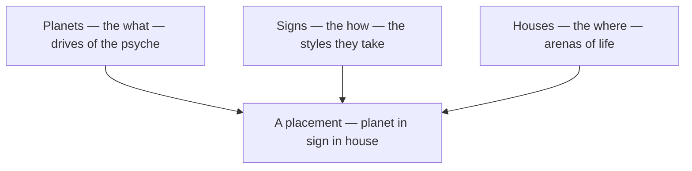

# Astrology

> *As above, so below — the sky read as a mirror of the soul.*

---

Astrology is the old art of reading the heavens as a map of character and time. Its grammar is simple and endlessly combinable: **planets** (the what — the drives and faculties of the psyche) move through **signs** (the how — the styles those drives take) and fall in **houses** (the where — the arenas of life they play out). The same symbols run straight through the rest of this vault — every [Tarot](/knowledge/tarot) card carries a planetary or zodiacal attribution, the [Tree of Life](/knowledge/tree-of-life) hangs its spheres on the planets, and the [gods](/knowledge/mythology) are the planets under another name.

The three parts of speech combine, endlessly, into every placement a chart holds:

---

## The Signs

The twelve signs of the zodiac — four elements times three modalities — each ruled by a planet and mirrored by a trump of the [Major Arcana](/knowledge/tarot/major-arcana). See [Signs](/knowledge/astrology/signs) for the wheel entire.

| Sign | | Element | Modality | Ruler | Tarot |
|------|---|---------|----------|-------|-------|
| [Aries](/knowledge/astrology/signs/aries) | ♈ | Fire | Cardinal | Mars | [The Emperor](/knowledge/tarot/major-arcana/the-emperor) |
| [Taurus](/knowledge/astrology/signs/taurus) | ♉ | Earth | Fixed | Venus | [The Hierophant](/knowledge/tarot/major-arcana/the-hierophant) |
| [Gemini](/knowledge/astrology/signs/gemini) | ♊ | Air | Mutable | Mercury | [The Lovers](/knowledge/tarot/major-arcana/the-lovers) |
| [Cancer](/knowledge/astrology/signs/cancer) | ♋ | Water | Cardinal | Moon | [The Chariot](/knowledge/tarot/major-arcana/the-chariot) |
| [Leo](/knowledge/astrology/signs/leo) | ♌ | Fire | Fixed | Sun | [Strength](/knowledge/tarot/major-arcana/strength) |
| [Virgo](/knowledge/astrology/signs/virgo) | ♍ | Earth | Mutable | Mercury | [The Hermit](/knowledge/tarot/major-arcana/the-hermit) |
| [Libra](/knowledge/astrology/signs/libra) | ♎ | Air | Cardinal | Venus | [Justice](/knowledge/tarot/major-arcana/justice) |
| [Scorpio](/knowledge/astrology/signs/scorpio) | ♏ | Water | Fixed | Mars / Pluto | [Death](/knowledge/tarot/major-arcana/death) |
| [Sagittarius](/knowledge/astrology/signs/sagittarius) | ♐ | Fire | Mutable | Jupiter | [Temperance](/knowledge/tarot/major-arcana/temperance) |
| [Capricorn](/knowledge/astrology/signs/capricorn) | ♑ | Earth | Cardinal | Saturn | [The Devil](/knowledge/tarot/major-arcana/the-devil) |
| [Aquarius](/knowledge/astrology/signs/aquarius) | ♒ | Air | Fixed | Saturn / Uranus | [The Star](/knowledge/tarot/major-arcana/the-star) |
| [Pisces](/knowledge/astrology/signs/pisces) | ♓ | Water | Mutable | Jupiter / Neptune | [The Moon](/knowledge/tarot/major-arcana/the-moon) |

## The Planets

The moving lights — the faculties of the psyche. (Pages are suffixed *(astrology)* to keep them distinct from the [gods](/knowledge/mythology) they share names with.) See [Planets](/knowledge/astrology/planets) for the faculties entire.

[Sun](/knowledge/astrology/planets/sun-astrology) ☉ · [Moon](/knowledge/astrology/planets/moon-astrology) ☽ · [Mercury](/knowledge/astrology/planets/mercury-astrology) ☿ · [Venus](/knowledge/astrology/planets/venus-astrology) ♀ · [Mars](/knowledge/astrology/planets/mars-astrology) ♂ · [Jupiter](/knowledge/astrology/planets/jupiter-astrology) ♃ · [Saturn](/knowledge/astrology/planets/saturn-astrology) ♄ · [Uranus](/knowledge/astrology/planets/uranus-astrology) ♅ · [Neptune](/knowledge/astrology/planets/neptune-astrology) ♆ · [Pluto](/knowledge/astrology/planets/pluto-astrology) ♇

## The Houses

The twelve arenas of life, from the self at the Ascendant to the hidden twelfth. See [Houses](/knowledge/astrology/houses) for the arenas entire.

[First House](/knowledge/astrology/houses/first-house) · [Second House](/knowledge/astrology/houses/second-house) · [Third House](/knowledge/astrology/houses/third-house) · [Fourth House](/knowledge/astrology/houses/fourth-house) · [Fifth House](/knowledge/astrology/houses/fifth-house) · [Sixth House](/knowledge/astrology/houses/sixth-house) · [Seventh House](/knowledge/astrology/houses/seventh-house) · [Eighth House](/knowledge/astrology/houses/eighth-house) · [Ninth House](/knowledge/astrology/houses/ninth-house) · [Tenth House](/knowledge/astrology/houses/tenth-house) · [Eleventh House](/knowledge/astrology/houses/eleventh-house) · [Twelfth House](/knowledge/astrology/houses/twelfth-house)

## Phases of the Moon

The one cycle visible to the naked eye night by night — the month read as eight moods of time, from seed to fullness to surrender. See [Phases of the Moon](/knowledge/astrology/phases-of-the-moon) for the cycle entire.

[New Moon](/knowledge/astrology/phases-of-the-moon/new-moon) 🌑 · [Waxing Crescent](/knowledge/astrology/phases-of-the-moon/waxing-crescent) 🌒 · [First Quarter](/knowledge/astrology/phases-of-the-moon/first-quarter) 🌓 · [Waxing Gibbous](/knowledge/astrology/phases-of-the-moon/waxing-gibbous) 🌔 · [Full Moon](/knowledge/astrology/phases-of-the-moon/full-moon) 🌕 · [Waning Gibbous](/knowledge/astrology/phases-of-the-moon/waning-gibbous) 🌖 · [Last Quarter](/knowledge/astrology/phases-of-the-moon/last-quarter) 🌗 · [Waning Crescent](/knowledge/astrology/phases-of-the-moon/waning-crescent) 🌘

---

## Related

- [The 36 Decans](/knowledge/astrology/the-36-decans) — the ten-degree faces tying zodiac, tarot pips, planets, and the 72 angels/spirits into one grid
- [Tarot](/knowledge/tarot) — every card carries a planet or sign; the trumps mirror the twelve signs and seven planets
- [Tree of Life](/knowledge/tree-of-life) — the seven classical planets are the middle and lower Sephiroth
- [Mythology](/knowledge/mythology) — the planets under their older names
- [Alchemy](/knowledge/alchemy) — the seven planetary metals
- [Knowledge Hub](/knowledge)
