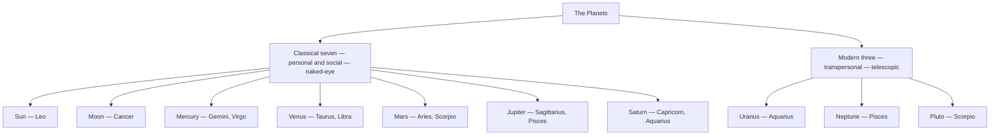

# Planets

> *The moving lights — the faculties of the psyche.*

---

## Overview

The planets are the *what* of astrology — the drives and faculties every psyche contains, styled by the signs and staged in the houses. The classical seven (Sun through Saturn) are the personal and social faculties, visible to the naked eye and known to every ancient culture; the modern three (Uranus, Neptune, Pluto) are the transpersonal forces, moving too slowly to belong to any one life. Pages are suffixed *(astrology)* to keep them distinct from the [gods](/knowledge/mythology) they share names with. Each note covers the planet's essence, correspondences, and how it behaves in a chart.

The ten drives split into the classical seven and the modern three, each keyed to the sign or signs it rules:

| Planet | Rules | Tarot | Metal |
| --- | --- | --- | --- |
| [Sun (astrology)](/knowledge/astrology/planets/sun-astrology) | [Leo](/knowledge/astrology/signs/leo) | [The Sun](/knowledge/tarot/major-arcana/the-sun) | gold |
| [Moon (astrology)](/knowledge/astrology/planets/moon-astrology) | [Cancer](/knowledge/astrology/signs/cancer) | [The High Priestess](/knowledge/tarot/major-arcana/the-high-priestess) | silver |
| [Mercury (astrology)](/knowledge/astrology/planets/mercury-astrology) | [Gemini](/knowledge/astrology/signs/gemini) & [Virgo](/knowledge/astrology/signs/virgo) | [The Magician](/knowledge/tarot/major-arcana/the-magician) | quicksilver |
| [Venus (astrology)](/knowledge/astrology/planets/venus-astrology) | [Taurus](/knowledge/astrology/signs/taurus) & [Libra](/knowledge/astrology/signs/libra) | [The Empress](/knowledge/tarot/major-arcana/the-empress) | copper |
| [Mars (astrology)](/knowledge/astrology/planets/mars-astrology) | [Aries](/knowledge/astrology/signs/aries) ([Scorpio](/knowledge/astrology/signs/scorpio), trad.) | [The Tower](/knowledge/tarot/major-arcana/the-tower) | iron |
| [Jupiter (astrology)](/knowledge/astrology/planets/jupiter-astrology) | [Sagittarius](/knowledge/astrology/signs/sagittarius) ([Pisces](/knowledge/astrology/signs/pisces), trad.) | [Wheel of Fortune](/knowledge/tarot/major-arcana/wheel-of-fortune) | tin |
| [Saturn (astrology)](/knowledge/astrology/planets/saturn-astrology) | [Capricorn](/knowledge/astrology/signs/capricorn) ([Aquarius](/knowledge/astrology/signs/aquarius), trad.) | [The World](/knowledge/tarot/major-arcana/the-world) | lead |
| [Uranus (astrology)](/knowledge/astrology/planets/uranus-astrology) | [Aquarius](/knowledge/astrology/signs/aquarius) (modern) | [The Fool](/knowledge/tarot/major-arcana/the-fool) | uranium |
| [Neptune (astrology)](/knowledge/astrology/planets/neptune-astrology) | [Pisces](/knowledge/astrology/signs/pisces) (modern) | [The Hanged Man](/knowledge/tarot/major-arcana/the-hanged-man) | neptunium |
| [Pluto (astrology)](/knowledge/astrology/planets/pluto-astrology) | [Scorpio](/knowledge/astrology/signs/scorpio) (modern) | [Death](/knowledge/tarot/major-arcana/death) | plutonium |

---

## Related

- [Astrology](/knowledge/astrology) — the parent index
- [Signs](/knowledge/astrology/signs) — the styles the planets take
- [Houses](/knowledge/astrology/houses) — the arenas where they act
- [Mythology](/knowledge/mythology) — the planets under their older names
- [Alchemy](/knowledge/alchemy) — the seven planetary metals
- [Tarot](/knowledge/tarot) — each classical planet carries a trump
