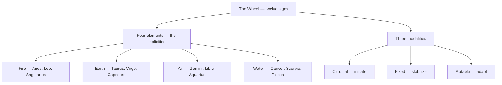

# Signs

> *Twelve styles of being, one wheel.*

---

## Overview

The twelve signs of the zodiac are the *how* of astrology — the styles the planetary drives take as they move around the wheel. Each is a combination of one of four elements (fire, earth, air, water) and one of three modalities (cardinal, fixed, mutable), so no two signs repeat a recipe. The wheel runs from the first shout of "I am" to the dissolving of every border, and each note in this folder covers one sign's essence, correspondences, and light and shadow.

Four elements down, three modalities across — twelve recipes, none repeated:

| Sign | Element | Modality | Ruler | Tarot |
| --- | --- | --- | --- | --- |
| [Aries](/knowledge/astrology/signs/aries) | Fire | Cardinal | [Mars](/knowledge/astrology/planets/mars-astrology) | [The Emperor](/knowledge/tarot/major-arcana/the-emperor) |
| [Taurus](/knowledge/astrology/signs/taurus) | Earth | Fixed | [Venus](/knowledge/astrology/planets/venus-astrology) | [The Hierophant](/knowledge/tarot/major-arcana/the-hierophant) |
| [Gemini](/knowledge/astrology/signs/gemini) | Air | Mutable | [Mercury](/knowledge/astrology/planets/mercury-astrology) | [The Lovers](/knowledge/tarot/major-arcana/the-lovers) |
| [Cancer](/knowledge/astrology/signs/cancer) | Water | Cardinal | [Moon](/knowledge/astrology/planets/moon-astrology) | [The Chariot](/knowledge/tarot/major-arcana/the-chariot) |
| [Leo](/knowledge/astrology/signs/leo) | Fire | Fixed | [Sun](/knowledge/astrology/planets/sun-astrology) | [Strength](/knowledge/tarot/major-arcana/strength) |
| [Virgo](/knowledge/astrology/signs/virgo) | Earth | Mutable | [Mercury](/knowledge/astrology/planets/mercury-astrology) | [The Hermit](/knowledge/tarot/major-arcana/the-hermit) |
| [Libra](/knowledge/astrology/signs/libra) | Air | Cardinal | [Venus](/knowledge/astrology/planets/venus-astrology) | [Justice](/knowledge/tarot/major-arcana/justice) |
| [Scorpio](/knowledge/astrology/signs/scorpio) | Water | Fixed | [Mars](/knowledge/astrology/planets/mars-astrology) (traditional) / [Pluto](/knowledge/astrology/planets/pluto-astrology) (modern) | [Death](/knowledge/tarot/major-arcana/death) |
| [Sagittarius](/knowledge/astrology/signs/sagittarius) | Fire | Mutable | [Jupiter](/knowledge/astrology/planets/jupiter-astrology) | [Temperance](/knowledge/tarot/major-arcana/temperance) |
| [Capricorn](/knowledge/astrology/signs/capricorn) | Earth | Cardinal | [Saturn](/knowledge/astrology/planets/saturn-astrology) | [The Devil](/knowledge/tarot/major-arcana/the-devil) |
| [Aquarius](/knowledge/astrology/signs/aquarius) | Air | Fixed | [Saturn](/knowledge/astrology/planets/saturn-astrology) (traditional) / [Uranus](/knowledge/astrology/planets/uranus-astrology) (modern) | [The Star](/knowledge/tarot/major-arcana/the-star) |
| [Pisces](/knowledge/astrology/signs/pisces) | Water | Mutable | [Jupiter](/knowledge/astrology/planets/jupiter-astrology) (traditional) / [Neptune](/knowledge/astrology/planets/neptune-astrology) (modern) | [The Moon](/knowledge/tarot/major-arcana/the-moon) |

---

## Related

- [Astrology](/knowledge/astrology) — the parent index, with the full correspondence table
- [Planets](/knowledge/astrology/planets) — the rulers of the signs
- [Houses](/knowledge/astrology/houses) — each house has a natural sign
- [Tarot](/knowledge/tarot) — every sign mirrors a trump of the Major Arcana
