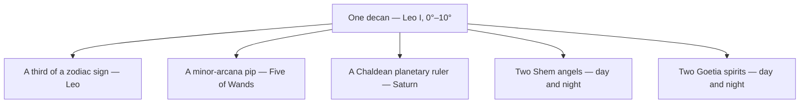

# The 36 Decans

> *The connective tissue of the whole correspondence web — one grid where the zodiac, the tarot, the planets, and the angels all key to the same thirty-six doors.*

---

## Overview

A **decan** (or *face*) is ten degrees of the zodiac — a third of a sign, so twelve signs give thirty-six decans. The system is ancient Egyptian: thirty-six star-groups that rose about ten days apart, marking off the 360-day year (36 × 10). What makes the decans the master key of the whole [Table of Correspondences](/knowledge/table-of-correspondences) is that almost every other system in this vault keys to them at once.

Each decan simultaneously is a third of a [zodiac](/knowledge/astrology) sign, one of the thirty-six minor-arcana pip cards (the [small cards](/knowledge/tarot/minor-arcana), Two through Ten of each suit — 9 pips × 4 suits = 36), the seat of a **Chaldean planetary ruler**, and the domain of a pair of angels and a pair of spirits: the seventy-two [Shem angels](/knowledge/angels-and-demons/shem-ha-mephorash) are thirty-six decans × two (a day angel and a night angel, five degrees each), and the seventy-two spirits of the [Ars Goetia](/knowledge/angels-and-demons/ars-goetia) map the same thirty-six, day and night. So the first ten degrees of Leo is at once the Five of Wands, ruled by Saturn, held by the angels Haziel and Aladiah and the spirits they pair with. Read one row and five collections light up together.

The planetary rulers run in **Chaldean order** — Mars, Sun, Venus, Mercury, Moon, Saturn, Jupiter — cycling continuously from the first face of Aries. The tarot attributions follow the Golden Dawn's assignment of the small cards to the decans.

One decan, read five ways at once — the knot the whole web is tied around:

---

## The Master Table

| # | Decan | Degrees | Tarot | Ruler | Shem Angels (day · night) | Goetia (day · night) |
|---|-------|---------|-------|-------|---------------------------|----------------------|
| 1 | [Aries](/knowledge/astrology/signs/aries) I | 0°–10° | [Two of Wands](/knowledge/tarot/minor-arcana/two-of-wands) | [Mars](/knowledge/astrology/planets/mars-astrology) | [Vehuiah](/knowledge/angels-and-demons/shem-ha-mephorash/vehuiah) · [Jeliel](/knowledge/angels-and-demons/shem-ha-mephorash/jeliel) | [Bael](/knowledge/angels-and-demons/ars-goetia/bael) · [Agares](/knowledge/angels-and-demons/ars-goetia/agares) |
| 2 | [Aries](/knowledge/astrology/signs/aries) II | 10°–20° | [Three of Wands](/knowledge/tarot/minor-arcana/three-of-wands) | [Sun](/knowledge/astrology/planets/sun-astrology) | [Sitael](/knowledge/angels-and-demons/shem-ha-mephorash/sitael) · [Elemiah](/knowledge/angels-and-demons/shem-ha-mephorash/elemiah) | [Vassago](/knowledge/angels-and-demons/ars-goetia/vassago) · [Samigina](/knowledge/angels-and-demons/ars-goetia/samigina) |
| 3 | [Aries](/knowledge/astrology/signs/aries) III | 20°–30° | [Four of Wands](/knowledge/tarot/minor-arcana/four-of-wands) | [Venus](/knowledge/astrology/planets/venus-astrology) | [Mahasiah](/knowledge/angels-and-demons/shem-ha-mephorash/mahasiah) · [Lelahel](/knowledge/angels-and-demons/shem-ha-mephorash/lelahel) | [Marbas](/knowledge/angels-and-demons/ars-goetia/marbas) · [Valefor](/knowledge/angels-and-demons/ars-goetia/valefor) |
| 4 | [Taurus](/knowledge/astrology/signs/taurus) I | 0°–10° | [Five of Pentacles](/knowledge/tarot/minor-arcana/five-of-pentacles) | [Mercury](/knowledge/astrology/planets/mercury-astrology) | [Achaiah](/knowledge/angels-and-demons/shem-ha-mephorash/achaiah) · [Cahetel](/knowledge/angels-and-demons/shem-ha-mephorash/cahetel) | [Amon](/knowledge/angels-and-demons/ars-goetia/amon) · [Barbatos](/knowledge/angels-and-demons/ars-goetia/barbatos) |
| 5 | [Taurus](/knowledge/astrology/signs/taurus) II | 10°–20° | [Six of Pentacles](/knowledge/tarot/minor-arcana/six-of-pentacles) | [Moon](/knowledge/astrology/planets/moon-astrology) | [Haziel](/knowledge/angels-and-demons/shem-ha-mephorash/haziel) · [Aladiah](/knowledge/angels-and-demons/shem-ha-mephorash/aladiah) | [Paimon](/knowledge/angels-and-demons/ars-goetia/paimon) · [Buer](/knowledge/angels-and-demons/ars-goetia/buer) |
| 6 | [Taurus](/knowledge/astrology/signs/taurus) III | 20°–30° | [Seven of Pentacles](/knowledge/tarot/minor-arcana/seven-of-pentacles) | [Saturn](/knowledge/astrology/planets/saturn-astrology) | [Lauviah](/knowledge/angels-and-demons/shem-ha-mephorash/lauviah) · [Hahaiah](/knowledge/angels-and-demons/shem-ha-mephorash/hahaiah) | [Gusion](/knowledge/angels-and-demons/ars-goetia/gusion) · [Sitri](/knowledge/angels-and-demons/ars-goetia/sitri) |
| 7 | [Gemini](/knowledge/astrology/signs/gemini) I | 0°–10° | [Eight of Swords](/knowledge/tarot/minor-arcana/eight-of-swords) | [Jupiter](/knowledge/astrology/planets/jupiter-astrology) | [Iezalel](/knowledge/angels-and-demons/shem-ha-mephorash/iezalel) · [Mebahel](/knowledge/angels-and-demons/shem-ha-mephorash/mebahel) | [Beleth](/knowledge/angels-and-demons/ars-goetia/beleth) · [Leraje](/knowledge/angels-and-demons/ars-goetia/leraje) |
| 8 | [Gemini](/knowledge/astrology/signs/gemini) II | 10°–20° | [Nine of Swords](/knowledge/tarot/minor-arcana/nine-of-swords) | [Mars](/knowledge/astrology/planets/mars-astrology) | [Hariel](/knowledge/angels-and-demons/shem-ha-mephorash/hariel) · [Hekamiah](/knowledge/angels-and-demons/shem-ha-mephorash/hekamiah) | [Eligos](/knowledge/angels-and-demons/ars-goetia/eligos) · [Zepar](/knowledge/angels-and-demons/ars-goetia/zepar) |
| 9 | [Gemini](/knowledge/astrology/signs/gemini) III | 20°–30° | [Ten of Swords](/knowledge/tarot/minor-arcana/ten-of-swords) | [Sun](/knowledge/astrology/planets/sun-astrology) | [Lauviah II](/knowledge/angels-and-demons/shem-ha-mephorash/lauviah-ii) · [Caliel](/knowledge/angels-and-demons/shem-ha-mephorash/caliel) | [Botis](/knowledge/angels-and-demons/ars-goetia/botis) · [Bathin](/knowledge/angels-and-demons/ars-goetia/bathin) |
| 10 | [Cancer](/knowledge/astrology/signs/cancer) I | 0°–10° | [Two of Cups](/knowledge/tarot/minor-arcana/two-of-cups) | [Venus](/knowledge/astrology/planets/venus-astrology) | [Leuviah](/knowledge/angels-and-demons/shem-ha-mephorash/leuviah) · [Pahaliah](/knowledge/angels-and-demons/shem-ha-mephorash/pahaliah) | [Sallos](/knowledge/angels-and-demons/ars-goetia/sallos) · [Purson](/knowledge/angels-and-demons/ars-goetia/purson) |
| 11 | [Cancer](/knowledge/astrology/signs/cancer) II | 10°–20° | [Three of Cups](/knowledge/tarot/minor-arcana/three-of-cups) | [Mercury](/knowledge/astrology/planets/mercury-astrology) | [Nelchael](/knowledge/angels-and-demons/shem-ha-mephorash/nelchael) · [Yeiayel](/knowledge/angels-and-demons/shem-ha-mephorash/yeiayel) | [Marax](/knowledge/angels-and-demons/ars-goetia/marax) · [Ipos](/knowledge/angels-and-demons/ars-goetia/ipos) |
| 12 | [Cancer](/knowledge/astrology/signs/cancer) III | 20°–30° | [Four of Cups](/knowledge/tarot/minor-arcana/four-of-cups) | [Moon](/knowledge/astrology/planets/moon-astrology) | [Melahel](/knowledge/angels-and-demons/shem-ha-mephorash/melahel) · [Haheuiah](/knowledge/angels-and-demons/shem-ha-mephorash/haheuiah) | [Aim](/knowledge/angels-and-demons/ars-goetia/aim) · [Naberius](/knowledge/angels-and-demons/ars-goetia/naberius) |
| 13 | [Leo](/knowledge/astrology/signs/leo) I | 0°–10° | [Five of Wands](/knowledge/tarot/minor-arcana/five-of-wands) | [Saturn](/knowledge/astrology/planets/saturn-astrology) | [Nith-Haiah](/knowledge/angels-and-demons/shem-ha-mephorash/nith-haiah) · [Haaiah](/knowledge/angels-and-demons/shem-ha-mephorash/haaiah) | [Glasya-Labolas](/knowledge/angels-and-demons/ars-goetia/glasya-labolas) · [Bune](/knowledge/angels-and-demons/ars-goetia/bune) |
| 14 | [Leo](/knowledge/astrology/signs/leo) II | 10°–20° | [Six of Wands](/knowledge/tarot/minor-arcana/six-of-wands) | [Jupiter](/knowledge/astrology/planets/jupiter-astrology) | [Yerathel](/knowledge/angels-and-demons/shem-ha-mephorash/yerathel) · [Seheiah](/knowledge/angels-and-demons/shem-ha-mephorash/seheiah) | [Ronove](/knowledge/angels-and-demons/ars-goetia/ronove) · [Berith](/knowledge/angels-and-demons/ars-goetia/berith) |
| 15 | [Leo](/knowledge/astrology/signs/leo) III | 20°–30° | [Seven of Wands](/knowledge/tarot/minor-arcana/seven-of-wands) | [Mars](/knowledge/astrology/planets/mars-astrology) | [Reiyel](/knowledge/angels-and-demons/shem-ha-mephorash/reiyel) · [Omael](/knowledge/angels-and-demons/shem-ha-mephorash/omael) | [Astaroth](/knowledge/angels-and-demons/ars-goetia/astaroth) · [Forneus](/knowledge/angels-and-demons/ars-goetia/forneus) |
| 16 | [Virgo](/knowledge/astrology/signs/virgo) I | 0°–10° | [Eight of Pentacles](/knowledge/tarot/minor-arcana/eight-of-pentacles) | [Sun](/knowledge/astrology/planets/sun-astrology) | [Lecabel](/knowledge/angels-and-demons/shem-ha-mephorash/lecabel) · [Vasariah](/knowledge/angels-and-demons/shem-ha-mephorash/vasariah) | [Foras](/knowledge/angels-and-demons/ars-goetia/foras) · [Asmoday](/knowledge/angels-and-demons/ars-goetia/asmoday) |
| 17 | [Virgo](/knowledge/astrology/signs/virgo) II | 10°–20° | [Nine of Pentacles](/knowledge/tarot/minor-arcana/nine-of-pentacles) | [Venus](/knowledge/astrology/planets/venus-astrology) | [Yehuiah](/knowledge/angels-and-demons/shem-ha-mephorash/yehuiah) · [Lehahiah](/knowledge/angels-and-demons/shem-ha-mephorash/lehahiah) | [Gaap](/knowledge/angels-and-demons/ars-goetia/gaap) · [Furfur](/knowledge/angels-and-demons/ars-goetia/furfur) |
| 18 | [Virgo](/knowledge/astrology/signs/virgo) III | 20°–30° | [Ten of Pentacles](/knowledge/tarot/minor-arcana/ten-of-pentacles) | [Mercury](/knowledge/astrology/planets/mercury-astrology) | [Chavakiah](/knowledge/angels-and-demons/shem-ha-mephorash/chavakiah) · [Menadel](/knowledge/angels-and-demons/shem-ha-mephorash/menadel) | [Marchosias](/knowledge/angels-and-demons/ars-goetia/marchosias) · [Stolas](/knowledge/angels-and-demons/ars-goetia/stolas) |
| 19 | [Libra](/knowledge/astrology/signs/libra) I | 0°–10° | [Two of Swords](/knowledge/tarot/minor-arcana/two-of-swords) | [Moon](/knowledge/astrology/planets/moon-astrology) | [Aniel](/knowledge/angels-and-demons/shem-ha-mephorash/aniel) · [Haamiah](/knowledge/angels-and-demons/shem-ha-mephorash/haamiah) | [Phenex](/knowledge/angels-and-demons/ars-goetia/phenex) · [Halphas](/knowledge/angels-and-demons/ars-goetia/halphas) |
| 20 | [Libra](/knowledge/astrology/signs/libra) II | 10°–20° | [Three of Swords](/knowledge/tarot/minor-arcana/three-of-swords) | [Saturn](/knowledge/astrology/planets/saturn-astrology) | [Rehael](/knowledge/angels-and-demons/shem-ha-mephorash/rehael) · [Ieiazel](/knowledge/angels-and-demons/shem-ha-mephorash/ieiazel) | [Malphas](/knowledge/angels-and-demons/ars-goetia/malphas) · [Raum](/knowledge/angels-and-demons/ars-goetia/raum) |
| 21 | [Libra](/knowledge/astrology/signs/libra) III | 20°–30° | [Four of Swords](/knowledge/tarot/minor-arcana/four-of-swords) | [Jupiter](/knowledge/astrology/planets/jupiter-astrology) | [Hahahel](/knowledge/angels-and-demons/shem-ha-mephorash/hahahel) · [Mikael](/knowledge/angels-and-demons/shem-ha-mephorash/mikael) | [Focalor](/knowledge/angels-and-demons/ars-goetia/focalor) · [Vepar](/knowledge/angels-and-demons/ars-goetia/vepar) |
| 22 | [Scorpio](/knowledge/astrology/signs/scorpio) I | 0°–10° | [Five of Cups](/knowledge/tarot/minor-arcana/five-of-cups) | [Mars](/knowledge/astrology/planets/mars-astrology) | [Veualiah](/knowledge/angels-and-demons/shem-ha-mephorash/veualiah) · [Yelahiah](/knowledge/angels-and-demons/shem-ha-mephorash/yelahiah) | [Sabnock](/knowledge/angels-and-demons/ars-goetia/sabnock) · [Shax](/knowledge/angels-and-demons/ars-goetia/shax) |
| 23 | [Scorpio](/knowledge/astrology/signs/scorpio) II | 10°–20° | [Six of Cups](/knowledge/tarot/minor-arcana/six-of-cups) | [Sun](/knowledge/astrology/planets/sun-astrology) | [Sealiah](/knowledge/angels-and-demons/shem-ha-mephorash/sealiah) · [Ariel](/knowledge/angels-and-demons/shem-ha-mephorash/ariel) | [Vine](/knowledge/angels-and-demons/ars-goetia/vine) · [Bifrons](/knowledge/angels-and-demons/ars-goetia/bifrons) |
| 24 | [Scorpio](/knowledge/astrology/signs/scorpio) III | 20°–30° | [Seven of Cups](/knowledge/tarot/minor-arcana/seven-of-cups) | [Venus](/knowledge/astrology/planets/venus-astrology) | [Asaliah](/knowledge/angels-and-demons/shem-ha-mephorash/asaliah) · [Mihael](/knowledge/angels-and-demons/shem-ha-mephorash/mihael) | [Uvall](/knowledge/angels-and-demons/ars-goetia/uvall) · [Haagenti](/knowledge/angels-and-demons/ars-goetia/haagenti) |
| 25 | [Sagittarius](/knowledge/astrology/signs/sagittarius) I | 0°–10° | [Eight of Wands](/knowledge/tarot/minor-arcana/eight-of-wands) | [Mercury](/knowledge/astrology/planets/mercury-astrology) | [Vehuel](/knowledge/angels-and-demons/shem-ha-mephorash/vehuel) · [Daniel](/knowledge/angels-and-demons/shem-ha-mephorash/daniel) | [Crocell](/knowledge/angels-and-demons/ars-goetia/crocell) · [Furcas](/knowledge/angels-and-demons/ars-goetia/furcas) |
| 26 | [Sagittarius](/knowledge/astrology/signs/sagittarius) II | 10°–20° | [Nine of Wands](/knowledge/tarot/minor-arcana/nine-of-wands) | [Moon](/knowledge/astrology/planets/moon-astrology) | [Hahasiah](/knowledge/angels-and-demons/shem-ha-mephorash/hahasiah) · [Imamiah](/knowledge/angels-and-demons/shem-ha-mephorash/imamiah) | [Balam](/knowledge/angels-and-demons/ars-goetia/balam) · [Alloces](/knowledge/angels-and-demons/ars-goetia/alloces) |
| 27 | [Sagittarius](/knowledge/astrology/signs/sagittarius) III | 20°–30° | [Ten of Wands](/knowledge/tarot/minor-arcana/ten-of-wands) | [Saturn](/knowledge/astrology/planets/saturn-astrology) | [Nanael](/knowledge/angels-and-demons/shem-ha-mephorash/nanael) · [Nithael](/knowledge/angels-and-demons/shem-ha-mephorash/nithael) | [Caim](/knowledge/angels-and-demons/ars-goetia/caim) · [Murmur](/knowledge/angels-and-demons/ars-goetia/murmur) |
| 28 | [Capricorn](/knowledge/astrology/signs/capricorn) I | 0°–10° | [Two of Pentacles](/knowledge/tarot/minor-arcana/two-of-pentacles) | [Jupiter](/knowledge/astrology/planets/jupiter-astrology) | [Mebahiah](/knowledge/angels-and-demons/shem-ha-mephorash/mebahiah) · [Poyel](/knowledge/angels-and-demons/shem-ha-mephorash/poyel) | [Orobas](/knowledge/angels-and-demons/ars-goetia/orobas) · [Gremory](/knowledge/angels-and-demons/ars-goetia/gremory) |
| 29 | [Capricorn](/knowledge/astrology/signs/capricorn) II | 10°–20° | [Three of Pentacles](/knowledge/tarot/minor-arcana/three-of-pentacles) | [Mars](/knowledge/astrology/planets/mars-astrology) | [Nemamiah](/knowledge/angels-and-demons/shem-ha-mephorash/nemamiah) · [Yeialel](/knowledge/angels-and-demons/shem-ha-mephorash/yeialel) | [Ose](/knowledge/angels-and-demons/ars-goetia/ose) · [Amy](/knowledge/angels-and-demons/ars-goetia/amy) |
| 30 | [Capricorn](/knowledge/astrology/signs/capricorn) III | 20°–30° | [Four of Pentacles](/knowledge/tarot/minor-arcana/four-of-pentacles) | [Sun](/knowledge/astrology/planets/sun-astrology) | [Harahel](/knowledge/angels-and-demons/shem-ha-mephorash/harahel) · [Mitzrael](/knowledge/angels-and-demons/shem-ha-mephorash/mitzrael) | [Orias](/knowledge/angels-and-demons/ars-goetia/orias) · [Vapula](/knowledge/angels-and-demons/ars-goetia/vapula) |
| 31 | [Aquarius](/knowledge/astrology/signs/aquarius) I | 0°–10° | [Five of Swords](/knowledge/tarot/minor-arcana/five-of-swords) | [Venus](/knowledge/astrology/planets/venus-astrology) | [Umabel](/knowledge/angels-and-demons/shem-ha-mephorash/umabel) · [Iah-Hel](/knowledge/angels-and-demons/shem-ha-mephorash/iah-hel) | [Zagan](/knowledge/angels-and-demons/ars-goetia/zagan) · [Valac](/knowledge/angels-and-demons/ars-goetia/valac) |
| 32 | [Aquarius](/knowledge/astrology/signs/aquarius) II | 10°–20° | [Six of Swords](/knowledge/tarot/minor-arcana/six-of-swords) | [Mercury](/knowledge/astrology/planets/mercury-astrology) | [Anauel](/knowledge/angels-and-demons/shem-ha-mephorash/anauel) · [Mehiel](/knowledge/angels-and-demons/shem-ha-mephorash/mehiel) | [Andras](/knowledge/angels-and-demons/ars-goetia/andras) · [Haures](/knowledge/angels-and-demons/ars-goetia/haures) |
| 33 | [Aquarius](/knowledge/astrology/signs/aquarius) III | 20°–30° | [Seven of Swords](/knowledge/tarot/minor-arcana/seven-of-swords) | [Moon](/knowledge/astrology/planets/moon-astrology) | [Damabiah](/knowledge/angels-and-demons/shem-ha-mephorash/damabiah) · [Manakel](/knowledge/angels-and-demons/shem-ha-mephorash/manakel) | [Andrealphus](/knowledge/angels-and-demons/ars-goetia/andrealphus) · [Cimejes](/knowledge/angels-and-demons/ars-goetia/cimejes) |
| 34 | [Pisces](/knowledge/astrology/signs/pisces) I | 0°–10° | [Eight of Cups](/knowledge/tarot/minor-arcana/eight-of-cups) | [Saturn](/knowledge/astrology/planets/saturn-astrology) | [Eyael](/knowledge/angels-and-demons/shem-ha-mephorash/eyael) · [Habuhiah](/knowledge/angels-and-demons/shem-ha-mephorash/habuhiah) | [Amdusias](/knowledge/angels-and-demons/ars-goetia/amdusias) · [Belial](/knowledge/angels-and-demons/ars-goetia/belial) |
| 35 | [Pisces](/knowledge/astrology/signs/pisces) II | 10°–20° | [Nine of Cups](/knowledge/tarot/minor-arcana/nine-of-cups) | [Jupiter](/knowledge/astrology/planets/jupiter-astrology) | [Rochel](/knowledge/angels-and-demons/shem-ha-mephorash/rochel) · [Jabamiah](/knowledge/angels-and-demons/shem-ha-mephorash/jabamiah) | [Decarabia](/knowledge/angels-and-demons/ars-goetia/decarabia) · [Seere](/knowledge/angels-and-demons/ars-goetia/seere) |
| 36 | [Pisces](/knowledge/astrology/signs/pisces) III | 20°–30° | [Ten of Cups](/knowledge/tarot/minor-arcana/ten-of-cups) | [Mars](/knowledge/astrology/planets/mars-astrology) | [Haiaiel](/knowledge/angels-and-demons/shem-ha-mephorash/haiaiel) · [Mumiah](/knowledge/angels-and-demons/shem-ha-mephorash/mumiah) | [Dantalion](/knowledge/angels-and-demons/ars-goetia/dantalion) · [Andromalius](/knowledge/angels-and-demons/ars-goetia/andromalius) |

---

## How to Read It

Take any row as a single knot in the web. Row 13 is the first face of Leo: zero to ten degrees, the [Five of Wands](/knowledge/tarot/minor-arcana/five-of-wands) (strife), ruled by [Saturn](/knowledge/astrology/planets/saturn-astrology) (discipline pressing on fire), and held by the Shem angels of that decan with their paired Goetic spirits. The card's meaning, the sign's fire, the ruler's weight, and the angels' offices are four readings of one ten-degree door. This is what Liber 777 means by a table of correspondences carried all the way down: not a list of separate systems, but a single structure seen from many sides.

The day/night split is the *quinance* — each decan divides into two five-degree halves, and the seventy-two angels and seventy-two spirits fill those seventy-two half-decans exactly. The pairing of each [Shem angel](/knowledge/angels-and-demons/shem-ha-mephorash) with its [Goetic spirit](/knowledge/angels-and-demons/ars-goetia) follows the attribution already recorded on each angel's page.

---

## Related

- [Table of Correspondences](/knowledge/table-of-correspondences) — the master grid this deepens
- [Astrology](/knowledge/astrology) · [Signs](/knowledge/astrology/signs) — the twelve signs, three decans each
- [Minor Arcana](/knowledge/tarot/minor-arcana) — the thirty-six small cards, one per decan
- [Shem ha-Mephorash](/knowledge/angels-and-demons/shem-ha-mephorash) — the seventy-two angels, two per decan
- [Ars Goetia](/knowledge/angels-and-demons/ars-goetia) — the seventy-two spirits, two per decan
- [Planets](/knowledge/astrology/planets) — the Chaldean decan rulers
- Liber 777 — Crowley's master table, the model for this one

---

*Thirty-six doors, each opening on the same room from a different wall.*
