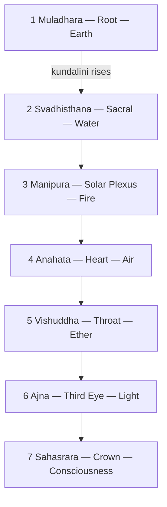

# Chakras

> *Seven wheels of light strung along the spine, from root to crown.*

---

The chakras are the seven principal energy centres of the subtle body in the yogic and tantric traditions — wheels (*chakra* means "wheel") strung along the central channel, the *sushumna*, that runs from the base of the spine to the crown of the head. Each governs a dimension of experience, from raw survival at the root to pure consciousness at the crown, and each carries its own element, colour, sound, and presiding energy. The awakening of *kundalini* is described as the rising of that energy up through the centres, integrating body and spirit on the way. The scheme belongs to the same non-dual current as [Vedanta](/knowledge/spirituality/vedanta).

---

## The Seven Centres

| # | Sanskrit | English | Element | Colour |
|---|----------|---------|---------|--------|
| 1 | [Muladhara](/knowledge/chakras/muladhara) | Root | Earth | Red |
| 2 | [Svadhisthana](/knowledge/chakras/svadhisthana) | Sacral | Water | Orange |
| 3 | [Manipura](/knowledge/chakras/manipura) | Solar Plexus | Fire | Yellow |
| 4 | [Anahata](/knowledge/chakras/anahata) | Heart | Air | Green |
| 5 | [Vishuddha](/knowledge/chakras/vishuddha) | Throat | Ether | Blue |
| 6 | [Ajna](/knowledge/chakras/ajna) | Third Eye | Light | Indigo |
| 7 | [Sahasrara](/knowledge/chakras/sahasrara) | Crown | Consciousness | Violet-white |

The lower centres ([Muladhara](/knowledge/chakras/muladhara), [Svadhisthana](/knowledge/chakras/svadhisthana), [Manipura](/knowledge/chakras/manipura)) govern the physical and instinctual life; the [heart](/knowledge/chakras/anahata) is the bridge; the upper centres ([Vishuddha](/knowledge/chakras/vishuddha), [Ajna](/knowledge/chakras/ajna), [Sahasrara](/knowledge/chakras/sahasrara)) govern expression, insight, and transcendence. Their ascending elements — earth, water, fire, air, ether — climb the same ladder of subtlety that the classical elements do in the [Tarot](/knowledge/tarot) and in [Alchemy](/knowledge/alchemy).

The seven form a single ascending column, each governing its own element as the energy climbs from root to crown.

---

## Related

- [Vedanta](/knowledge/spirituality/vedanta) — the non-dual philosophy the subtle body belongs to
- [Spirituality Hub](/knowledge/spirituality)
- [Tree of Life](/knowledge/tree-of-life) — the Western esoteric counterpart, spheres strung on a central pillar
- [Tarot](/knowledge/tarot) — the elemental ladder in another key
