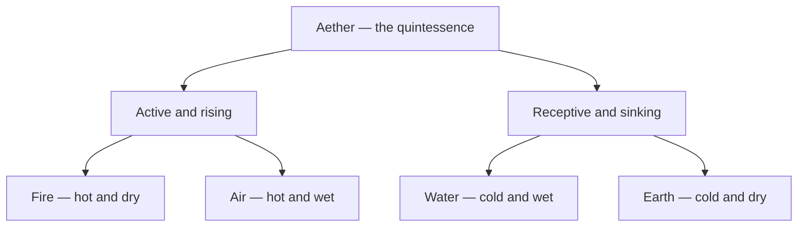

# Elements

> *Four states of being, and the fifth that holds them — the alphabet every esoteric language is spelled in.*

---

The classical elements are the oldest and most portable of all the correspondence systems — four qualities of being (with a fifth, the quintessence, above them) into which the ancients divided the whole of nature. They are the connective tissue of this vault: the four suits of the [Tarot](/knowledge/tarot), the four triplicities of [Astrology](/knowledge/astrology), the working principles of [Alchemy](/knowledge/alchemy), the ascending rungs of the [Chakras](/knowledge/chakras), and the five [Platonic Solids](/knowledge/sacred-geometry/platonic-solids) all resolve to the same handful of elements. To know them is to hold the key that translates one system into another.

---

## The Four, and the Fifth

| Element | Qualities | Tarot Suit | Triplicity | Solid | Jungian |
|---------|-----------|-----------|------------|-------|---------|
| [Fire](/knowledge/elements/fire) | Hot & dry | Wands | [Aries](/knowledge/astrology/signs/aries) · [Leo](/knowledge/astrology/signs/leo) · [Sagittarius](/knowledge/astrology/signs/sagittarius) | [Tetrahedron](/knowledge/sacred-geometry/tetrahedron) | Intuition |
| [Water](/knowledge/elements/water) | Cold & wet | Cups | [Cancer](/knowledge/astrology/signs/cancer) · [Scorpio](/knowledge/astrology/signs/scorpio) · [Pisces](/knowledge/astrology/signs/pisces) | [Icosahedron](/knowledge/sacred-geometry/icosahedron) | Feeling |
| [Air](/knowledge/elements/air) | Hot & wet | Swords | [Gemini](/knowledge/astrology/signs/gemini) · [Libra](/knowledge/astrology/signs/libra) · [Aquarius](/knowledge/astrology/signs/aquarius) | [Octahedron](/knowledge/sacred-geometry/octahedron) | Thinking |
| [Earth](/knowledge/elements/earth) | Cold & dry | Pentacles | [Taurus](/knowledge/astrology/signs/taurus) · [Virgo](/knowledge/astrology/signs/virgo) · [Capricorn](/knowledge/astrology/signs/capricorn) | [Cube](/knowledge/sacred-geometry/cube) | Sensation |
| [Aether](/knowledge/elements/aether) | The quintessence | (Spirit / Major Arcana) | — | [Dodecahedron](/knowledge/sacred-geometry/dodecahedron) | The transcendent function |

The four material elements pair by quality — [Fire](/knowledge/elements/fire) and [Air](/knowledge/elements/air) are active and rising, [Water](/knowledge/elements/water) and [Earth](/knowledge/elements/earth) receptive and sinking — and each shares a quality with two neighbours, so the whole makes a wheel rather than a list. Above them all stands [Aether](/knowledge/elements/aether), the fifth essence, the spirit that is present in each of the four and reducible to none.

The fifth essence presides over the four, which split into the active and rising and the receptive and sinking:

---

## Related

- [Tarot](/knowledge/tarot) — the four suits of the Minor Arcana
- [Astrology](/knowledge/astrology) — the fire, earth, air, and water triplicities
- [Alchemy](/knowledge/alchemy) — the elements as principles of transformation
- [Chakras](/knowledge/chakras) — the elemental ladder of the subtle body
- [Platonic Solids](/knowledge/sacred-geometry/platonic-solids) — the geometric bodies of the elements
- [Trigrams](/knowledge/trigrams) — the eight bagua of the I Ching, the Eastern echo of the elements
- [Table of Correspondences](/knowledge/table-of-correspondences) — the full grid
- [Spirituality Hub](/knowledge/spirituality)
