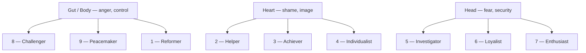

# Enneagram

> *Nine ways of being, nine ways of going wrong, nine ways home.*

---

The Enneagram is a map of nine personality types arranged around a nine-pointed figure, each type defined not by its behaviour but by its underlying motivation — a core fear and a core desire that organize the whole self around them. Unlike a fixed label, it is a map of *movement*: each type has two neighbouring **wings** that colour it, and two **arrows** that show where it goes in growth (integration) and in stress (disintegration). It pairs naturally with the vault's Jungian material — another way of naming the patterns that run us until we make them conscious.

---

## The Three Centres

The nine types cluster into three centres of intelligence, each with a driving emotion:

**Gut / Body** *(anger, control)* — [Type 8 - The Challenger](/knowledge/enneagram/type-8-the-challenger), [Type 9 - The Peacemaker](/knowledge/enneagram/type-9-the-peacemaker), [Type 1 - The Reformer](/knowledge/enneagram/type-1-the-reformer)
**Heart** *(shame, image)* — [Type 2 - The Helper](/knowledge/enneagram/type-2-the-helper), [Type 3 - The Achiever](/knowledge/enneagram/type-3-the-achiever), [Type 4 - The Individualist](/knowledge/enneagram/type-4-the-individualist)
**Head** *(fear, security)* — [Type 5 - The Investigator](/knowledge/enneagram/type-5-the-investigator), [Type 6 - The Loyalist](/knowledge/enneagram/type-6-the-loyalist), [Type 7 - The Enthusiast](/knowledge/enneagram/type-7-the-enthusiast)

## The Nine Types

| Type | Name | Core Desire |
|------|------|-------------|
| 1 | [Type 1 - The Reformer](/knowledge/enneagram/type-1-the-reformer) | Integrity, to be good |
| 2 | [Type 2 - The Helper](/knowledge/enneagram/type-2-the-helper) | To be loved and needed |
| 3 | [Type 3 - The Achiever](/knowledge/enneagram/type-3-the-achiever) | To be valuable, admired |
| 4 | [Type 4 - The Individualist](/knowledge/enneagram/type-4-the-individualist) | To be uniquely themselves |
| 5 | [Type 5 - The Investigator](/knowledge/enneagram/type-5-the-investigator) | To be capable, competent |
| 6 | [Type 6 - The Loyalist](/knowledge/enneagram/type-6-the-loyalist) | Security and support |
| 7 | [Type 7 - The Enthusiast](/knowledge/enneagram/type-7-the-enthusiast) | Satisfaction, freedom |
| 8 | [Type 8 - The Challenger](/knowledge/enneagram/type-8-the-challenger) | To protect themselves, control |
| 9 | [Type 9 - The Peacemaker](/knowledge/enneagram/type-9-the-peacemaker) | Inner and outer peace |

The three centres and the types that cluster within each:

---

## Related

- Psychology Hub
- The Shadow — what each type disowns
- [Individuation](/knowledge/psychology/jungian/individuation) — the arrows of integration as a path toward wholeness
- [Knowledge Hub](/knowledge)
