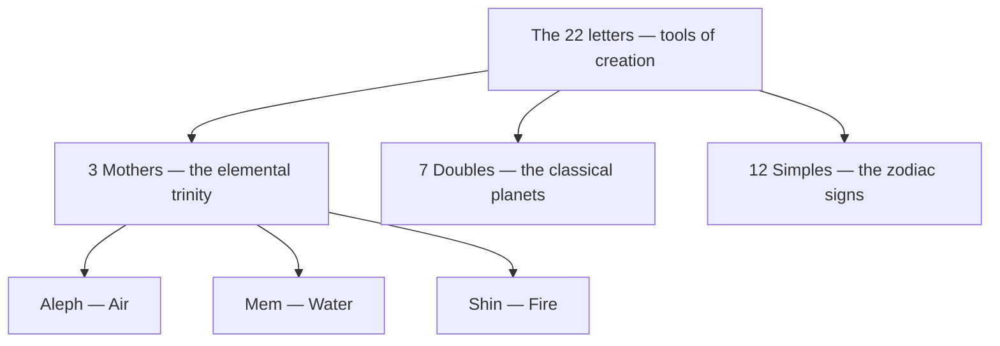

# Hebrew Letters

> *He engraved them, carved them, weighed them, permuted them — and with twenty-two letters He founded the world.*

---

The twenty-two letters of the Hebrew alef-bet are, in the [Kabbalah](/knowledge/spirituality/kabbalah), nothing less than the instruments of creation. The Sefer Yetzirah — the Book of Formation, the tradition's oldest surviving text — describes God engraving, carving, weighing, and permuting the letters, and building all that exists out of their combinations. On this view the alphabet is not a notation invented to record the world; the world is a text spelled out of a prior alphabet. Each letter is simultaneously a sound, a number, a pictograph, and a channel of creative force — which is why the mystic who studies the letters is studying the grammar of reality itself.

Because every letter is also a number, every word carries a hidden arithmetic. This is gematria: words that share a sum share a secret kinship, and the tradition mines these equivalences endlessly — *ahavah* (love) and *echad* (one) both counting thirteen, and together making twenty-six, the number of the four-lettered Name. The five letters that take a final form (kaf, mem, nun, pe, tzadi) extend the count past four hundred.

The Sefer Yetzirah sorts the letters into three classes. The **three mothers** — [Aleph](/knowledge/hebrew-letters/aleph), [Mem](/knowledge/hebrew-letters/mem), [Shin](/knowledge/hebrew-letters/shin) — are the elemental trinity of Air, Water, and Fire. The **seven doubles** — [Bet](/knowledge/hebrew-letters/bet), [Gimel](/knowledge/hebrew-letters/gimel), [Dalet](/knowledge/hebrew-letters/dalet), [Kaf](/knowledge/hebrew-letters/kaf), [Pe](/knowledge/hebrew-letters/pe), [Resh](/knowledge/hebrew-letters/resh), [Tav](/knowledge/hebrew-letters/tav) — each take a hard and a soft pronunciation, carry a pair of opposed qualities, and correspond to the seven classical planets. The **twelve simples** carry the twelve signs of the zodiac and twelve human faculties. In the Golden Dawn synthesis this same alphabet is laid onto the twenty-two paths of the [Tree of Life](/knowledge/tree-of-life) and the twenty-two trumps of the [Major Arcana](/knowledge/tarot/major-arcana) — each letter a path, each path a card, so that the alef-bet, the Tree, and the tarot are three notations for one structure.

The Sefer Yetzirah divides the twenty-two into three classes — the elemental mothers, the planetary doubles, and the zodiacal simples:

---

## The Twenty-Two Letters

| Letter | Glyph | Value | Meaning | Class | Trump |
|---|---|---|---|---|---|
| [Aleph](/knowledge/hebrew-letters/aleph) | א | 1 | Ox | Mother — Air | [The Fool](/knowledge/tarot/major-arcana/the-fool) |
| [Bet](/knowledge/hebrew-letters/bet) | ב | 2 | House | Double — Mercury | [The Magician](/knowledge/tarot/major-arcana/the-magician) |
| [Gimel](/knowledge/hebrew-letters/gimel) | ג | 3 | Camel | Double — Moon | [The High Priestess](/knowledge/tarot/major-arcana/the-high-priestess) |
| [Dalet](/knowledge/hebrew-letters/dalet) | ד | 4 | Door | Double — Venus | [The Empress](/knowledge/tarot/major-arcana/the-empress) |
| [He](/knowledge/hebrew-letters/he) | ה | 5 | Window | Simple — Aries | [The Emperor](/knowledge/tarot/major-arcana/the-emperor) |
| [Vav](/knowledge/hebrew-letters/vav) | ו | 6 | Nail | Simple — Taurus | [The Hierophant](/knowledge/tarot/major-arcana/the-hierophant) |
| [Zayin](/knowledge/hebrew-letters/zayin) | ז | 7 | Sword | Simple — Gemini | [The Lovers](/knowledge/tarot/major-arcana/the-lovers) |
| [Chet](/knowledge/hebrew-letters/chet) | ח | 8 | Fence | Simple — Cancer | [The Chariot](/knowledge/tarot/major-arcana/the-chariot) |
| [Tet](/knowledge/hebrew-letters/tet) | ט | 9 | Serpent | Simple — Leo | [Strength](/knowledge/tarot/major-arcana/strength) |
| [Yod](/knowledge/hebrew-letters/yod) | י | 10 | Hand | Simple — Virgo | [The Hermit](/knowledge/tarot/major-arcana/the-hermit) |
| [Kaf](/knowledge/hebrew-letters/kaf) | כ | 20 | Palm | Double — Jupiter | [Wheel of Fortune](/knowledge/tarot/major-arcana/wheel-of-fortune) |
| [Lamed](/knowledge/hebrew-letters/lamed) | ל | 30 | Ox-goad | Simple — Libra | [Justice](/knowledge/tarot/major-arcana/justice) |
| [Mem](/knowledge/hebrew-letters/mem) | מ | 40 | Water | Mother — Water | [The Hanged Man](/knowledge/tarot/major-arcana/the-hanged-man) |
| [Nun](/knowledge/hebrew-letters/nun) | נ | 50 | Fish | Simple — Scorpio | [Death](/knowledge/tarot/major-arcana/death) |
| [Samekh](/knowledge/hebrew-letters/samekh) | ס | 60 | Prop | Simple — Sagittarius | [Temperance](/knowledge/tarot/major-arcana/temperance) |
| [Ayin](/knowledge/hebrew-letters/ayin) | ע | 70 | Eye | Simple — Capricorn | [The Devil](/knowledge/tarot/major-arcana/the-devil) |
| [Pe](/knowledge/hebrew-letters/pe) | פ | 80 | Mouth | Double — Mars | [The Tower](/knowledge/tarot/major-arcana/the-tower) |
| [Tzadi](/knowledge/hebrew-letters/tzadi) | צ | 90 | Fish-hook | Simple — Aquarius | [The Star](/knowledge/tarot/major-arcana/the-star) |
| [Qof](/knowledge/hebrew-letters/qof) | ק | 100 | Back of the head | Simple — Pisces | [The Moon](/knowledge/tarot/major-arcana/the-moon) |
| [Resh](/knowledge/hebrew-letters/resh) | ר | 200 | Head | Double — Sun | [The Sun](/knowledge/tarot/major-arcana/the-sun) |
| [Shin](/knowledge/hebrew-letters/shin) | ש | 300 | Tooth | Mother — Fire | [Judgement](/knowledge/tarot/major-arcana/judgement) |
| [Tav](/knowledge/hebrew-letters/tav) | ת | 400 | Mark | Double — Saturn | [The World](/knowledge/tarot/major-arcana/the-world) |

The letters run from [Aleph](/knowledge/hebrew-letters/aleph) to [Tav](/knowledge/hebrew-letters/tav) as the paths run from the eleventh (Kether to Chokmah) to the thirty-second (Yesod to Malkuth) — the full descent from the first breath to the sealed world, and the ladder back up.

---

## Related

- [Kabbalah](/knowledge/spirituality/kabbalah) — the tradition in which the letters are the tools of creation
- [Tree of Life](/knowledge/tree-of-life) — the twenty-two paths the letters name
- [Major Arcana](/knowledge/tarot/major-arcana) — the twenty-two trumps the letters carry
- [Merkabah](/knowledge/spirituality/mysticism/merkabah) — the older mysticism of ascent the letter-work grew alongside
- [The Shekhinah](/knowledge/spirituality/the-shekhinah) — the indwelling presence the final He of the Name carries
- [Spirituality Hub](/knowledge/spirituality)
