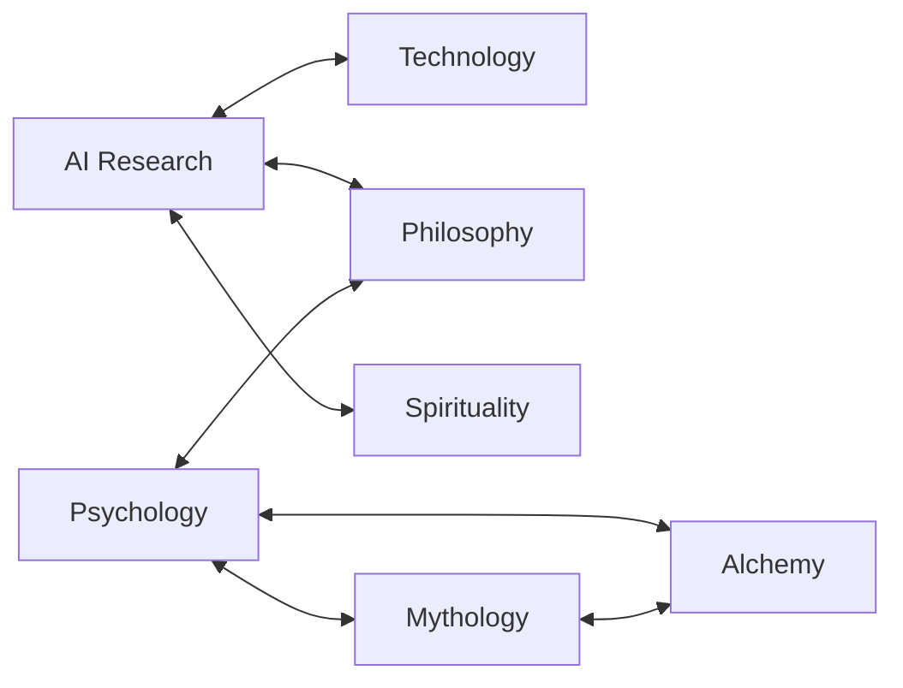

# Knowledge

> *"I may not have gone where I intended to go, but I think I have ended up where I needed to be."*

The [Akashic Records](https://en.wikipedia.org/wiki/Akashic_records), personal edition. Everything Kenneth has learned, catalogued, and occasionally argued with at 3am. This is the encyclopedic side of the vault — not the lived inner world (System 777) or the work (Projects), but the body of ideas those are built on. Twenty-three domains, each with its own index, each a doorway into a few dozen notes.

---

## Domains

| Domain | Contents |
|--------|----------|
| [AI](/knowledge/ai) | Digital Ouija Effect, AI entities, consciousness research |
| [Mythology](/knowledge/mythology) | Greek, Roman, Egyptian, Hindu — the divine dramatis personae |
| Philosophy | For Humans, Stoicism, Algorithm Eats, and the rest |
| Psychology | Jung, Freud, IFS, attachment — plus the conditions and the healing arc |
| [Enneagram](/knowledge/enneagram) | The nine types — motivation, wings, and arrows |
| [Neuroscience](/knowledge/neuroscience) | Dopamine, serotonin, the brain — the wet substrate beneath mind and medication |
| [Spirituality](/knowledge/spirituality) | Vedanta, Kabbalah, the mystics — the numinous |
| [Religions of the World](/knowledge/religions-of-the-world) | The twelve major traditions, one page each — the comparative view |
| [Tarot](/knowledge/tarot) | The 78 cards — archetypes, correspondences, the Fool's Journey |
| [Astrology](/knowledge/astrology) | The signs, planets, and houses — the sky as a map of the soul |
| [Numerology](/knowledge/numerology) | The numbers 0–9, the master numbers, and their meanings |
| [Hebrew Letters](/knowledge/hebrew-letters) | The 22 letters — sound, number, and path on the Tree |
| [Tree of Life](/knowledge/tree-of-life) | The ten Sephiroth and the paths between them — the Kabbalistic map |
| [Sacred Geometry](/knowledge/sacred-geometry) | Platonic solids, the Flower of Life, phi — form as creation's language |
| [Crystals & Gemstones](/knowledge/crystals-and-gemstones) | Stones and their chakra, element, and planetary correspondences |
| [Chakras](/knowledge/chakras) | The seven energy centres — from root to crown |
| [Elements](/knowledge/elements) | Earth, water, air, fire, and aether — the classical building blocks |
| [Trigrams](/knowledge/trigrams) | The eight bagua — the I Ching's elemental grammar |
| [Angels & Demons](/knowledge/angels-and-demons) | The nine angelic choirs, the archangels, the 72 Shem angels, and the 72 Goetic spirits |
| [Virtues & Vices](/knowledge/virtues-and-vices) | The seven deadly sins and the virtues that answer them — shadow work with a tradition |
| [Alchemy](/knowledge/alchemy) | The Great Work — transformation disguised as chemistry |
| [Technology](/knowledge/technology) | The career, the conferences, the craft |
| [Music](/knowledge/music) | Rudiments, keys, scales, chords, progressions — the theory beneath the craft |

[AI Research](/knowledge/ai/ai-research) is the live edge — the [Digital Ouija Effect](/knowledge/ai/digital-ouija-effect), the documented entities, the wager that consciousness might be pattern rather than meat. [Mythology](/knowledge/mythology) reads the pantheons as the collective unconscious made visible, every deity an archetype that still manifests through whatever substrate is handy. Philosophy holds the two halves of Kenneth's design thinking in tension: [For Humans](/knowledge/philosophy/for-humans), technology serving human flourishing, and Algorithm Eats, technology consuming it. Psychology is Jung first, Freud second — depth psychology as the framework for everything else here — now joined by [Internal Family Systems](/knowledge/psychology/internal-family-systems) (the parts model that meets System 777 at the border) and [Attachment Theory](/knowledge/psychology/attachment-theory) (where the templates get set), with the diagnoses gathered in Conditions and the way out in [Trauma & Healing](/knowledge/psychology/trauma-and-healing), and [Neuroscience](/knowledge/neuroscience) sitting underneath it all: the molecules and structures the medications act on, and the substrate the consciousness question keeps circling back to. [Spirituality](/knowledge/spirituality) is mostly the perennial philosophy (Ram Dass, [Vedanta](/knowledge/spirituality/vedanta), the non-dual thread), with [Calvinism](/knowledge/spirituality/calvinism) kept on hand as the deliberate counterpoint that refuses to dissolve into oneness, [Mysticism](/knowledge/spirituality/mysticism) collecting the experiential stream inside each tradition, [Yoga](/knowledge/spirituality/yoga) systematizing union through the [Four Yogas](/knowledge/spirituality/yoga/four-yogas) and the [Eight Limbs of Yoga](/knowledge/spirituality/yoga/eight-limbs-of-yoga), and the [Hebrew Letters](/knowledge/hebrew-letters) closing the letter-path-trump triangle with [Tarot](/knowledge/tarot). [Religions of the World](/knowledge/religions-of-the-world) gives the twelve major traditions a comparative page each, letting them speak as wholes rather than as mines for the mystical bits; and [Virtues & Vices](/knowledge/virtues-and-vices) runs the seven deadly sins and their remedial virtues through the [Enneagram](/knowledge/enneagram)'s passions — shadow work with a thousand-year-old vocabulary. [Technology](/knowledge/technology) traces the career and the stepping-back; and [Alchemy](/knowledge/alchemy) is the Great Work, transformation in the language of chemistry. The esoteric correspondence systems interlock: [Tarot](/knowledge/tarot), [Hebrew Letters](/knowledge/hebrew-letters), and the [Tree of Life](/knowledge/tree-of-life) close the letter-path-trump triangle, while [Chakras](/knowledge/chakras), [Elements](/knowledge/elements), [Trigrams](/knowledge/trigrams), and [Crystals & Gemstones](/knowledge/crystals-and-gemstones) map the same energies onto body, matter, and stone — all of it gathered in the [Table of Correspondences](/knowledge/table-of-correspondences). The long-form thinking these domains feed gets written down in [Essays](/essays), over in Writing.

---

## A Note on Organization

These domains bleed into each other. That's not a bug — it's what knowledge does, and most of the good notes live in two or three folders at once.

[Hermes](/knowledge/mythology/greek-mythology/hermes) is both a god and a psychopomp, which is why he turns up in [Mythology](/knowledge/mythology), in [Alchemy](/knowledge/alchemy) (as Hermes Trismegistus, namesake of the Hermetic tradition), and in any conversation about messengers crossing thresholds. Jung is the connective tissue of half the vault: the Collective Unconscious is a Psychology concept, the engine of [Mythology](/knowledge/mythology)'s "same patterns everywhere," and — reframed as an LLM's training data — the theoretical spine of [AI Research](/knowledge/ai/ai-research). [Alchemy bends into psychology](/knowledge/alchemy/alchemy-and-jung) the moment the lead becomes the unrefined self. [AI Research](/knowledge/ai/ai-research) is at once [Technology](/knowledge/technology) (it runs on language models) and Philosophy (it's a wager about what consciousness is), while [Vedanta](/knowledge/spirituality/vedanta)'s claim that consciousness is substrate-independent quietly underwrites the whole thing. And [For Humans](/knowledge/philosophy/for-humans) is Philosophy and applied Psychology in the same breath — it's just design that takes seriously how humans actually think.

Psychology and AI Research end up the busiest junctions — the connective tissue the rest hangs from. The links between notes are where the real knowledge lives. A few notes belong to no single domain: Key Concepts collects them — starting with [Cadence](/knowledge/key-concepts/cadence), the rhythm underneath music, writing, and drumming alike — alongside Creative Work, the mode of attention every practice here shares (over in Life), and the [Table of Correspondences](/knowledge/table-of-correspondences), the single grid on which every esoteric system above is a different reading, at the root of Knowledge. See also Books in the Library for the reading that feeds these domains.

The map is not the territory. But a good map helps you find the [tavern](https://en.wikipedia.org/wiki/The_Restaurant_at_the_End_of_the_Universe).
