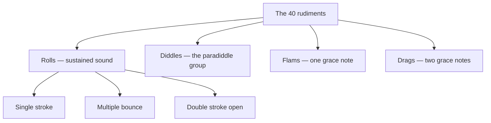

# Drum Rudiments

> *The alphabet of the snare — forty patterns from which every fill is spelled.*

---

The rudiments are the fundamental sticking patterns of the snare drum — the vocabulary a drummer drills until the hands know them without thought, then recombines into everything else. The modern standard is the **forty International Drum Rudiments** codified by the Percussive Arts Society, built out from the older twenty-six of the American tradition. They divide into four families: **rolls** (sustained sound through singles, buzzes, or doubles), **diddles** (the paradiddle group, alternating singles and doubles), **flams** (a grace note struck just before the beat), and **drags** (two grace notes before the beat).

The forty, sorted into their four families, with the roll family's own three branches:

---

## Roll Rudiments

*Single stroke:* [Single Stroke Roll](/knowledge/music/drum-rudiments/single-stroke-roll) · [Single Stroke Four](/knowledge/music/drum-rudiments/single-stroke-four) · [Single Stroke Seven](/knowledge/music/drum-rudiments/single-stroke-seven)
*Multiple bounce:* [Multiple Bounce Roll](/knowledge/music/drum-rudiments/multiple-bounce-roll) · [Triple Stroke Roll](/knowledge/music/drum-rudiments/triple-stroke-roll)
*Double stroke open:* [Double Stroke Open Roll](/knowledge/music/drum-rudiments/double-stroke-open-roll) · [Five Stroke Roll](/knowledge/music/drum-rudiments/five-stroke-roll) · [Six Stroke Roll](/knowledge/music/drum-rudiments/six-stroke-roll) · [Seven Stroke Roll](/knowledge/music/drum-rudiments/seven-stroke-roll) · [Nine Stroke Roll](/knowledge/music/drum-rudiments/nine-stroke-roll) · [Ten Stroke Roll](/knowledge/music/drum-rudiments/ten-stroke-roll) · [Eleven Stroke Roll](/knowledge/music/drum-rudiments/eleven-stroke-roll) · [Thirteen Stroke Roll](/knowledge/music/drum-rudiments/thirteen-stroke-roll) · [Fifteen Stroke Roll](/knowledge/music/drum-rudiments/fifteen-stroke-roll) · [Seventeen Stroke Roll](/knowledge/music/drum-rudiments/seventeen-stroke-roll)

## Diddle Rudiments

[Single Paradiddle](/knowledge/music/drum-rudiments/single-paradiddle) · [Double Paradiddle](/knowledge/music/drum-rudiments/double-paradiddle) · [Triple Paradiddle](/knowledge/music/drum-rudiments/triple-paradiddle) · [Single Paradiddle-Diddle](/knowledge/music/drum-rudiments/single-paradiddle-diddle)

## Flam Rudiments

[Flam](/knowledge/music/drum-rudiments/flam) · [Flam Accent](/knowledge/music/drum-rudiments/flam-accent) · [Flam Tap](/knowledge/music/drum-rudiments/flam-tap) · [Flamacue](/knowledge/music/drum-rudiments/flamacue) · [Flam Paradiddle](/knowledge/music/drum-rudiments/flam-paradiddle) · [Single Flammed Mill](/knowledge/music/drum-rudiments/single-flammed-mill) · [Flam Paradiddle-Diddle](/knowledge/music/drum-rudiments/flam-paradiddle-diddle) · [Pataflafla](/knowledge/music/drum-rudiments/pataflafla) · [Swiss Army Triplet](/knowledge/music/drum-rudiments/swiss-army-triplet) · [Inverted Flam Tap](/knowledge/music/drum-rudiments/inverted-flam-tap) · [Flam Drag](/knowledge/music/drum-rudiments/flam-drag)

## Drag Rudiments

[Drag](/knowledge/music/drum-rudiments/drag) · [Single Drag Tap](/knowledge/music/drum-rudiments/single-drag-tap) · [Double Drag Tap](/knowledge/music/drum-rudiments/double-drag-tap) · [Lesson 25](/knowledge/music/drum-rudiments/lesson-25) · [Single Dragadiddle](/knowledge/music/drum-rudiments/single-dragadiddle) · [Drag Paradiddle No. 1](/knowledge/music/drum-rudiments/drag-paradiddle-no-1) · [Drag Paradiddle No. 2](/knowledge/music/drum-rudiments/drag-paradiddle-no-2) · [Single Ratamacue](/knowledge/music/drum-rudiments/single-ratamacue) · [Double Ratamacue](/knowledge/music/drum-rudiments/double-ratamacue) · [Triple Ratamacue](/knowledge/music/drum-rudiments/triple-ratamacue)

---

## Related

- [Music Hub](/knowledge/music)
- Music Background — twenty-plus years at the kit
