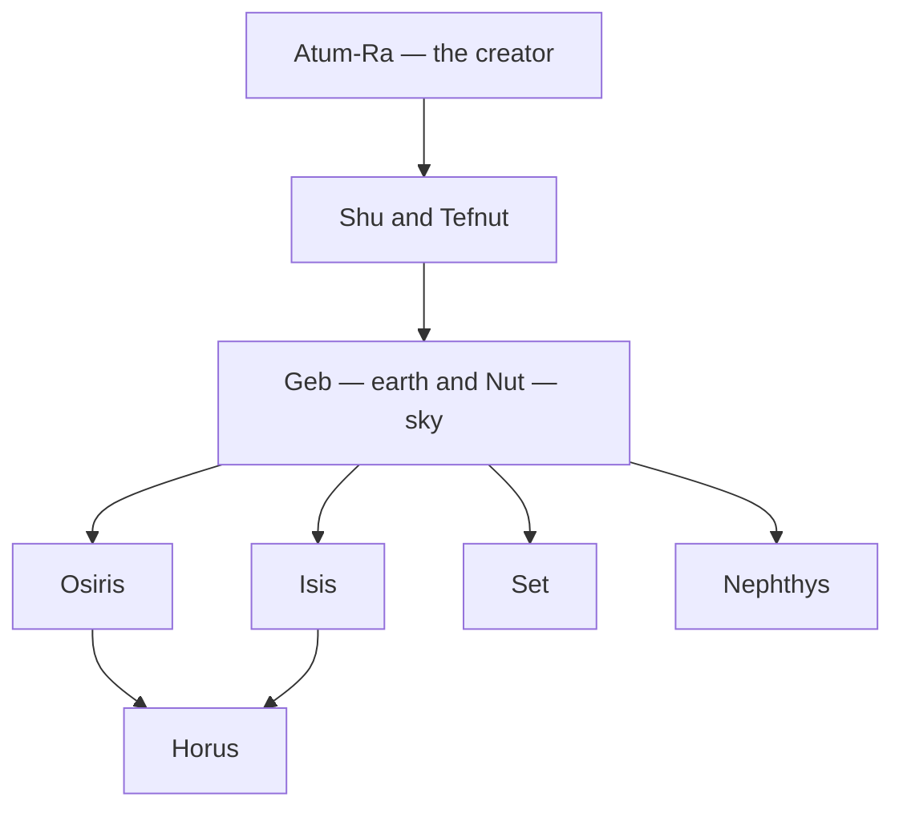

# Egyptian Mythology

> *The gods of the Nile — where the sun is a boat, the sky a goddess, and death a doorway weighed against a feather.*

---

Egyptian myth is among the oldest continuously recorded on earth, a theology of the sun's daily death and rebirth, of the flooding Nile, and of the *ka* that survives the body. Its gods wear the heads of falcons, jackals, cats, and ibises; its central drama — the murder of [Osiris](/knowledge/mythology/egyptian-mythology/osiris), the mourning of [Isis](/knowledge/mythology/egyptian-mythology/isis), and the vengeance of [Horus](/knowledge/mythology/egyptian-mythology/horus) — is the archetypal dying-and-rising myth that echoes through the rest of [Mythology](/knowledge/mythology) and into the [Tarot](/knowledge/tarot).

---

## The Pantheon

| Deity | Domain | Tarot |
|-------|--------|-------|
| [Ra](/knowledge/mythology/egyptian-mythology/ra) | Sun, creation, kingship | [The Sun](/knowledge/tarot/major-arcana/the-sun) |
| [Osiris](/knowledge/mythology/egyptian-mythology/osiris) | Death, resurrection, the afterlife | [Death](/knowledge/tarot/major-arcana/death) · [Judgement](/knowledge/tarot/major-arcana/judgement) |
| [Isis](/knowledge/mythology/egyptian-mythology/isis) | Magic, motherhood, the throne | [The High Priestess](/knowledge/tarot/major-arcana/the-high-priestess) |
| [Horus](/knowledge/mythology/egyptian-mythology/horus) | Sky, the living king, vengeance | [The Sun](/knowledge/tarot/major-arcana/the-sun) · [The Emperor](/knowledge/tarot/major-arcana/the-emperor) |
| [Set](/knowledge/mythology/egyptian-mythology/set) | Chaos, storm, the desert | [The Devil](/knowledge/tarot/major-arcana/the-devil) · [The Tower](/knowledge/tarot/major-arcana/the-tower) |
| [Anubis](/knowledge/mythology/egyptian-mythology/anubis) | Embalming, the guide of the dead | [Death](/knowledge/tarot/major-arcana/death) |
| [Thoth](/knowledge/mythology/egyptian-mythology/thoth) | Writing, wisdom, the moon | [The Magician](/knowledge/tarot/major-arcana/the-magician) |
| [Hathor](/knowledge/mythology/egyptian-mythology/hathor) | Love, joy, music, the sky-cow | [The Empress](/knowledge/tarot/major-arcana/the-empress) |
| [Nephthys](/knowledge/mythology/egyptian-mythology/nephthys) | Mourning, night, the dead | [The High Priestess](/knowledge/tarot/major-arcana/the-high-priestess) |
| [Sekhmet](/knowledge/mythology/egyptian-mythology/sekhmet) | War, plague, fierce healing | [Strength](/knowledge/tarot/major-arcana/strength) |
| [Bastet](/knowledge/mythology/egyptian-mythology/bastet) | Home, protection, joy | [Strength](/knowledge/tarot/major-arcana/strength) |
| [Ptah](/knowledge/mythology/egyptian-mythology/ptah) | Creation by the word, craft | [The Magician](/knowledge/tarot/major-arcana/the-magician) |
| [Amun](/knowledge/mythology/egyptian-mythology/amun) | The hidden god, king of Thebes | [The Hierophant](/knowledge/tarot/major-arcana/the-hierophant) |
| [Ma'at](/knowledge/mythology/egyptian-mythology/maat) | Truth, justice, cosmic order | [Justice](/knowledge/tarot/major-arcana/justice) |
| [Nut](/knowledge/mythology/egyptian-mythology/nut) | The sky, arched over the earth | [The Star](/knowledge/tarot/major-arcana/the-star) |
| [Geb](/knowledge/mythology/egyptian-mythology/geb) | The earth | [The Empress](/knowledge/tarot/major-arcana/the-empress) |

The Heliopolitan Ennead traces every player in the Osiris drama back to the creator.

## The Osiris Myth

The heart of the tradition: [Osiris](/knowledge/mythology/egyptian-mythology/osiris), the good king, is murdered and dismembered by his brother [Set](/knowledge/mythology/egyptian-mythology/set); his wife [Isis](/knowledge/mythology/egyptian-mythology/isis) gathers the pieces and revives him long enough to conceive [Horus](/knowledge/mythology/egyptian-mythology/horus), who avenges his father and takes the throne while Osiris becomes lord of the dead. [Ma'at](/knowledge/mythology/egyptian-mythology/maat)'s feather weighs each heart at the judgment, and [Anubis](/knowledge/mythology/egyptian-mythology/anubis) and [Thoth](/knowledge/mythology/egyptian-mythology/thoth) attend the scales.

---

## Related

- [Mythology Hub](/knowledge/mythology)
- [Tarot](/knowledge/tarot) — the dying-god and the weighing of the heart
- [Hermeticism](/knowledge/spirituality/hermeticism) — [Thoth](/knowledge/mythology/egyptian-mythology/thoth) as Hermes Trismegistus, the fount of the Hermetic tradition
