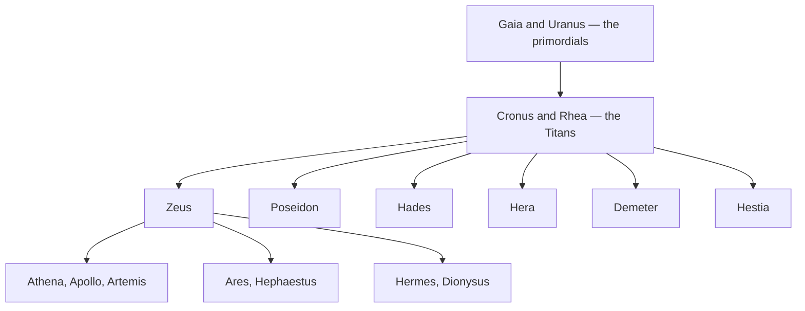

# Greek Mythology

> *Gods, heroes, and legends of ancient Greece*

---

## The Olympian Pantheon

| Deity | Domain | Symbol |
|-------|--------|--------|
| [Zeus](/knowledge/mythology/greek-mythology/zeus) | King of gods, sky, thunder | Thunderbolt, eagle |
| [Hera](/knowledge/mythology/greek-mythology/hera) | Queen of gods, marriage | Peacock, cow |
| [Poseidon](/knowledge/mythology/greek-mythology/poseidon) | Sea, earthquakes | Trident, horse |
| [Athena](/knowledge/mythology/greek-mythology/athena) | Wisdom, warfare, crafts | Owl, olive tree |
| [Apollo](/knowledge/mythology/greek-mythology/apollo) | Sun, music, prophecy | Lyre, laurel |
| [Artemis](/knowledge/mythology/greek-mythology/artemis) | Hunt, moon, wilderness | Bow, deer |
| [Ares](/knowledge/mythology/greek-mythology/ares) | War | Spear, helmet |
| [Aphrodite](/knowledge/mythology/greek-mythology/aphrodite) | Love, beauty | Dove, rose |
| [Hephaestus](/knowledge/mythology/greek-mythology/hephaestus) | Fire, forge, crafts | Hammer, anvil |
| [Hermes](/knowledge/mythology/greek-mythology/hermes) | Messenger, travel, commerce | Winged sandals, caduceus |
| [Dionysus](/knowledge/mythology/greek-mythology/dionysus) | Wine, ecstasy, theater | Grapevine, thyrsus |
| [Demeter](/knowledge/mythology/greek-mythology/demeter) | Agriculture, harvest | Wheat, cornucopia |
| [Hestia](/knowledge/mythology/greek-mythology/hestia) | Hearth, home, sacred fire | Hearth, eternal flame |

## Chthonic Deities

The powers of the underworld and the earth's depths: **Persephone** — Kore the maiden, who becomes Queen of the Underworld — and **[Hades](/knowledge/mythology/greek-mythology/hades)**, her consort, lord of the dead. They govern death, rebirth, and what lies beneath. The witch-goddess **[Hecate](/knowledge/mythology/greek-mythology/hecate)** keeps the crossroads and the dark of the moon between the worlds.

## Primordial Deities

The oldest forces: Chaos, **[Gaia](/knowledge/mythology/greek-mythology/gaia)** (Earth), **[Uranus](/knowledge/mythology/greek-mythology/uranus)** (Sky), Tartarus, and **[Eros](/knowledge/mythology/greek-mythology/eros)** (desire). These existed before the Titans and Olympians, forming the foundation of the Greek cosmogony. The wild itself has its god in **[Pan](/knowledge/mythology/greek-mythology/pan)**, goat-legged lord of shepherds, panic, and the untamed places.

## Titans

The generation between primordials and Olympians, the twelve children of [Gaia](/knowledge/mythology/greek-mythology/gaia) and [Uranus](/knowledge/mythology/greek-mythology/uranus). Youngest and boldest was **[Cronus](/knowledge/mythology/greek-mythology/cronus)**, who unseated his father and ruled the golden age with his sister-wife **[Rhea](/knowledge/mythology/greek-mythology/rhea)** until their own son overthrew him. The eldest, **[Oceanus](/knowledge/mythology/greek-mythology/oceanus)**, is the world-encircling river, husband of **[Tethys](/knowledge/mythology/greek-mythology/tethys)**, the two of them the parents of every stream and spring. Four brothers held the pillars of the sky at its quarters: **[Hyperion](/knowledge/mythology/greek-mythology/hyperion)**, the light of heaven, who with his sister **[Theia](/knowledge/mythology/greek-mythology/theia)** fathered the luminaries **[Helios](/knowledge/mythology/greek-mythology/helios)** (the Sun), **[Selene](/knowledge/mythology/greek-mythology/selene)** (the Moon), and the dawn; **[Coeus](/knowledge/mythology/greek-mythology/coeus)**, the inquiring intellect and the northern axis, whose union with **[Phoebe](/knowledge/mythology/greek-mythology/phoebe)**, the bright Titaness of the Delphic oracle, produced **[Leto](/knowledge/mythology/greek-mythology/leto)**; **[Crius](/knowledge/mythology/greek-mythology/crius)**, the measure of the constellations; and **[Iapetus](/knowledge/mythology/greek-mythology/iapetus)**, the Titan of mortality, father of the fire-bringer **[Prometheus](/knowledge/mythology/greek-mythology/prometheus)**, who stole flame for humanity, and of **[Atlas](/knowledge/mythology/greek-mythology/atlas)**, condemned to bear the sky. Among the Titanesses stand **[Themis](/knowledge/mythology/greek-mythology/themis)**, the voice of divine law and order, and **[Mnemosyne](/knowledge/mythology/greek-mythology/mnemosyne)**, memory itself, the mother of the Muses. The Titans were overthrown by Zeus and the Olympians in the Titanomachy — the succession the Olympian order is built on.

The succession from the primordial powers through the Titans to the Olympians forms a three-generation family tree.

## Lesser Divinities & Messengers

Beyond the great houses run the messengers and personifications: **[Iris](/knowledge/mythology/greek-mythology/iris)**, goddess of the rainbow and the older herald of the gods, who carries the divine word between sky, earth, and the underworld river Styx before [Hermes](/knowledge/mythology/greek-mythology/hermes) took the wider Olympian role. Alongside her stand the powers that give a face to the abstract forces of life. **[Nike](/knowledge/mythology/greek-mythology/nike)** is winged victory, the swift spirit who alights on the winning side and attends the throne of [Zeus](/knowledge/mythology/greek-mythology/zeus) and the hand of [Athena](/knowledge/mythology/greek-mythology/athena); **[Tyche](/knowledge/mythology/greek-mythology/tyche)** is her counterweight, the goddess of fortune and chance whose rudder and turning wheel steer outcomes no virtue can secure — the tutelary luck of whole cities. The line of Night personifies the day's edges: the twin brothers **[Hypnos](/knowledge/mythology/greek-mythology/hypnos)** and **[Thanatos](/knowledge/mythology/greek-mythology/thanatos)**, sleep and gentle death, born together and near-indistinguishable, one who releases and one who leads down to [Hades](/knowledge/mythology/greek-mythology/hades); **[Morpheus](/knowledge/mythology/greek-mythology/morpheus)**, son of Hypnos, the shaper of the human figures that walk through dreams; and at the other end of the dark, **[Eos](/knowledge/mythology/greek-mythology/eos)**, the rosy-fingered dawn, sister of [Helios](/knowledge/mythology/greek-mythology/helios) and [Selene](/knowledge/mythology/greek-mythology/selene) and the daily promise that the night has an end.

---

## Heroes & Mortals

The great heroes of Greek myth: Heracles (Hercules), Perseus, Theseus, Odysseus, Achilles, and Jason. Each embodies a different facet of human excellence tested against divine forces.

---

## Major Epic Cycles

The Iliad, the Odyssey, and the Argonautica form the backbone of Greek literary mythology.

---

## Monsters & Creatures

Medusa, the Minotaur, the Hydra, Cerberus, the Chimera, and the Sphinx -- adversaries that give the heroes their defining trials.

---

## Related

- [Roman Mythology](/knowledge/mythology/roman-mythology) - Roman adaptations
- Jungian Archetypes
