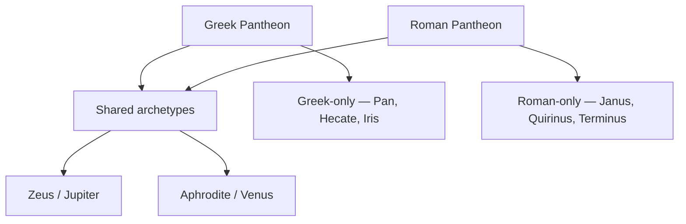

# Greek-Roman Equivalents

> *Quick reference chart for corresponding deities across pantheons*

---

## Major Olympian Deities

| Greek Name | Roman Name | Domain | Notes |
| ---------- | ---------- | ------ | ----- |
| [Zeus](/knowledge/mythology/greek-mythology/zeus) | [Jupiter](/knowledge/mythology/roman-mythology/jupiter) | King of gods, sky, thunder | Romans emphasized Jupiter's role as state protector |
| [Hera](/knowledge/mythology/greek-mythology/hera) | [Juno](/knowledge/mythology/roman-mythology/juno) | Queen of gods, marriage | Similar roles, both jealous wives |
| [Poseidon](/knowledge/mythology/greek-mythology/poseidon) | [Neptune](/knowledge/mythology/roman-mythology/neptune) | Sea, earthquakes, horses | Romans focused more on sea aspect |
| [Athena](/knowledge/mythology/greek-mythology/athena) | [Minerva](/knowledge/mythology/roman-mythology/minerva) | Wisdom, warfare, crafts | Similar attributes in both cultures |
| [Apollo](/knowledge/mythology/greek-mythology/apollo) | [Apollo](/knowledge/mythology/greek-mythology/apollo) | Sun, music, prophecy, healing | Same name in both pantheons |
| [Artemis](/knowledge/mythology/greek-mythology/artemis) | [Diana](/knowledge/mythology/roman-mythology/diana) | Hunt, moon, wilderness | Romans emphasized moon aspect more |
| [Ares](/knowledge/mythology/greek-mythology/ares) | [Mars](/knowledge/mythology/roman-mythology/mars) | War | Mars was far more honored; also agricultural god |
| [Aphrodite](/knowledge/mythology/greek-mythology/aphrodite) | [Venus](/knowledge/mythology/roman-mythology/venus) | Love, beauty, desire | Venus also associated with gardens |
| [Hephaestus](/knowledge/mythology/greek-mythology/hephaestus) | [Vulcan](/knowledge/mythology/roman-mythology/vulcan) | Fire, forge, metalworking | Similar roles in both cultures |
| [Hermes](/knowledge/mythology/greek-mythology/hermes) | [Mercury](/knowledge/mythology/roman-mythology/mercury) | Messenger, travel, commerce | Romans emphasized commercial aspect |
| [Dionysus](/knowledge/mythology/greek-mythology/dionysus) | [Bacchus](/knowledge/mythology/roman-mythology/bacchus) | Wine, ecstasy, theater | Similar wild, ecstatic nature |
| [Demeter](/knowledge/mythology/greek-mythology/demeter) | [Ceres](/knowledge/mythology/roman-mythology/ceres) | Agriculture, harvest, grain | Ceres gave us the word "cereal" |

---

## Other Important Deities

| Greek Name | Roman Name | Domain | Notes |
|------------|------------|--------|-------|
| [Hades](/knowledge/mythology/greek-mythology/hades) | [Pluto](/knowledge/mythology/roman-mythology/pluto) | Underworld, death | Romans less fearful of underworld deity |
| Persephone | [Proserpina](/knowledge/mythology/roman-mythology/proserpina) | Queen of underworld, spring | Similar abduction myth |
| [Hestia](/knowledge/mythology/greek-mythology/hestia) | [Vesta](/knowledge/mythology/roman-mythology/vesta) | Hearth, home | Vesta had unique Roman cult (Vestals) |
| [Kronos](/knowledge/mythology/greek-mythology/cronus) | [Saturn](/knowledge/mythology/roman-mythology/saturn) | Time, agriculture | Saturn's festival: Saturnalia |
| [Gaia](/knowledge/mythology/greek-mythology/gaia) | Terra | Earth | Terra Mater (Mother Earth) |
| [Uranus](/knowledge/mythology/greek-mythology/uranus) | Caelus | Sky | Less prominent in Roman mythology |
| [Eros](/knowledge/mythology/greek-mythology/eros) | [Cupid](/knowledge/mythology/roman-mythology/cupid) (Amor) | Love, desire | Cupid more childlike in Roman art |
| [Nike](/knowledge/mythology/greek-mythology/nike) | [Victoria](/knowledge/mythology/roman-mythology/victoria) | Victory | Victoria important in Roman state cult |
| [Tyche](/knowledge/mythology/greek-mythology/tyche) | [Fortuna](/knowledge/mythology/roman-mythology/fortuna) | Fortune, luck | Fortuna very popular in Rome |
| [Hypnos](/knowledge/mythology/greek-mythology/hypnos) | [Somnus](/knowledge/mythology/greek-mythology/hypnos) | Sleep | Similar personifications |
| [Thanatos](/knowledge/mythology/greek-mythology/thanatos) | [Mors](/knowledge/mythology/greek-mythology/thanatos) | Death | Similar personifications |

---

## Uniquely Roman Deities

These gods had no Greek equivalent:

| Roman Name | Domain | Notes |
|------------|--------|-------|
| [Janus](/knowledge/mythology/roman-mythology/janus) | Beginnings, transitions, doorways | Two-faced god, uniquely Roman |
| [Quirinus](/knowledge/mythology/roman-mythology/quirinus) | Deified Romulus, Roman state | Part of Capitoline Triad originally |
| [Bellona](/knowledge/mythology/roman-mythology/bellona) | War (especially bloodlust) | War goddess, companion of Mars |
| [Terminus](/knowledge/mythology/roman-mythology/terminus) | Boundaries, markers | God of boundary stones |
| Robigus | Grain rust, blight | Agricultural protection deity |
| [Pomona](/knowledge/mythology/roman-mythology/pomona) | Fruit trees, orchards | Garden goddess |
| Cardea | Hinges, door pivots | Domestic deity |

---

## Uniquely Greek Deities

These gods had no Roman equivalent or were much less significant in Rome:

| Greek Name | Domain | Notes |
|------------|--------|-------|
| [Pan](/knowledge/mythology/greek-mythology/pan) | Nature, shepherds, flocks | [Faunus](/knowledge/mythology/roman-mythology/faunus) was similar but distinct |
| [Hecate](/knowledge/mythology/greek-mythology/hecate) | Magic, crossroads, moon | Adopted but remained Greek in character |
| [Iris](/knowledge/mythology/greek-mythology/iris) | Rainbow, messenger | Less prominent in Rome |
| [Morpheus](/knowledge/mythology/greek-mythology/morpheus) | Dreams | Part of Hypnos/Somnus domain |

---

## Key Differences

Greek gods are more human-like, flawed, emotional, and embedded in personal stories. Roman gods are more abstract, civic, and focused on state religion and duty. Greek names tend to be descriptive of attributes or domains; Roman names derive from Latin roots, some adopted from Etruscan religion. Greek worship was personal, mythological, and theatrical. Roman worship was state-focused, contractual, and practical.

The two pantheons overlap on a shared core of archetypes while each keeps deities the other lacks.

---

## Related

- [Greek Mythology Index](/knowledge/mythology/greek-mythology)
- [Roman Mythology Index](/knowledge/mythology/roman-mythology)
- [Mythology Hub](/knowledge/mythology)
