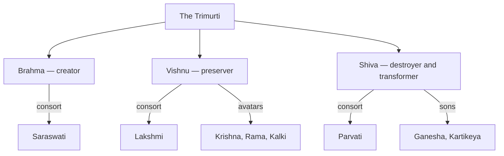

# Hindu Mythology

> *The Trimurti, major deities, and the vast Hindu pantheon*

---

## The Trimurti (Triple Deity)

The three primary aspects of the divine in Hinduism:

| Deity | Role | Consort | Symbol |
|-------|------|---------|--------|
| [Brahma](/knowledge/mythology/hindu-mythology/brahma) | Creator | Saraswati | Lotus, four faces |
| Vishnu | Preserver | Lakshmi | Conch, lotus, discus, mace |
| Shiva | Destroyer/Transformer | Parvati | Trident, third eye, crescent moon |

The three aspects of the divine, with their consorts, Vishnu's avatars, and Shiva's family, map the core of the pantheon.

---

## Major Deities

### Vishnu & Avatars

[Vishnu](/knowledge/mythology/hindu-mythology/vishnu) the Preserver descends to earth in ten avatars when dharma is threatened. The most significant: [Krishna](/knowledge/mythology/hindu-mythology/krishna) (8th avatar, hero of the Mahabharata, teacher of the Bhagavad Gita), Rama (7th avatar, hero of the Ramayana), Buddha (9th, in some traditions), and Kalki (10th, yet to come).

### Shiva & Family

[Shiva](/knowledge/mythology/hindu-mythology/shiva) the Destroyer/Transformer, with his consort Parvati (Divine Mother), son [Ganesha](/knowledge/mythology/hindu-mythology/ganesha) (remover of obstacles), and son Kartikeya/Murugan (god of war).

### Devi (Divine Feminine)

[Parvati](/knowledge/mythology/hindu-mythology/parvati) (the gentle Divine Mother, consort of Shiva), [Durga](/knowledge/mythology/hindu-mythology/durga) (warrior goddess), [Kali](/knowledge/mythology/hindu-mythology/kali) (goddess of time and destruction), [Lakshmi](/knowledge/mythology/hindu-mythology/lakshmi) (goddess of wealth and prosperity), and [Saraswati](/knowledge/mythology/hindu-mythology/saraswati) (goddess of knowledge and arts).

---

## Other Important Deities

[Hanuman](/knowledge/mythology/hindu-mythology/hanuman) (monkey god, devotee of Rama), [Indra](/knowledge/mythology/hindu-mythology/indra) (king of gods, god of rain and thunder), Agni (fire god), Surya (sun god), Yama (god of death), and Varuna (god of water and oceans).

---

## Concepts & Philosophy

**Dharma**: Cosmic law and order, duty and righteousness. **Karma**: Action and consequence, the cycle of cause and effect. **Maya**: Illusion, the material world as veil over ultimate reality. **Moksha**: Liberation from the cycle of rebirth, the ultimate spiritual goal.

---

## Sacred Texts

The four Vedas (Rigveda, Samaveda, Yajurveda, Atharvaveda) form the oldest layer. The great epics -- the Mahabharata (containing the Bhagavad Gita) and the Ramayana -- provide narrative theology. The Puranas tell stories of gods and creation.

---

## Related

- [Mythology Hub](/knowledge/mythology)
- Jungian Archetypes
