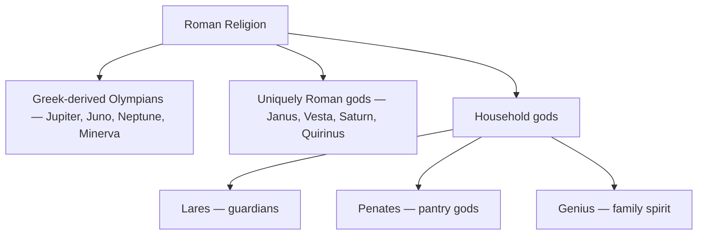

# Roman Mythology

> *Gods, legends, and religious practices of ancient Rome*

---

## The Roman Pantheon

### Major Deities (with Greek equivalents)

| Roman Name | Greek Equivalent | Domain | Symbol |
|------------|------------------|--------|--------|
| [Jupiter](/knowledge/mythology/roman-mythology/jupiter) | [Zeus](/knowledge/mythology/greek-mythology/zeus) | King of gods, sky | Thunderbolt, eagle |
| [Juno](/knowledge/mythology/roman-mythology/juno) | [Hera](/knowledge/mythology/greek-mythology/hera) | Queen of gods, marriage | Peacock |
| [Neptune](/knowledge/mythology/roman-mythology/neptune) | [Poseidon](/knowledge/mythology/greek-mythology/poseidon) | Sea | Trident |
| [Minerva](/knowledge/mythology/roman-mythology/minerva) | [Athena](/knowledge/mythology/greek-mythology/athena) | Wisdom, warfare | Owl |
| Apollo | [Apollo](/knowledge/mythology/greek-mythology/apollo) | Sun, prophecy | Lyre |
| [Diana](/knowledge/mythology/roman-mythology/diana) | [Artemis](/knowledge/mythology/greek-mythology/artemis) | Hunt, moon | Bow |
| [Mars](/knowledge/mythology/roman-mythology/mars) | [Ares](/knowledge/mythology/greek-mythology/ares) | War | Spear |
| [Venus](/knowledge/mythology/roman-mythology/venus) | [Aphrodite](/knowledge/mythology/greek-mythology/aphrodite) | Love, beauty | Dove |
| [Vulcan](/knowledge/mythology/roman-mythology/vulcan) | [Hephaestus](/knowledge/mythology/greek-mythology/hephaestus) | Fire, forge | Hammer |
| [Mercury](/knowledge/mythology/roman-mythology/mercury) | [Hermes](/knowledge/mythology/greek-mythology/hermes) | Messenger, commerce | Caduceus |
| [Bacchus](/knowledge/mythology/roman-mythology/bacchus) | [Dionysus](/knowledge/mythology/greek-mythology/dionysus) | Wine | Grapevine |
| [Ceres](/knowledge/mythology/roman-mythology/ceres) | [Demeter](/knowledge/mythology/greek-mythology/demeter) | Agriculture | Wheat |

### Uniquely Roman Deities

- [Janus](/knowledge/mythology/roman-mythology/janus) - Beginnings, transitions, doorways
- [Vesta](/knowledge/mythology/roman-mythology/vesta) - Hearth, home
- [Saturn](/knowledge/mythology/roman-mythology/saturn) - Agriculture, time, the lost Golden Age
- [Fortuna](/knowledge/mythology/roman-mythology/fortuna) - Fortune, chance, the turning wheel
- [Pluto](/knowledge/mythology/roman-mythology/pluto) - The underworld and its buried wealth (Greek [Hades](/knowledge/mythology/greek-mythology/hades))
- [Proserpina](/knowledge/mythology/roman-mythology/proserpina) - Queen of the underworld, the seed of spring (Greek Persephone)
- [Cupid](/knowledge/mythology/roman-mythology/cupid) - Desire and love (Greek [Eros](/knowledge/mythology/greek-mythology/eros))
- [Veritas](/knowledge/mythology/roman-mythology/veritas) - Truth personified, daughter of Saturn (Greek Aletheia)
- [Quirinus](/knowledge/mythology/roman-mythology/quirinus) - The deified Romulus, the citizen-body at peace; of the Archaic Triad
- [Faunus](/knowledge/mythology/roman-mythology/faunus) - The wild, forests, and herds; prophetic woodland voice (Greek [Pan](/knowledge/mythology/greek-mythology/pan))
- [Pomona](/knowledge/mythology/roman-mythology/pomona) - Fruit trees and orchards, the pruning-knife
- [Bellona](/knowledge/mythology/roman-mythology/bellona) - War and martial frenzy, companion of [Mars](/knowledge/mythology/roman-mythology/mars)
- [Terminus](/knowledge/mythology/roman-mythology/terminus) - Boundary stones and property markers, the fixity of borders
- [Victoria](/knowledge/mythology/roman-mythology/victoria) - Victory and triumph (Greek [Nike](/knowledge/mythology/greek-mythology/nike))

---

## Household Gods

Roman domestic religion centered on three types of household spirits: the Lares (household guardians), the Penates (pantry gods), and the Genius (family spirit).

Roman religion sorted its gods into three broad groups.

## Roman Myths & Legends

The founding myths of Rome -- Romulus and Remus, Aeneas and the Aeneid -- anchor Roman mythology in the city's own origin story, blending Greek mythic tradition with distinctly Roman civic values.

---

## Related

- [Greek Mythology](/knowledge/mythology/greek-mythology) - Greek origins
- Jungian Archetypes
