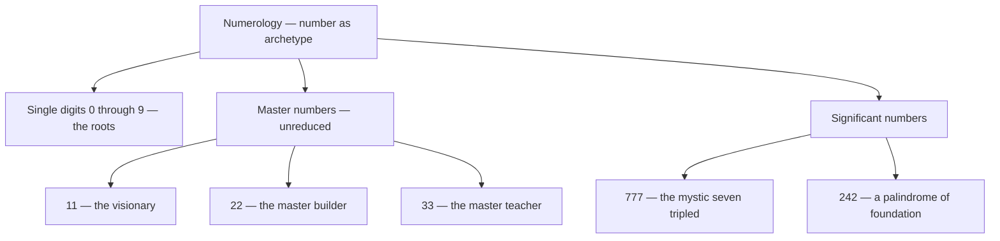

# Numerology

> *Everything counts — the universe spelled in single digits.*

---

Numerology treats number as the hidden skeleton of meaning — the idea, older than Pythagoras, that the digits one through nine are not just quantities but qualities, archetypes as real as any god or tarot trump. Every name and birth date reduces, by adding and re-adding its digits, to a single root number whose character colours the whole. The system rhymes with the rest of the vault: each number mirrors a card of the [Major Arcana](/knowledge/tarot/major-arcana), a sphere of the [Tree of Life](/knowledge/tree-of-life), and a planet of [Astrology](/knowledge/astrology).

The figures sort into three families — the root digits, the unreduced master numbers, and a few numbers of special weight:

---

## The Numbers

| # | Number | Keywords | Tarot |
|---|--------|----------|-------|
| 0 | [Number 0](/knowledge/numerology/number-0) | Potential, the void, wholeness | [The Fool](/knowledge/tarot/major-arcana/the-fool) |
| 1 | [Number 1](/knowledge/numerology/number-1) | Unity, initiative, leadership | [The Magician](/knowledge/tarot/major-arcana/the-magician) |
| 2 | [Number 2](/knowledge/numerology/number-2) | Duality, balance, receptivity | [The High Priestess](/knowledge/tarot/major-arcana/the-high-priestess) |
| 3 | [Number 3](/knowledge/numerology/number-3) | Creativity, expression, joy | [The Empress](/knowledge/tarot/major-arcana/the-empress) |
| 4 | [Number 4](/knowledge/numerology/number-4) | Structure, stability, work | [The Emperor](/knowledge/tarot/major-arcana/the-emperor) |
| 5 | [Number 5](/knowledge/numerology/number-5) | Change, freedom, the senses | [The Hierophant](/knowledge/tarot/major-arcana/the-hierophant) |
| 6 | [Number 6](/knowledge/numerology/number-6) | Harmony, love, responsibility | [The Lovers](/knowledge/tarot/major-arcana/the-lovers) |
| 7 | [Number 7](/knowledge/numerology/number-7) | Introspection, mysticism, the seeker | [The Chariot](/knowledge/tarot/major-arcana/the-chariot) |
| 8 | [Number 8](/knowledge/numerology/number-8) | Power, abundance, karma | [Strength](/knowledge/tarot/major-arcana/strength) |
| 9 | [Number 9](/knowledge/numerology/number-9) | Completion, compassion, wisdom | [The Hermit](/knowledge/tarot/major-arcana/the-hermit) |

## The Master Numbers

The doubled digits are not reduced — they carry a higher, more demanding charge: [Master Number 11](/knowledge/numerology/master-number-11) (the visionary), [Master Number 22](/knowledge/numerology/master-number-22) (the master builder), and [Master Number 33](/knowledge/numerology/master-number-33) (the master teacher).

## Significant Numbers

Numbers that carry particular weight here: [Number 777](/knowledge/numerology/number-777) — the mystic seven tripled, the name of System 777 and the title of Crowley's Liber 777 — and [Number 242](/knowledge/numerology/number-242), a palindrome of foundation framed by partnership.

---

## Related

- [Tarot](/knowledge/tarot) — each number is a trump of the Major Arcana
- [Tree of Life](/knowledge/tree-of-life) — the ten Sephiroth are the numbers one through ten
- [Astrology](/knowledge/astrology) — each digit answers to a planet
- [Knowledge Hub](/knowledge)
