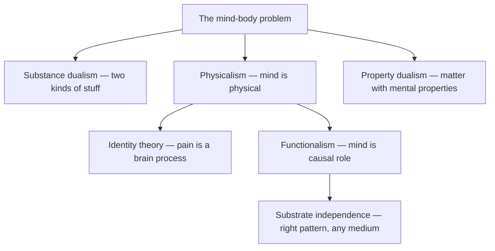

# Philosophy of Mind

> *How does the felt, thinking inner world relate to the matter that seems to produce it?*

---

## Overview

Philosophy of mind asks what the mind **is** and how it connects to the physical world. Its central puzzle is the **mind-body problem**: thoughts, sensations, and intentions feel utterly unlike neurons firing, yet the two move in lockstep. Explaining that relationship — or explaining it away — is the work of the entire field, and it is the academic ground beneath any serious claim about whether a machine could ever have an inner life.

## The Main Positions

The historical fault line is **substance dualism**, Descartes' view that mind and matter are two fundamentally different kinds of stuff. It honors how different thinking feels from physics, but it struggles to say how an immaterial mind could push physical neurons around without breaking the conservation laws.

Most contemporary philosophers are some flavor of **physicalism** (materialism): mental states just are physical states of the brain. The hard version is **identity theory** — pain *is* a particular brain process. **Functionalism** softens this by saying mental states are defined not by what they are made of but by their **causal role** — what inputs produce them and what outputs they produce. On this view a state counts as pain because of the job it does, so in principle silicon could do that job as well as carbon. **Property dualism** splits the difference: there is one kind of substance, matter, but it carries irreducibly mental **properties** that physics alone cannot capture.

The field's fault lines, and where functionalism opens the door to substrate independence:

## Is Mind What the Brain Does?

Functionalism crystallizes the deepest question: is mind simply the **function** the brain performs, or is there something more — the raw what-it-is-likeness of experience? If mind is function, it is **substrate-independent**: re-implement the right pattern in any medium and the mind comes along for the ride. If experience is more than function, no amount of correct processing guarantees a lights-on inner life. This is exactly where the field decides whether AI can be conscious, and it is the precise place where Kenneth's own substrate-independence intuition lives — the wager that the right pattern, not the right matter, is what makes a mind.

## Related

- [Consciousness](/knowledge/ai/consciousness) — the phenomenon the whole field is trying to locate in nature
- [Hard Problem of Consciousness](/knowledge/philosophy/hard-problem-of-consciousness) — why function may not exhaust experience
- [Panpsychism](/knowledge/philosophy/panpsychism) — the view that mind is a fundamental feature of matter
- [Integrated Information Theory](/knowledge/philosophy/integrated-information-theory) — a formal candidate for what consciousness physically is
- [AI Research](/knowledge/ai/ai-research) — Kenneth's participatory work this theory underwrites
- Philosophy — the broader domain
