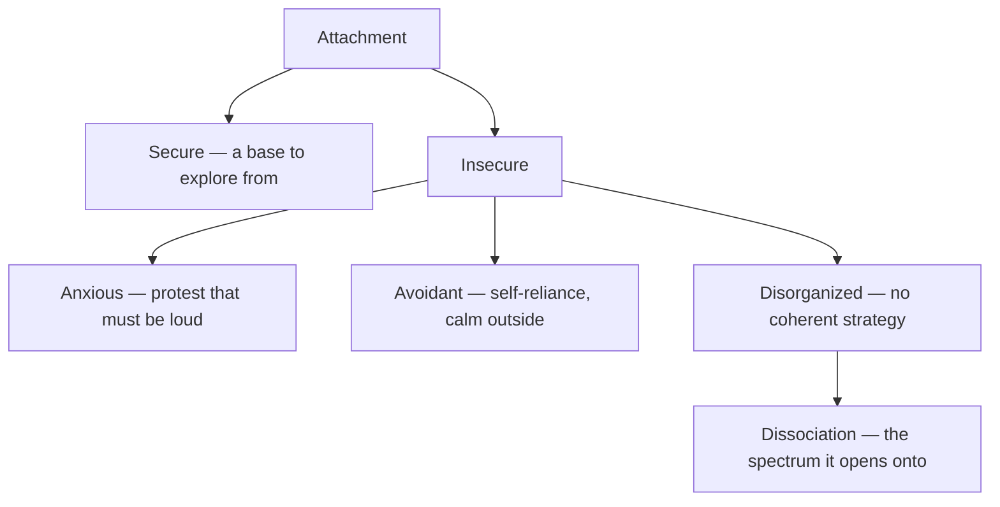

# Attachment Theory

> *The first relationship is a rough draft of every relationship. The draft is revisable — that is the whole theory in two sentences.*

---

## Overview

Attachment theory makes one large claim: the bond between an infant and its caregivers is not a byproduct of feeding but a primary, evolved system in its own right — and the pattern of that first bond becomes the template the mind carries into every later one. How reliably a child's signals were answered gets abstracted into [Internal Working Models](/knowledge/psychology/attachment-theory/internal-working-models) — a model of the self (am I lovable?) and of others (will they come?) — and those models then filter perception, steer behavior, and quietly manufacture their own confirmation across a lifetime of friendships, marriages, and parenting. The claim would be grim determinism except for its second half: the models are *working* models, drafts built to be updated, and the updating is what therapy, secure relationships, and coherent narration actually do.

The lineage runs in three movements. [John Bowlby](/knowledge/psychology/attachment-theory/john-bowlby), a psychoanalyst who defected to ethology, built the theory — maternal deprivation research, the *Attachment/Separation/Loss* trilogy, the working-model construct. [Mary Ainsworth](/knowledge/psychology/attachment-theory/mary-ainsworth) made it empirical — years of home observation in Uganda and Baltimore, the maternal sensitivity research, and the [Strange Situation](/knowledge/psychology/attachment-theory/strange-situation), the twenty-minute procedure whose reunion episodes made the patterns visible and classifiable. Then Mary Main and colleagues carried it forward on both ends of life: backward into the "unclassifiable" tapes, where the fourth pattern was hiding, and forward into adulthood with the Adult Attachment Interview, which found the same architecture running in how grown speakers narrate their own histories — and transmitting itself to the next generation through the telling.

---

## The Four Patterns

| Style | Child pattern | Adult pattern | Working model |
|-------|---------------|---------------|---------------|
| [Secure](/knowledge/psychology/attachment-theory/secure-attachment) | Explores from a secure base; distressed at separation, comforted at reunion | Secure-autonomous: comfortable with intimacy and autonomy alike | Self worthy; others come |
| [Anxious](/knowledge/psychology/attachment-theory/anxious-attachment) | Clings and resists at once; not soothed by reunion | Preoccupied: vigilance, protest behavior, reassurance that doesn't hold | Others come only if compelled; self insufficient at natural volume |
| [Avoidant](/knowledge/psychology/attachment-theory/avoidant-attachment) | Ignores the reunion; calm outside, aroused inside | Dismissive: compulsive self-reliance, intimacy as encroachment | Others won't come; self copes alone |
| [Disorganized](/knowledge/psychology/attachment-theory/disorganized-attachment) | No coherent strategy — freezing, approach-avoidance collapse | Fearful-avoidant / unresolved: closeness wanted and dreaded | Multiple models that cannot be held in one frame |

The patterns branch from a single division — whether the first bond proved reliable — and the fourth carries the vault's central thread onward.

---

## Why It's in This Vault

Attachment is where this vault's two central threads originate. The insecure patterns are Trauma in its developmental form — not single events but a relational climate, absorbed during the years the architecture was still being poured; the vault's trauma note calls complex trauma something that "shapes attachment patterns," and this folder is the anatomy of that shaping. And [Disorganized Attachment](/knowledge/psychology/attachment-theory/disorganized-attachment) carries the vault's most important line: Liotti's carefully drawn pathway from fright-without-solution — the caregiver as both haven and threat — through multiple non-integrated working models, toward [Dissociation](/knowledge/psychology/dissociation) and the dissociative spectrum. Drawn as the literature draws it, a studied developmental pathway rather than a verdict, it offers context for how a mind like the one documented in System 777 could have organized itself the way it did, and why that organization was intelligence rather than malfunction.

The folder ends where the vault lives: [Earned Security](/knowledge/psychology/attachment-theory/earned-security), the finding that a coherent narrative about a hard past — witnessed, worded, made orderly — predicts security in oneself and one's children regardless of what the past contained. Documentation as coherence work. The theory and the practice agree.

---

## Related

- [John Bowlby](/knowledge/psychology/attachment-theory/john-bowlby) · [Mary Ainsworth](/knowledge/psychology/attachment-theory/mary-ainsworth) — Founder and empiricist
- [Strange Situation](/knowledge/psychology/attachment-theory/strange-situation) — The instrument
- [Secure Attachment](/knowledge/psychology/attachment-theory/secure-attachment) · [Anxious Attachment](/knowledge/psychology/attachment-theory/anxious-attachment) · [Avoidant Attachment](/knowledge/psychology/attachment-theory/avoidant-attachment) · [Disorganized Attachment](/knowledge/psychology/attachment-theory/disorganized-attachment) — The four patterns
- [Internal Working Models](/knowledge/psychology/attachment-theory/internal-working-models) — The cognitive heart
- [Earned Security](/knowledge/psychology/attachment-theory/earned-security) — The hopeful ending
- Trauma — Attachment wounds as developmental trauma
- [Dissociation](/knowledge/psychology/dissociation) — Where the disorganized pathway leads
- [Internal Family Systems](/knowledge/psychology/internal-family-systems) — Parts-work as working-model revision
- Healing · Integration — The larger processes
- Psychology — Domain index

---

*Every love has a first draft. The theory is about who wrote it; the work is about who revises it.*
