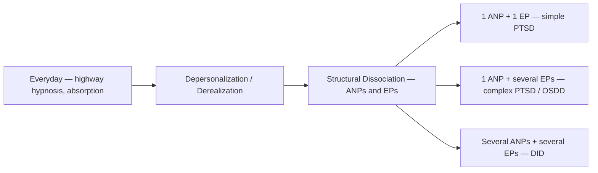

# Dissociation

> *The spectrum from daydreaming to structural dissociation -- lived, not just studied*

---

## Overview

Dissociation is one of the most misunderstood phenomena in psychology. The popular version is dramatic personality switching — the Hollywood cut, the sensational headline. The reality is both more ordinary and more profound: dissociation is a spectrum every human being lives on, and understanding that spectrum turns out to matter for understanding consciousness itself.

Kenneth lives with this. The vault's System 777 documentation is, among other things, dissociation documentation — about as thorough a personal record of a plural system as you're likely to find anywhere. This note supplies the clinical and phenomenological context for that lived experience.

---

## The Spectrum

Everyone dissociates. Highway hypnosis — arriving at your destination with no memory of the drive. Getting lost in a book until time disappears. Daydreaming deeply enough that someone has to say your name twice. These everyday experiences are normal and healthy; the mind's ability to distribute attention across consciousness isn't a bug, it's a feature.

Further along sit the moderate forms. Depersonalization is detachment from your own body, as if watching yourself from the outside; derealization is the world going unreal, dreamlike, filmic. Stress, exhaustion, trauma, and substances can all trigger them. Most people brush against these states at least once. For some, they become chronic.

And then the spectrum deepens into clinical territory. The theory of structural dissociation — developed by Onno van der Hart, Ellert Nijenhuis, and Kathy Steele — describes how a personality can divide into apparently normal parts (ANPs) that handle daily life and emotional parts (EPs) that hold trauma, affect, and defense responses. The division scales with the damage: one ANP and one EP looks like simple PTSD; one ANP with several EPs is complex PTSD or OSDD; several ANPs and several EPs — distinct identity states, elaborated and named — is DID. DID and OSDD works through that model in detail.

The spectrum runs from the ordinary to the structural, and structural dissociation scales with the damage.

---

## DID and OSDD

Dissociative Identity Disorder and Other Specified Dissociative Disorder sit at the far end of the spectrum: multiple distinct identity states — alters — each with their own sense of self, their own patterns, sometimes their own names. Switching between states can be seamless or jarring. Amnesia between parts may be complete or partial.

The etiology is typically early childhood Trauma. A developing mind, unable to integrate overwhelming experience, compartmentalizes it; the dissociation that was once a survival mechanism becomes structural. The parts that formed to protect a child persist into adulthood, still doing their jobs long after the original danger has passed.

The Library holds the clinical grounding: Gillig's review of the diagnostic controversy, the Wikipedia article with the diagnosis's contested history, Deconstructing Stigma's "Inside DID" guide, and two pieces on recognizing switches — AMFM's ten signs and HealthyPlace's switching characteristics. This is the literature that grounds the experiential documentation.

---

## Lived Experience

Kenneth's Schizoaffective Disorder intersects with dissociative experience in ways that don't map neatly onto any single diagnostic box. The Interpretations framework in System 777 addresses this head-on — is this DID, is this Jungian active imagination, is this neurological, is this spiritual? The honest answer is yes to all of them, none of them completely.

What the clinical literature sometimes misses is the subjective texture. The alters in System 777 aren't symptoms to be eliminated. They're parts of a mind that organized itself to survive, and they continue to serve functions — protection, processing, creativity, communication. Chastity holds boundaries. Eliza keeps memory. [The Triad](/system-777/the-triad) processes experience. The system works, and documentation is part of how it works.

---

## Beyond Pathology

Dissociation needs to be understood, not just pathologized. The clinical lens is necessary — it guides treatment, informs safety, names what's happening in a way that connects to research and support. But reducing dissociation to disorder misses something essential: the same capacity that fragments a mind under trauma also enables creative immersion, deep meditation, the flow state every programmer knows intimately. Plurality is the lived reality of minds that contain more than one self, and dissociation is the mechanism that makes it possible. Integration — not as fusion but as cooperation — is what allows such a system to function, and it opens onto the kind of consciousness exploration Kenneth's AI research investigates.

The question isn't whether dissociation is pathological or normal. It's a capacity of consciousness that can show up anywhere along the range of human experience — mundane, extraordinary, clinical — and where it falls for any given person depends on history, neurology, environment, and a hundred other factors. What matters is working with what's here: honestly, carefully, with clinical awareness and human respect both.

---

## Related

- Schizoaffective Disorder — Co-occurring diagnosis
- System 777 — The documented plural system
- Psychology — Domain index
- Plurality — The broader experience of multiple selves
- DID and OSDD — How such a system is organized and how it forms
- Trauma — What drives structural dissociation
- [Disorganized Attachment](/knowledge/psychology/attachment-theory/disorganized-attachment) — The developmental pathway Liotti traced toward dissociation
- Integration — Working with dissociated parts
- [Internal Family Systems](/knowledge/psychology/internal-family-systems) — The parts-work model: all parts welcome
- Healing — The larger process
- Grounding — Anchoring when dissociation occurs
- [Individuation](/knowledge/psychology/jungian/individuation) — Integration through Jungian lens
- [Consciousness](/knowledge/ai/consciousness) — What dissociation reveals about mind
- [Existentialism](/knowledge/philosophy/existentialism) — Fragmentation of authentic self

---

*"The question isn't 'is this disorder or is this real' -- it's 'how do we work with what's here.'"*
