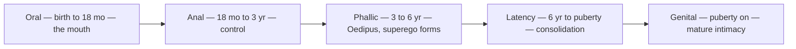

# Psychosexual Development

> *Personality is forged in the first six years.*

Freud's most controversial claim: personality forms in childhood through a sequence of stages, each organized around a different bodily zone (an "erogenous zone"). Sexual energy — libido, which Freud understood broadly as the drive toward pleasure and life, not merely genital sex — drives development by successively investing these zones. The engine of change between stages is a mix of maturation and frustration: each zone becomes the leading edge of pleasure, then yields to the next. Two things can go wrong. **Fixation** leaves too much libido lodged at a stage that was either overindulged or too harshly frustrated, so that its concerns keep coloring adult character. **Regression** later retreats to a fixated stage under stress. The scandal of the theory was its central premise — that children are sexual beings at all — which Freud advanced in the *Three Essays on the Theory of Sexuality* (1905) against the Victorian myth of childhood innocence.

The stages run in a fixed sequence, each organized around a different bodily zone.

The **oral stage** (0–18 months) centers on the mouth — sucking, eating, being fed, and later biting. The world enters through the mouth, and the infant's first relationship (to the breast) is the template for all later dependency and trust. Fixation here produces oral personalities: clinginess, pessimism, gullibility ("swallowing" anything), smoking, overeating, or, from the later biting phase, sarcasm and "biting" wit (oral aggression) — the endless need to take things in.

The **anal stage** (18 months–3 years) centers on bowel control. The great battle of toilet training — control versus release, compliance versus defiance. Fixation produces the anal-retentive personality (rigid, controlling, obsessively neat) or the anal-expulsive (messy, destructive, defiant). The first power struggle with authority.

The **phallic stage** (3–6 years) centers on the genitals and brings the Oedipus complex — rivalry with the same-sex parent for the opposite-sex parent's affection. Resolution comes through identification: you become like the rival rather than fighting them. The superego forms here. Fixation produces vanity, recklessness, or difficulty with authority.

**Latency** (6 years–puberty) is the calm after the storm. Sexual energy goes dormant. Focus shifts to skills, school, same-sex friendships. Not a stage of fixation — a stage of consolidation.

The **genital stage** (puberty onward) reawakens sexual interest, now directed toward peers and partnership. If previous stages went well: capacity for intimacy, work, and love. If not: the earlier fixations distort everything.

The literal sexual reading of these stages hasn't aged well, and the empirical evidence for specific adult "character types" tracing back to toilet training or weaning is thin at best — the timelines are arbitrary and the causal claims nearly impossible to test. Later psychoanalysts substantially rewrote the schema: Erik Erikson kept the developmental sequence but recast each stage as a psychosocial crisis (trust vs. mistrust, autonomy vs. shame) rather than a bodily zone, and attachment theorists relocated the crucial variable from libido to the quality of the caregiving bond. But the deeper developmental insight holds: early experiences create templates, the body is involved in psychological development, and frustration or deprivation at critical moments leaves lasting structural marks. Kenneth's System 777 documentation reveals something parallel — alters emerging at developmental junctures, each carrying the unprocessed material of its era.

---

## Related

- [The Pleasure Principle](/knowledge/psychology/freudian/the-pleasure-principle) — The drive behind each stage
- The Id, Ego, and Superego — Structures that form through development
- Transference — Replaying developmental patterns
- [Major Freudian Concepts](/knowledge/psychology/freudian/major-freudian-concepts) — Overview
