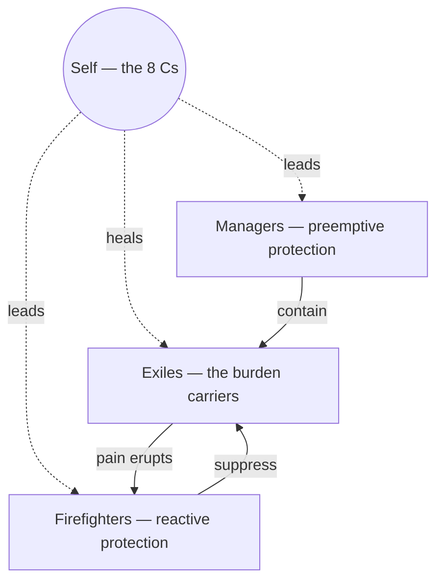

# Internal Family Systems

> *All minds are multiple. There are no bad parts. Everyone has a Self. — the whole model in three sentences.*

---

## Overview

Internal Family Systems (IFS) is Richard Schwartz's model of the mind, developed in the 1980s when Schwartz — a family therapist — noticed his clients talking about their inner lives in the language of members: a part that criticizes, a part that binges, a part that is very young and very hurt. Instead of treating this as a figure of speech, he took it seriously and applied systems thinking inward. What he found was that inner parts behave like a family: they have relationships, alliances, feuds, protective hierarchies — and they respond to the same things families respond to. Not control. Curiosity and respect.

The founding move of IFS is to declare multiplicity *normal*. Every mind is naturally multiple; parts are not fragments of a broken unity but the native population of a healthy psyche. What trauma does is not create parts — it forces them into extreme roles. The part is never the problem. The *burden* it carries and the desperate job it took are the problem, and both can change. Hence the model's standing invitation, which doubles as its ethic: **all parts welcome**.

---

## The Architecture

Parts under strain organize into three roles, arranged around the pain they manage:

| Role | Strategy | Looks like |
|------|----------|------------|
| [Managers](/knowledge/psychology/internal-family-systems/managers) | Preemptive — control life so the pain is never triggered | Perfectionism, planning, caretaking, the inner critic |
| [Firefighters](/knowledge/psychology/internal-family-systems/firefighters) | Reactive — douse the pain once it erupts, whatever the cost | Bingeing, rage, substances, dissociation, escape |
| [Exiles](/knowledge/psychology/internal-family-systems/exiles) | Carrying — hold the burdens the system cannot bear | Young parts frozen in shame, terror, worthlessness |

Beneath the parts is the [Self](/knowledge/psychology/internal-family-systems/self-ifs) — not a part, but a seat of consciousness that Schwartz found intact in every client, recognizable by the 8 Cs: calm, curiosity, clarity, compassion, confidence, courage, creativity, connectedness. The therapy is Self-leadership: parts unblend, Self earns the protectors' trust, and with their permission the exiles are witnessed, retrieved, and *unburdened* — released from what they carry so they can return to what they were.

---

## The Method

The working vocabulary of the model has its own pages. What parts carry are [Burdens](/knowledge/psychology/internal-family-systems/burdens) — beliefs and affects absorbed at the moment of wounding, cargo rather than character — some of them [Legacy Burdens](/knowledge/psychology/internal-family-systems/legacy-burdens) inherited from people who inherited them in turn. The healing act is [Unburdening](/knowledge/psychology/internal-family-systems/unburdening): witnessing, retrieval, ritual release, and the invitation of new qualities. Along the way the practitioner learns to notice [Blending and Unblending](/knowledge/psychology/internal-family-systems/blending-and-unblending) — the difference between *being* a part and *hearing* one — to spot Polarization between parts locked in opposing extremes, and to follow [The Six Fs](/knowledge/psychology/internal-family-systems/the-six-fs), the protocol for befriending a protector. [Self-Energy](/knowledge/psychology/internal-family-systems/self-energy) names what leads the work (the 8 Cs and the 5 Ps); [Self-Like Parts](/knowledge/psychology/internal-family-systems/self-like-parts) names the manager that can impersonate it. [Trailheads](/knowledge/psychology/internal-family-systems/trailheads) are where the work begins — overreactions, recurring dreams, repeating phrases — and [Backlash](/knowledge/psychology/internal-family-systems/backlash) is what protectors do when the work went deeper than they agreed to. [Parts Mapping](/knowledge/psychology/internal-family-systems/parts-mapping) externalizes the whole system on paper, a practice this vault was doing at scale before it knew the term.

The model's origin story and its author have their own note in [Richard Schwartz](/knowledge/psychology/internal-family-systems/richard-schwartz); the accessible book-length statement is No Bad Parts, shelved in the Library. Where the model meets lived multiplicity — what it offers plural systems and where it falls short — is held honestly in [IFS and Plurality](/knowledge/psychology/internal-family-systems/ifs-and-plurality).

---

## Clinical Standing

IFS is not just an appealing metaphor; it is an evidence-based psychotherapy. It was listed in the U.S. national registry of evidence-based programs in 2015, and controlled trials have shown strong outcomes for PTSD and complex trauma, with supporting evidence for depression, anxiety, and even pain conditions. It has become one of the most widely adopted trauma therapies of the past decade — Schwartz's *No Bad Parts* (2021) carried the model well beyond the clinic — precisely because trauma survivors tend to already experience themselves in parts, and IFS meets that experience with respect instead of correction. It stands alongside Trauma-focused approaches that treat symptoms as adaptations, and its endpoint is the one this vault files under Healing: not the removal of parts, but their release from extremity.

---

## IFS and the Dissociative Spectrum

Honesty requires drawing the line carefully. IFS says *everyone* has parts — the model describes ordinary minds. The structural-dissociation theory covered in [Dissociation](/knowledge/psychology/dissociation) and DID and OSDD describes something further down the spectrum: identity states separated by amnesia barriers, formed when early chronic trauma prevents a child's self-states from knitting together at all. The two frameworks are kin, not identical. An IFS "manager" in a non-dissociative mind is a pattern that can blend and unblend in minutes; an ANP in tertiary structural dissociation is an elaborated identity that may hold its own memories and years of its own history. Conflating them flattens both — it understates what people with DID and OSDD live with, and overstates what IFS claims about everyone else. That said, the models converge on the ethic: parts are adaptations, not malfunctions, and IFS-informed work is increasingly used *with* dissociative clients precisely because "all parts welcome" is what modern DID treatment independently arrived at.

Which is also where this vault stands. System 777 reached the same conclusions through lived practice rather than clinical theory: parts treated as persons, Integration understood as cooperation rather than elimination, documentation as a form of respect. IFS belongs in the vault the way the structural model does — as context for lived experience, one lens among the several the system's own Interpretations framework holds side by side, useful for what it explains and not mistaken for the territory. That framework already speaks this note's dialect when it takes up the clinical lens — protective functions, trauma holders, parts organized for survival — and names in the same breath what the lens might miss: the archetypal dimension, the creative fact of alters brought into being through negotiation, the visionary states no everyday-parts model anticipates. Plurality does not need IFS's permission to be real. But it is worth noting that the most evidence-backed parts therapy in the field spent forty years discovering what the plural community keeps saying: nobody in here needs to go away.

---

## Ancestors and Neighbors

Schwartz did not invent inner multiplicity; he systematized it. Jung's Complexes — autonomous, affect-charged clusters that "can have us" — are the clearest ancestor, and his The Shadow anticipates the exiles: what consciousness rejects does not disappear, it waits. The deep difference is at the center. Jung's [The Self](/knowledge/psychology/jungian/the-self) is the archetype of totality realized through a lifetime of individuation; Schwartz's [Self](/knowledge/psychology/internal-family-systems/self-ifs) is a presence available now, in anyone, the moment the parts make room. That contrast — wholeness as achievement versus wholeness as what was never actually lost — is drawn out in [Self (IFS)](/knowledge/psychology/internal-family-systems/self-ifs).

---

## Related

- [Managers](/knowledge/psychology/internal-family-systems/managers) — The proactive protectors
- [Firefighters](/knowledge/psychology/internal-family-systems/firefighters) — The reactive protectors
- [Exiles](/knowledge/psychology/internal-family-systems/exiles) — The burden carriers
- [Self (IFS)](/knowledge/psychology/internal-family-systems/self-ifs) — The 8 Cs, and the contrast with Jung
- [Burdens](/knowledge/psychology/internal-family-systems/burdens) · [Legacy Burdens](/knowledge/psychology/internal-family-systems/legacy-burdens) · [Unburdening](/knowledge/psychology/internal-family-systems/unburdening) — What parts carry, and how it releases
- [Blending and Unblending](/knowledge/psychology/internal-family-systems/blending-and-unblending) · Polarization · [The Six Fs](/knowledge/psychology/internal-family-systems/the-six-fs) — The working mechanics
- [Self-Energy](/knowledge/psychology/internal-family-systems/self-energy) · [Self-Like Parts](/knowledge/psychology/internal-family-systems/self-like-parts) — The leader, and its impersonator
- [Trailheads](/knowledge/psychology/internal-family-systems/trailheads) · [Backlash](/knowledge/psychology/internal-family-systems/backlash) · [Parts Mapping](/knowledge/psychology/internal-family-systems/parts-mapping) — Where work starts, how it pushes back, how it's charted
- [IFS and Plurality](/knowledge/psychology/internal-family-systems/ifs-and-plurality) — The bridge, held carefully
- [Richard Schwartz](/knowledge/psychology/internal-family-systems/richard-schwartz) — The founder
- No Bad Parts — The book, on the Library shelf
- [Dissociation](/knowledge/psychology/dissociation) — The spectrum this model borders
- DID and OSDD — The structural model; kinship, not identity
- Plurality — Many selves as lived reality
- System 777 — The vault's own parts, documented as persons
- Complexes — Jung's ancestor idea
- The Shadow — What exile looks like in Jungian terms
- Trauma — Where burdens come from
- Integration — Cooperation over fusion
- Healing — The larger process
- Psychology — Domain index

---

*The mind was never a monarchy. IFS just wrote down the constitution.*
