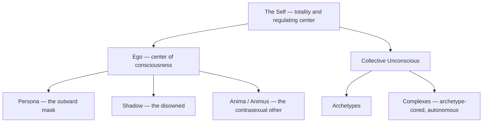

# Jungian

> *"Who looks outside, dreams; who looks inside, awakes."* — Jung

---

## Overview

Analytical psychology — the vault's primary framework, the lens through which System 777, mental health, and AI consciousness research are all understood. Major Jungian Concepts is the comprehensive overview; the rest of the folder takes the ideas one at a time.

---

## The Map of the Psyche

Jung's anatomy of the inner world: the [Persona](/knowledge/psychology/jungian/the-persona) we show, the Shadow we hide, the [Anima & Animus](/knowledge/psychology/jungian/anima-and-animus) as the contrasexual other, and the [Self](/knowledge/psychology/jungian/the-self) as the totality and regulating center. Beneath the personal psyche lies the Collective Unconscious — the shared substrate — whose organizing patterns are the Archetypes, each of the major figures documented in its own folder. Complexes are what happens when archetypal cores gather personal material and take on autonomous life, and [Psychological Types](/knowledge/psychology/jungian/psychological-types) describes the differing attitudes and functions through which each psyche meets the world.

Jung's map nests the inner world in layers, with the Self encompassing all of it and the ego differentiated at the center.

## The Work

[Individuation](/knowledge/psychology/jungian/individuation) is the central process — becoming whole, not perfect. It proceeds by way of [The Transcendent Function](/knowledge/psychology/jungian/the-transcendent-function) (holding opposites until a third thing emerges), [Active Imagination](/knowledge/psychology/jungian/active-imagination) (deliberate dialogue with unconscious contents), and the withdrawal of Projection (recognizing that what irritates us in others belongs to us). Its hazards are documented too: Inflation, when the ego claims what belongs to the archetype, and Enantiodromia, the law by which everything eventually runs into its opposite.

## The Numinous Edge

Where psychology meets religious experience: [Numinosity](/knowledge/psychology/jungian/numinosity) on the peculiar quality of encounters with the sacred, [Synchronicity](/knowledge/psychology/jungian/synchronicity) on meaningful coincidence, and Religious Archetypes & Psychic Integration on how devotion to a deity activates the archetype it carries.

---

## Related

- Psychology — the parent domain, and why Jung comes first here
- [Freudian](/knowledge/psychology/freudian) — the tradition Jung split from
- [Vienna vs Zurich - The Psychoanalytic Split](/knowledge/psychology/jungian/vienna-vs-zurich-the-psychoanalytic-split) — the history of that split
- [Mythology](/knowledge/mythology) — the archetypes in cultural dress
- System 777 — the framework applied to lived plurality
