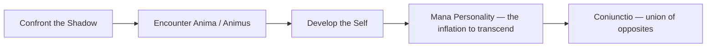

# Individuation

**Jungian Concept**: The process of becoming one's true self - psychological development toward wholeness

---

## Definition

Individuation is the central process in Jungian psychology — the lifelong journey of becoming who you truly are. It is the differentiation of the individual from the collective, the integration of conscious and unconscious, and the realization of the Self. The tarot renders this same arc as the Fool's Journey through the [Major Arcana](/knowledge/tarot/major-arcana) — from [The Fool](/knowledge/tarot/major-arcana/the-fool)'s naive first step to the completed wholeness of [The World](/knowledge/tarot/major-arcana/the-world).

**Jung's Definition**: "Individuation means becoming a single, homogeneous being, and, in so far as 'individuality' embraces our innermost, last, and incomparable uniqueness, it also implies becoming one's own self."

---

## Core Principles

### Becoming Yourself

Individuation is not about becoming perfect or fitting social roles. It's about becoming your unique, authentic self by accepting and integrating all parts of who you are.

### Differentiation

This means separating from collective norms and expectations, from family programming, from persona identifications, and from unconscious identification with any single aspect of psyche.

### Integration

Conscious and unconscious must come into relationship. Ego and Self find their proper balance. Light and shadow are both acknowledged. Masculine and feminine (anima/animus) are reconciled.

### Wholeness, Not Perfection

Individuation means accepting flaws and limitations, integrating rejected parts, embracing paradox, and living your totality rather than an idealized fragment.

---

## The Individuation Process

### First Half of Life (Ego Development)

The tasks are to build a strong ego, develop persona (social identity), achieve in the external world, establish relationships, career, and family, and learn collective values. The focus is adaptation to the outer world — building up, achievement and success, social integration.

This is a necessary phase, not "wrong" or to be skipped. It provides the foundation for later work. Problems arise from staying here permanently.

### Mid-Life Transition

**The Call** comes when outer success feels empty, meaning enters crisis, "is this all there is?" takes hold, and old ways no longer work. **The Crisis** brings identity questioning, depression or anxiety, symbolic death of the old self ([Death](/knowledge/tarot/major-arcana/death) as ego death, not literal end), and confrontation with shadow. **The Opportunity** is to turn inward, begin the second journey, reclaim rejected parts, and seek the authentic self.

### Second Half of Life (Self-Realization)

The tasks shift to integrating unconscious material, reclaiming projections, shadow work, anima/animus work, developing neglected functions, and serving something beyond ego. The focus moves to inner world, depth over achievement, meaning over success, being over doing, service and wisdom.

---

## Stages of Individuation

The classic sequence runs through five stations, each an integration the one before it makes possible.

### 1. Confrontation with the Shadow

The first major step: facing what we've rejected, owning projections, integrating the "dark" side. See: The Shadow

### 2. Encounter with Anima/Animus

Meeting the contrasexual other within, withdrawing romantic projections, developing neglected qualities, bridging conscious and unconscious. See: [Anima & Animus](/knowledge/psychology/jungian/anima-and-animus)

### 3. Development of the Self

Realizing the organizing center, living from your core, ego serving the Self, wholeness and integration. See: [The Self](/knowledge/psychology/jungian/the-self)

### 4. Mana Personality

The temptation to inflate — identifying with the Self, "I am enlightened." This must be recognized and transcended.

### 5. Union of Opposites (Coniunctio)

Integration of all pairs of opposites. Conscious and unconscious united. The transcendent function active. Living paradox.

---

## Signs of Individuation

### Psychological Indicators

Greater self-acceptance, less need for external validation, comfort with paradox, accessing intuition and inner guidance, dreams of wholeness symbols.

### Behavioral Changes

More authentic in relationships, following inner calling over outer expectations, increased creative expression, developing service orientation, less reactive and more responsive.

### Challenges Faced

Loneliness from standing apart from the collective. Misunderstanding from others. No clear external rewards. Requires courage and commitment. Ongoing, never "finished."

---

## Individuation vs. Individualism

Individuation IS becoming your unique self, differentiating from the collective, integrating opposites, serving from an authentic place, and connecting to deeper humanity.

Individualism IS NOT individuation. Ego inflation, narcissism, rejection of all collective values, "I'll do whatever I want," isolation from community, selfishness disguised as growth — none of this is the real work.

---

## Obstacles to Individuation

### External Obstacles

Collective pressure to conform, family expectations, cultural programming, economic demands, and lack of support or understanding.

### Internal Obstacles

Fear of the unconscious, ego resistance to change, attachment to persona, shadow avoidance, and comfort of the familiar.

### The Ultimate Obstacle

Identification of ego with Self — inflation and grandiosity, the "I've arrived" attitude, spiritual bypassing, stopping the process. The journey never ends.

---

## Individuation in Practice

### Daily Practices

Dream journaling and analysis, active imagination, creative expression, shadow work, meditation and contemplation, honest self-reflection.

### Life Choices

Following vocation over just career. Choosing authenticity over approval. Taking the road less traveled. Honoring inner guidance. Making space for inner work.

### Relationships

More authentic connections, less projection, accepting others' individuation, maintaining boundaries and autonomy, depth over breadth.

---

## Individuation and Society

By individuating, you serve the collective. Conscious individuals create conscious society. Less projection means less conflict. Integration heals collective shadow. The cost may include alienating some people, challenging social norms, loneliness, and misunderstanding. The gift is authentic contribution, living example, cultural renewal, and breaking destructive patterns.

---

## Individuation Across Life Stages

In **youth**, the time is for building ego — not yet for deep individuation. Ego must be strong first; this prepares the foundation. At **mid-life**, the classic time for individuation to begin, crisis serves as catalyst and the second half beckons. In **elder years**, the harvest of individuation arrives: sharing wisdom, preparing for death, legacy and meaning.

---

## Individuation and Death

Death is completion. Individuation prepares for death; integration makes death meaningful; living fully makes death acceptable. As Jung said, "Life is a preparation for death." The second half of life is a conscious approach to the end, finding wholeness in facing mortality.

---

## Related Concepts

### Core Jungian Ideas
- [The Self](/knowledge/psychology/jungian/the-self) — Goal of individuation
- The Shadow — Must be integrated
- [Anima & Animus](/knowledge/psychology/jungian/anima-and-animus) — Bridge to unconscious
- [The Persona](/knowledge/psychology/jungian/the-persona) — Must be seen through
- Collective Unconscious — Source we differentiate from
- Overview of All Concepts

### In Practice
- Psychology Hub
- [Spiritual Practice](/knowledge/spirituality)
- System 777 — Plurality and identity

### Connections
- Integration — The mechanism of individuation
- Healing — The broader process
- Trauma — What drives the need for integration
- [Alchemy](/knowledge/alchemy) — Symbolic language of transformation
- Transformation — The direction of individuation
- Archetype Map — Archetypal patterns being integrated
- [Existentialism](/knowledge/philosophy/existentialism) — Becoming authentically yourself

---

## Resources

### Jung's Core Works
- "Two Essays on Analytical Psychology"
- "The Archetypes and the Collective Unconscious"
- "Memories, Dreams, Reflections"
- "The Development of Personality"

### Contemporary Guides
- James Hollis - "The Middle Passage"
- Marion Woodman - "The Pregnant Virgin"
- Robert Johnson - "Inner Work"
