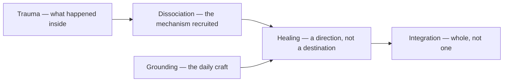

# Trauma & Healing

> *What happened inside you — and the direction out*

---

## Overview

Four notes that belong together because they describe one arc. Trauma is the origin — not the event but what the event did inside, the wound that drives everything from [Dissociation](/knowledge/psychology/dissociation) to the extreme roles parts take on. Healing is the direction rather than the destination; the vault files most of its hope under this word. Integration is what healing means in a plural context — making whole what was divided, where wholeness explicitly does not mean one. And Grounding is the daily craft: staying here when the mind wants to be everywhere else.

The arc runs through everything nearby. The Conditions next door are largely what untreated trauma weathers into; [Internal Family Systems](/knowledge/psychology/internal-family-systems) calls the wound a burden and the healing [Unburdening](/knowledge/psychology/internal-family-systems/unburdening); [Attachment Theory](/knowledge/psychology/attachment-theory) traces where the template was set and [Earned Security](/knowledge/psychology/attachment-theory/earned-security) names how narrating a hard past coherently — this vault's entire method — rewrites it.

The four notes describe one arc, with grounding as the daily practice that sustains it.

---

## Related

- Psychology — Domain index
- Conditions — What the wound weathers into
- [Dissociation](/knowledge/psychology/dissociation) — The mechanism trauma recruits
- Plurality — The context integration serves
- [Internal Family Systems](/knowledge/psychology/internal-family-systems) — Burdens and their release
- [Attachment Theory](/knowledge/psychology/attachment-theory) — Where templates are set, and reset
- System 777 — The lived work
- Healing · Trauma · Integration · Grounding — The four notes themselves

---

*The wound is where the work is.*
