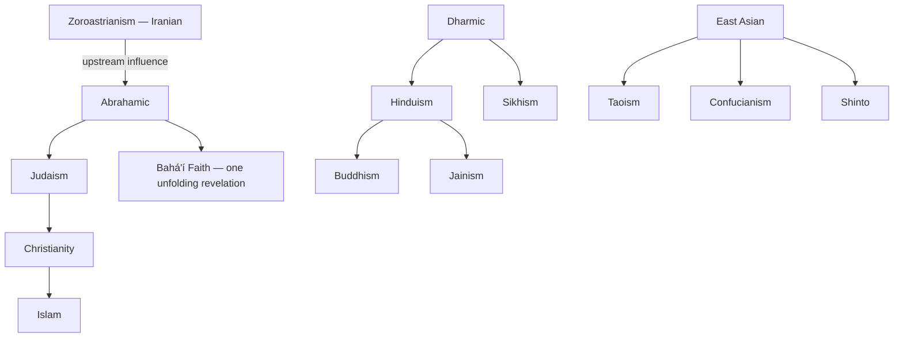

# Religions of the World

> *Twelve ways humanity has answered the same question*

---

## Overview

The world's major religious traditions, one page each — origins, core beliefs, practices, texts, and branches. This folder is the comparative view; the vault's deeper dives live elsewhere and are linked from each page. [Spirituality](/knowledge/spirituality) holds the practices and mystical systems ([Kabbalah](/knowledge/spirituality/kabbalah), [Vedanta](/knowledge/spirituality/vedanta), [Gnosticism](/knowledge/spirituality/gnosticism), [Calvinism](/knowledge/spirituality/calvinism)), [Mythology](/knowledge/mythology) holds the pantheons, and the KJV Study corpus holds the Bible itself. Here the traditions get to speak as wholes.

They fall into three broad families, plus two that resist the grouping. The Abrahamic line runs from [Judaism](/knowledge/religions-of-the-world/judaism) through [Christianity](/knowledge/religions-of-the-world/christianity) to [Islam](/knowledge/religions-of-the-world/islam), one covenant God reinterpreted across three revelations — with [Zoroastrianism](/knowledge/religions-of-the-world/zoroastrianism) standing just upstream, the Persian tradition whose dualism and eschatology left fingerprints on all three. The Dharmic family — [Hinduism](/knowledge/religions-of-the-world/hinduism), [Buddhism](/knowledge/religions-of-the-world/buddhism), [Jainism](/knowledge/religions-of-the-world/jainism), [Sikhism](/knowledge/religions-of-the-world/sikhism) — shares the grammar of [Karma](/knowledge/spirituality/karma), rebirth, and liberation while disagreeing profoundly about the self that is reborn. The East Asian traditions — [Taoism](/knowledge/religions-of-the-world/taoism), [Confucianism](/knowledge/religions-of-the-world/confucianism), [Shinto](/knowledge/religions-of-the-world/shinto) — are less exclusive memberships than complementary orientations, long practiced side by side. And the [Bahá'í Faith](/knowledge/religions-of-the-world/bahai-faith), youngest of the twelve, claims the whole sequence as a single unfolding revelation.

The twelve fall into three broad families, with Zoroastrianism standing upstream of the Abrahamic line and the Bahá'í Faith claiming the whole sequence.

---

## The Twelve

| Tradition | Family | Essence |
|-----------|--------|---------|
| [Judaism](/knowledge/religions-of-the-world/judaism) | Abrahamic | Covenant, Torah, and a people's long conversation with God |
| [Christianity](/knowledge/religions-of-the-world/christianity) | Abrahamic | God incarnate, crucified, and risen — grace over law |
| [Islam](/knowledge/religions-of-the-world/islam) | Abrahamic | Absolute oneness of God, final revelation, life as submission |
| [Zoroastrianism](/knowledge/religions-of-the-world/zoroastrianism) | Iranian | Cosmic struggle of truth and lie; good thoughts, words, deeds |
| [Hinduism](/knowledge/religions-of-the-world/hinduism) | Dharmic | Brahman behind all forms; many paths up the same mountain |
| [Buddhism](/knowledge/religions-of-the-world/buddhism) | Dharmic | Suffering, its cause, its end — no self to save, yet a path |
| [Jainism](/knowledge/religions-of-the-world/jainism) | Dharmic | Radical nonviolence; karma as substance to be burned away |
| [Sikhism](/knowledge/religions-of-the-world/sikhism) | Dharmic | One God beyond Hindu and Muslim; remembrance, work, service |
| [Taoism](/knowledge/religions-of-the-world/taoism) | East Asian | The Way that cannot be named; effortless action, natural balance |
| [Confucianism](/knowledge/religions-of-the-world/confucianism) | East Asian | Virtue through ritual and relationship; the ordered heart |
| [Shinto](/knowledge/religions-of-the-world/shinto) | East Asian | The kami in all things; purity, presence, and place |
| [Bahá'í Faith](/knowledge/religions-of-the-world/bahai-faith) | Universal | Progressive revelation; one human family, one unfolding truth |

---

## Christianity in Depth

The [Christianity](/knowledge/religions-of-the-world/christianity) page above is the comparative overview; two of its branches have their own full collections over in [Spirituality](/knowledge/spirituality), where the vault keeps a tradition's inner theology (the way [Vedanta](/knowledge/spirituality/vedanta) deepens Hinduism and [Kabbalah](/knowledge/spirituality/kabbalah) deepens Judaism). [Catholicism](/knowledge/spirituality/catholicism) covers the largest communion — the sacraments, the Marian dogmas, the saints, the Mass — and [Protestantism](/knowledge/spirituality/protestantism) covers the Reformation and its heirs, from the [five solas](/knowledge/spirituality/protestantism/the-five-solas) to [Evangelicalism](/knowledge/spirituality/protestantism/evangelicalism), with the vault's existing [Calvinism](/knowledge/spirituality/calvinism) as its Reformed core. The two read grace, authority, and sacrament in deliberately different keys.

---

## How This Folder Connects

The vault reads religion through several lenses at once, and the cross-links reflect it. Jungian psychology treats every tradition's symbols as archetypes — the Collective Unconscious made liturgical. The perennial thread in [Spirituality](/knowledge/spirituality) ([Ram Dass](/knowledge/spirituality/ram-dass), [Vedanta](/knowledge/spirituality/vedanta), [Henotheism](/knowledge/spirituality/henotheism)) leans toward "many paths, one summit," while [Calvinism](/knowledge/spirituality/calvinism) stays on hand as the counterexample that refuses the synthesis — and several pages here (Islam's tawhid, Jainism's karma-as-matter, Buddhism's anatta) push back on easy oneness in their own ways. The traditions disagree, and the pages let them.

---

## Related

- [Knowledge](/knowledge) — The encyclopedia this belongs to
- [Spirituality](/knowledge/spirituality) — Mystical systems and practices, one level deeper
- [Mythology](/knowledge/mythology) — The pantheons behind several of these traditions
- Psychology — The archetypal lens
- KJV Study — The Christian scripture, studied verse by verse
- [Angels & Demons](/knowledge/angels-and-demons) — The intermediary beings of the Abrahamic world

---

*Twelve answers. One question. The question is older than all of them.*
