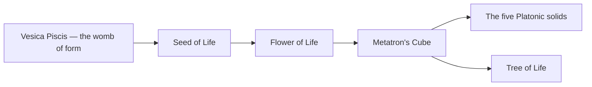

# Sacred Geometry

> *The patterns God draws with a compass — form as the language of creation.*

---

Sacred geometry is the study of the shapes and proportions that recur across nature, art, and the esoteric traditions, held to encode the structure of creation itself. From the spiral of a shell to the hexagonal packing of a honeycomb, the same handful of forms appear again and again — and the mystics read them not as coincidence but as signature. It is the geometric grammar beneath [Alchemy](/knowledge/alchemy), the [Kabbalah](/knowledge/spirituality/kabbalah), and the elemental world the [Tarot](/knowledge/tarot) divides into four.

---

## The Platonic Solids

The five regular convex polyhedra, which Plato assigned to the classical elements — the only shapes whose faces, edges, and angles are all identical. See [Platonic Solids](/knowledge/sacred-geometry/platonic-solids) for the set.

| Solid | Faces | Element |
|-------|-------|---------|
| [Tetrahedron](/knowledge/sacred-geometry/tetrahedron) | 4 triangles | Fire |
| [Cube](/knowledge/sacred-geometry/cube) | 6 squares | Earth |
| [Octahedron](/knowledge/sacred-geometry/octahedron) | 8 triangles | Air |
| [Icosahedron](/knowledge/sacred-geometry/icosahedron) | 20 triangles | Water |
| [Dodecahedron](/knowledge/sacred-geometry/dodecahedron) | 12 pentagons | Aether |

## The Generative Forms

The figures from which the rest unfold: [Vesica Piscis](/knowledge/sacred-geometry/vesica-piscis) (the womb of form), [Seed of Life](/knowledge/sacred-geometry/seed-of-life), [Flower of Life](/knowledge/sacred-geometry/flower-of-life), and [Metatron's Cube](/knowledge/sacred-geometry/metatrons-cube) — the last containing all five Platonic solids and tying the geometry back to the [Tree of Life](/knowledge/tree-of-life).

One form unfolds from the last, until Metatron's Cube gathers all five solids and ties the geometry back to the Tree:

## Proportion & Pattern

[Golden Ratio](/knowledge/sacred-geometry/golden-ratio) (phi) · [Fibonacci Sequence](/knowledge/sacred-geometry/fibonacci-sequence) · [Sri Yantra](/knowledge/sacred-geometry/sri-yantra) · [Merkaba](/knowledge/sacred-geometry/merkaba) · [Torus](/knowledge/sacred-geometry/torus)

---

## Related

- [Alchemy](/knowledge/alchemy) — the elements the solids embody
- [Kabbalah](/knowledge/spirituality/kabbalah) — [Metatron's Cube](/knowledge/sacred-geometry/metatrons-cube) and the Tree of Life
- [Tarot](/knowledge/tarot) — the fourfold elemental world
- [Knowledge Hub](/knowledge)
