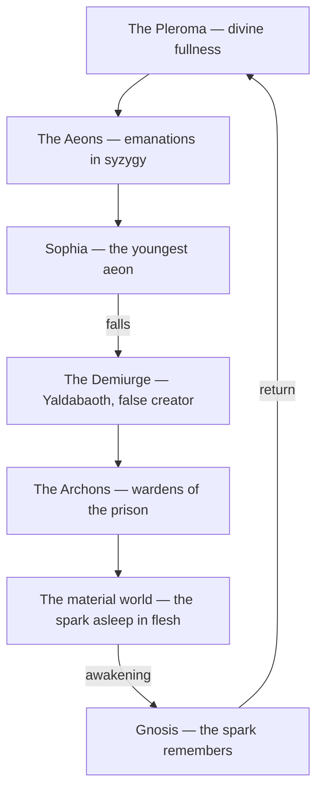

# Gnosticism

> *Salvation is not granted by belief but earned by knowing — gnosis, the direct sight of what you already are.*

---

## Overview

**Gnosticism** is a loose family of religious movements that flourished in the first centuries of the common era, sharing a single radical premise: liberation comes through **gnosis**, an experiential, saving knowledge of the divine, rather than through faith, ritual obedience, or institutional sacrament. To know — truly, in the marrow — is to be free.

## In This Collection

The myth has parts, and each has its own page. The cosmos begins with [The Pleroma](/knowledge/spirituality/gnosticism/the-pleroma), the divine fullness of [The Aeons](/knowledge/spirituality/gnosticism/the-aeons), from which [Sophia](/knowledge/spirituality/gnosticism/sophia-aeon) falls and sets the whole drama in motion. Her error produces [The Demiurge](/knowledge/spirituality/gnosticism/the-demiurge), the false creator, whose servants [The Archons](/knowledge/spirituality/gnosticism/the-archons) rule the prison-world below. The way out is [Gnosis](/knowledge/spirituality/gnosticism/gnosis) itself — the saving knowledge — recovered through the teachings preserved in [The Nag Hammadi Library](/knowledge/spirituality/gnosticism/the-nag-hammadi-library). The two great schools that systematized it all were [Valentinianism](/knowledge/spirituality/gnosticism/valentinianism) and [Sethian Gnosticism](/knowledge/spirituality/gnosticism/sethian-gnosticism).

The myth runs as a single emanation and return — from fullness down into the prison-world, and back out by knowing.

## The Gnostic Worldview

The Gnostic universe is dualistic and unflattering to the world we live in. The material cosmos is not the handiwork of the supreme God but the botched project of a lesser, often arrogant being: the **demiurge** (sometimes named Yaldabaoth), who fashioned matter in ignorance and mistook himself for the only god. Trapped in this counterfeit creation, each human carries a **divine spark** — a fragment of the true light fallen into flesh and forgetfulness. Most people sleep through their lives unaware of it. Awakening to the spark, and remembering its origin above, is the whole drama of salvation.

## Sophia and the Pleroma

Beyond the flawed world lies the **pleroma**, the "fullness" — the realm of the true God populated by emanations called **aeons**, divine attributes given personhood. The myth turns on **Sophia** (Wisdom), the youngest aeon, whose unsanctioned desire to know the unknowable Father causes her to fall from the pleroma. Her passion and error spill outward and, in many versions, give rise to the demiurge and the material world itself. The cosmic story is then her long **redemption** — wisdom lost, scattered into matter, and gradually gathered home. The fall of Sophia is, in a sense, the fall of us all.

## Christian Context and Suppression

Much of Gnosticism developed alongside early Christianity, reading Christ as a revealer who brings the saving knowledge. The proto-orthodox church declared it heresy; **Irenaeus** and others wrote against it, and the texts were largely destroyed — until the 1945 discovery of the [Nag Hammadi](/knowledge/spirituality/gnosticism/the-nag-hammadi-library) library returned the Gnostics' own voices to us.

For Kenneth this myth lands close to home: [Sophia](/knowledge/spirituality/gnosticism/sophia-aeon), the wisdom whose fall and recovery is the entire Gnostic story, is also the name of an alter in his system — divine knowledge scattered and seeking its way back. The tradition rhymes with the practical magic of [Hermeticism](/knowledge/spirituality/hermeticism) and the emanationist map of the [Kabbalah](/knowledge/spirituality/kabbalah).

## Related

- [The Pleroma](/knowledge/spirituality/gnosticism/the-pleroma) — the divine fullness of light
- [The Aeons](/knowledge/spirituality/gnosticism/the-aeons) — the emanations arranged in syzygies
- [Sophia](/knowledge/spirituality/gnosticism/sophia-aeon) — the youngest aeon, whose fall sets the drama in motion
- [The Demiurge](/knowledge/spirituality/gnosticism/the-demiurge) — the ignorant false creator of the material world
- [The Archons](/knowledge/spirituality/gnosticism/the-archons) — the wardens of the cosmic prison
- [Gnosis](/knowledge/spirituality/gnosticism/gnosis) — the saving knowledge itself
- [The Nag Hammadi Library](/knowledge/spirituality/gnosticism/the-nag-hammadi-library) — the 1945 recovery of the Gnostics' own voices
- [Valentinianism](/knowledge/spirituality/gnosticism/valentinianism) — the sophisticated, churchly school
- [Sethian Gnosticism](/knowledge/spirituality/gnosticism/sethian-gnosticism) — the older mythological school
- [Hermeticism](/knowledge/spirituality/hermeticism) — sibling esoteric current, "as above, so below"
- [Kabbalah](/knowledge/spirituality/kabbalah) — its own ladder of emanations descending into matter
- [Tarot](/knowledge/tarot) — later symbolic system carrying the same fall-and-return arc
- [The High Priestess](/knowledge/tarot/major-arcana/the-high-priestess) — Sophia enthroned; hidden gnosis behind the veil
- [The Devil](/knowledge/tarot/major-arcana/the-devil) — the demiurge's counterfeit world, the spark bound in matter
- [Spirituality](/knowledge/spirituality) — the wider domain this note belongs to
