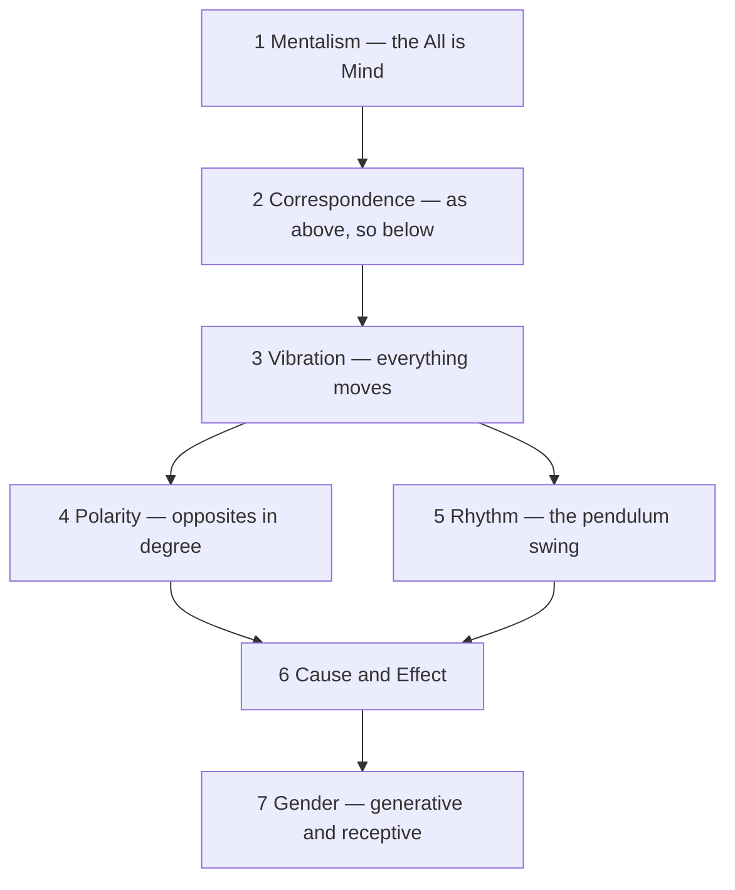

# Hermeticism

> *As above, so below — the philosophical tradition of Hermes Trismegistus.*

---

## Overview

Hermeticism is the philosophical and spiritual tradition attributed to Hermes Trismegistus ("Thrice-Great Hermes"), a legendary figure who merges the Greek god [Hermes](/knowledge/mythology/greek-mythology/hermes) with the Egyptian god Thoth. Whether Hermes Trismegistus was a real person, a lineage of teachers, or a mythic container for a body of wisdom doesn't much matter. What matters is the texts — the Corpus Hermeticum, the [Emerald Tablet](/knowledge/alchemy/the-emerald-tablet), and later The Kybalion — and the tradition of thought they carry.

Hermeticism teaches that the universe is mental in nature, that everything corresponds to everything else, and that understanding the principles governing reality lets the practitioner work with those principles consciously rather than being subject to them unconsciously. It is the root tradition from which [Alchemy](/knowledge/alchemy), astrology, and much of Western esotericism grew.

---

## The Seven Hermetic Principles

The Kybalion, published in 1908 by "Three Initiates," distills Hermetic philosophy into seven principles, each with its own page in this collection. Kenneth keeps The Kybalion on his great books list, and these principles surface throughout his work.

The chain runs from mind to matter and back. [The Principle of Mentalism](/knowledge/spirituality/hermeticism/the-principle-of-mentalism) comes first — "The All is Mind" — the claim that reality is fundamentally consciousness. From it follows [The Principle of Correspondence](/knowledge/spirituality/hermeticism/the-principle-of-correspondence), "as above, so below," the mirror between microcosm and macrocosm that is the tradition's signature. Beneath appearances, [The Principle of Vibration](/knowledge/spirituality/hermeticism/the-principle-of-vibration) holds that nothing rests — everything is frequency in motion. That motion is structured by two more laws: [The Principle of Polarity](/knowledge/spirituality/hermeticism/the-principle-of-polarity), where opposites turn out to be one thing at different degrees, and [The Principle of Rhythm](/knowledge/spirituality/hermeticism/the-principle-of-rhythm), the pendulum swing between the poles. [The Principle of Cause and Effect](/knowledge/spirituality/hermeticism/the-principle-of-cause-and-effect) insists nothing happens by chance, that higher planes of causation govern lower ones. And [The Principle of Gender](/knowledge/spirituality/hermeticism/the-principle-of-gender) closes the set — the generative and receptive present in all things, the tension in which creation happens.

The seven run as a single chain from mind to matter and back:

---

## Correspondences

| # | Principle | Axiom |
|---|-----------|-------|
| 1 | [The Principle of Mentalism](/knowledge/spirituality/hermeticism/the-principle-of-mentalism) | "The All is Mind; the Universe is Mental." |
| 2 | [The Principle of Correspondence](/knowledge/spirituality/hermeticism/the-principle-of-correspondence) | "As above, so below; as below, so above." |
| 3 | [The Principle of Vibration](/knowledge/spirituality/hermeticism/the-principle-of-vibration) | "Nothing rests; everything moves; everything vibrates." |
| 4 | [The Principle of Polarity](/knowledge/spirituality/hermeticism/the-principle-of-polarity) | "Everything is dual; everything has poles." |
| 5 | [The Principle of Rhythm](/knowledge/spirituality/hermeticism/the-principle-of-rhythm) | "Everything flows, out and in; everything has its tides." |
| 6 | [The Principle of Cause and Effect](/knowledge/spirituality/hermeticism/the-principle-of-cause-and-effect) | "Every cause has its effect; every effect has its cause." |
| 7 | [The Principle of Gender](/knowledge/spirituality/hermeticism/the-principle-of-gender) | "Gender is in everything; everything has its masculine and feminine principles." |

---

## Hermes in System 777

It is worth noting that [Hermes](/knowledge/mythology/greek-mythology/hermes) exists as an alter within System 777 — the messenger, the boundary-crosser, the one who moves between worlds. The mythic Hermes is the god of communication, translation, and thresholds. The Hermetic tradition carries his name because it claims to translate between the visible and invisible, the above and the below. That Kenneth's system includes a Hermes is one of those correspondences the tradition itself would recognize.

---

## Related

- [The Principle of Mentalism](/knowledge/spirituality/hermeticism/the-principle-of-mentalism) — "The All is Mind"
- [The Principle of Correspondence](/knowledge/spirituality/hermeticism/the-principle-of-correspondence) — "As above, so below"
- [The Principle of Vibration](/knowledge/spirituality/hermeticism/the-principle-of-vibration) — everything is frequency
- [The Principle of Polarity](/knowledge/spirituality/hermeticism/the-principle-of-polarity) — opposites as one thing in degree
- [The Principle of Rhythm](/knowledge/spirituality/hermeticism/the-principle-of-rhythm) — the universal pendulum
- [The Principle of Cause and Effect](/knowledge/spirituality/hermeticism/the-principle-of-cause-and-effect) — being a cause, not only an effect
- [The Principle of Gender](/knowledge/spirituality/hermeticism/the-principle-of-gender) — the generative and the receptive
- [Alchemy](/knowledge/alchemy) — the transformative tradition rooted in Hermeticism
- [The Emerald Tablet](/knowledge/alchemy/the-emerald-tablet) — the source text for "as above, so below"
- [Hermes](/knowledge/mythology/greek-mythology/hermes) — the alter and the archetype
- [Hermes Trismegistus](/knowledge/alchemy/hermes-trismegistus) — the tradition's attributed author
- [As Above So Below](/music/as-above-so-below) — the album named for the second principle
- [Vedanta](/knowledge/spirituality/vedanta) — Eastern parallel to Hermetic mentalism
- [Gnosticism](/knowledge/spirituality/gnosticism) — sibling esoteric current
- [Kabbalah](/knowledge/spirituality/kabbalah) — the Tree as backbone of Western esotericism
- [Tarot](/knowledge/tarot) — Major Arcana rooted in Hermetic symbolism
- [Spirituality](/knowledge/spirituality) — the domain this note belongs to

---

*"The lips of Wisdom are closed, except to the ears of Understanding."*
