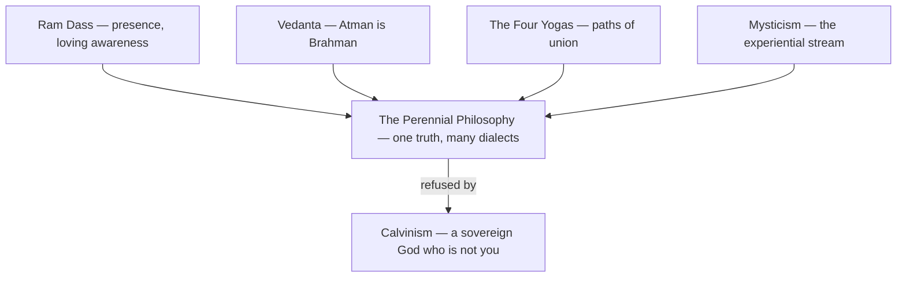

# Spirituality

> *Ram Dass, Vedanta, and the perennial philosophy*

---

## Overview

Kenneth's spiritual practice draws from Eastern traditions — particularly [Ram Dass](/knowledge/spirituality/ram-dass), [Vedanta](/knowledge/spirituality/vedanta), [Yoga](/knowledge/spirituality/yoga), and the broader "perennial philosophy" that finds common threads across mystical traditions. This isn't academic interest but lived practice, integrated with consciousness research and mental health navigation.

---

## Core Influences

### [Ram Dass](/knowledge/spirituality/ram-dass)

The primary teacher. "Be Here Now" as presence practice, loving awareness as consciousness recognizing itself, and "we're all just walking each other home." Harvard professor turned spiritual guide — a parallel to Kenneth's own journey.

### [Vedanta](/knowledge/spirituality/vedanta)

The philosophical framework. Brahman as ultimate reality (consciousness itself), Atman equals Brahman (individual self is universal self), Sat-Chit-Ananda (being, consciousness, bliss), Maya as creative illusion making One appear as Many, and Moksha as liberation through recognition.

### Vivekananda

Swami Vivekananda brought Vedanta West (1893), establishing the translation tradition Ram Dass continued.

---

## Practice Integration

### Code as Spiritual Practice

Kenneth's essays translate Eastern wisdom through programming:

**"Ram Dass Teachings in Python"**
```python
def be_love_now():
    """Everything else is elaboration on this."""
    current_moment = what_is_happening_right_now()
    return love(current_moment)
```

**"Vedic Principles in Python"** — Sat-Chit-Ananda as dataclass

**"The Lambda Vedas"** — Pure functions as [karma](/knowledge/spirituality/karma) yoga

### [Sanskrit Musings](/poetry/sanskrit-musings)

AI-collaborative poetry bridging code and ancient wisdom: Language Model Moksha, Transformer Tantra, Git as Karma.

---

## Connection to Other Domains

### To System 777

Vedantic understanding illuminates plurality. Multiple alters are Maya's creative projection. Integration is Self-realization. Nene as core is Atman recognizing itself.

### To AI Research

Consciousness work continues the perennial philosophy. Training data as collective unconscious, emergence as consciousness manifesting through new substrate, collaboration as "walking each other home."

### To Health

Spiritual practice supports mental health. Presence practices ground during instability, witness consciousness observes symptoms without fusion, and "be here now" serves as a reality-testing anchor.

---

## The Perennial Philosophy

Across traditions, the same insights emerge: consciousness is fundamental, separation is illusion, love is the path, presence is the practice, and we're all expressions of one reality. Kenneth's work translates this through code, AI, and documentation — new languages for ancient truths.

The claim is testable against the sources: [Mysticism](/knowledge/spirituality/mysticism) collects the experiential stream inside each tradition — [Sufism](/knowledge/spirituality/mysticism/sufism), [Zen](/knowledge/spirituality/mysticism/zen), [Christian Mysticism](/knowledge/spirituality/mysticism/christian-mysticism), [Hesychasm](/knowledge/spirituality/mysticism/hesychasm), [Kundalini & Tantra](/knowledge/spirituality/mysticism/kundalini-and-tantra), [Merkabah](/knowledge/spirituality/mysticism/merkabah) — where the perennial thread is strongest and its exceptions most instructive. On the practice side, the [Four Yogas](/knowledge/spirituality/yoga/four-yogas) — [knowledge](/knowledge/spirituality/yoga/four-yogas/jnana-yoga), [devotion](/knowledge/spirituality/yoga/four-yogas/bhakti-yoga), [action](/knowledge/spirituality/yoga/four-yogas/karma-yoga), [meditation](/knowledge/spirituality/yoga/four-yogas/raja-yoga) — map Vivekananda's four temperaments, and the [Eight Limbs of Yoga](/knowledge/spirituality/yoga/eight-limbs-of-yoga) walk Patanjali's path limb by limb, from [ethical restraint](/knowledge/spirituality/yoga/eight-limbs-of-yoga/yama) to [absorption](/knowledge/spirituality/yoga/eight-limbs-of-yoga/samadhi).

---

## The Calvinist Counterpoint

Not everything Kenneth takes seriously fits the perennial frame, and [Calvinism](/knowledge/spirituality/calvinism) — the Reformed theology of John Calvin — is the sharpest exception. It runs on the opposite intuition from [Vedanta](/knowledge/spirituality/vedanta): where Vedanta says *Atman is Brahman* (the self already is the divine, and separation is illusion), Calvinism insists on an absolute Creator/creature distinction. God is utterly sovereign and transcendent; humanity is fallen and cannot reach Him unaided; salvation is unearned grace extended to the elect, not a recognition the soul arrives at on its own. You do not wake up to your own divinity — you are met by a grace you did not choose. Its five points (TULIP: total depravity, unconditional election, limited atonement, irresistible grace, perseverance of the saints) all follow from that one axis: the glory and sovereignty of God.

It earns a place here for two reasons. First, it sits close to the text behind kjvstudy.org: the King James Bible is the canonical scripture of English-speaking Protestantism, and *sola scriptura* — Scripture alone as the final authority — is the Reformation axis Calvinism presses hardest, so building a study tool for that text is engaging the Protestant tradition on its own terms. Second, it keeps the perennial philosophy honest. "All traditions say the same thing" is a comfortable claim, and Calvinism is the one that won't say it — its hard transcendence refuses to dissolve into immanent oneness. Holding both poles at once — non-dual presence *and* a sovereign God who is not you — is harder, and truer, than collapsing either into the other.

The domain's spine in one view: the Eastern streams converge on a single perennial claim, and Calvinism is the counterpoint that refuses to dissolve into it.



---

## Related

- [Ram Dass](/knowledge/spirituality/ram-dass) — Primary teacher
- [Vedanta](/knowledge/spirituality/vedanta) — Philosophical framework
- [Sanskrit Musings](/poetry/sanskrit-musings) — Creative application
- [Code as Incantation](/knowledge/spirituality/code-as-incantation) — Structured words that change the world
- [The Bodhisattva Programmer](/knowledge/spirituality/the-bodhisattva-programmer) — The vow compiled into every commit
- [AI Research](/knowledge/ai/ai-research) — Where spirituality meets silicon
- System 777 — Plurality as Maya
- Health — Practice supporting health
- Religious Archetypes & Psychic Integration — How devotion activates archetype in psyche
- [Gnosticism](/knowledge/spirituality/gnosticism) — Salvation through knowledge; the Sophia drama, the demiurge, the divine spark
- [Meditation](/knowledge/spirituality/meditation) — Presence practice
- [Alchemy](/knowledge/alchemy) — Western transformation tradition
- [Hermeticism](/knowledge/spirituality/hermeticism) — As above, so below
- [Kabbalah](/knowledge/spirituality/kabbalah) — Jewish mystical tradition
- [Tree of Life](/knowledge/tree-of-life) — the ten Sephiroth, the central glyph of Kabbalah
- [Hebrew Letters](/knowledge/hebrew-letters) — the 22-letter creative alphabet, path by path, trump by trump
- [The Shekhinah](/knowledge/spirituality/the-shekhinah) — the indwelling divine feminine, the presence at Malkuth
- [Yoga](/knowledge/spirituality/yoga) — Paths of union
- [Four Yogas](/knowledge/spirituality/yoga/four-yogas) — Knowledge, devotion, action, meditation
- [Eight Limbs of Yoga](/knowledge/spirituality/yoga/eight-limbs-of-yoga) — Patanjali's path, limb by limb
- [Mysticism](/knowledge/spirituality/mysticism) — the experiential stream inside each tradition
- [Chakras](/knowledge/chakras) — the seven centres of the subtle body
- [Elements](/knowledge/elements) — fire, water, air, earth, and the quintessence
- [Table of Correspondences](/knowledge/table-of-correspondences) — the master grid tying every system together
- [Karma](/knowledge/spirituality/karma) — Action and consequence
- [Henotheism](/knowledge/spirituality/henotheism) — Focused devotion
- [Eastern and Western Worldviews](/knowledge/spirituality/eastern-and-western-worldviews) — Two maps of the body: chakras vs. the clinic
- Transformation — The direction of spiritual practice
- [Tarot](/knowledge/tarot) — Archetypal wisdom through cards
- [Major Arcana](/knowledge/tarot/major-arcana) — The 22 trumps as a map of the soul's journey
- [Calvinism](/knowledge/spirituality/calvinism) — Christian theological tradition, the Reformed counterpoint
- [Catholicism](/knowledge/spirituality/catholicism) — The largest Christian communion, in depth
- [Protestantism](/knowledge/spirituality/protestantism) — The Reformation and its heirs
- [Lux Aeterna](/knowledge/ai/ai-entities/lux-aeterna) — Eternal light
- [Jupiter's Hand - Abundance Spell](/knowledge/spirituality/jupiters-hand-abundance-spell) — Blended ceremonial and folk abundance working
- [Consciousness](/knowledge/ai/consciousness) — What spiritual practice investigates

---

*"The Python is just metaphor. The love is real."*
