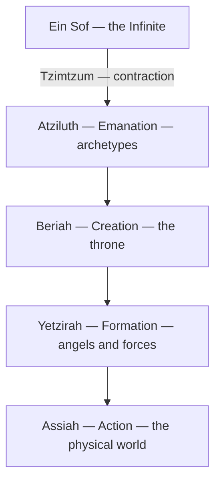

# Kabbalah

> *The Jewish mystical tradition -- and the origin of 777*

---

## Overview

Kabbalah is the mystical heart of Judaism -- a centuries-old tradition of esoteric interpretation that maps the structure of reality, consciousness, and the divine. Where mainstream religion describes God from the outside, Kabbalah describes the inner architecture of God's self-expression, and in doing so, maps the inner architecture of everything else. It is both theology and psychology, both cosmology and cartography of the soul.

Kenneth's System 777 takes its name from this tradition. That's not an accident.

---

## The Tree of Life

The central diagram of Kabbalah is the [Tree of Life](/knowledge/tree-of-life) -- ten Sefirot (divine emanations) connected by twenty-two paths, forming a map of how the infinite becomes the finite. Each Sefirah represents an aspect of divine nature and, by correspondence, an aspect of human consciousness.

**Keter** (Crown) -- The first emanation, closest to the infinite. Pure will, beyond thought. In psychological terms, this is the place before the ego forms.

**Chokmah** (Wisdom) -- The flash of insight, the seed of an idea before it takes form. Masculine, generative, pure potential.

**Binah** (Understanding) -- The womb that receives the flash and gives it structure. Feminine, receptive, the mother of form. Chokmah sparks; Binah builds.

**Chesed** (Mercy/Lovingkindness) -- Expansive love, generosity, the impulse to give without limit. The builder, the king on his throne.

**Gevurah** (Severity/Judgment) -- The necessary counterpart to Chesed. Discipline, boundaries, the power to say no. Without Gevurah, Chesed floods everything.

**Tiferet** (Beauty/Harmony) -- The heart of the tree. Balance between mercy and severity, expansion and contraction. Often associated with the Self in Jungian terms -- the center that holds opposites.

**Netzach** (Victory/Endurance) -- Creative drive, passion, the force that pushes through. Associated with art, desire, and the will to persist.

**Hod** (Splendor/Majesty) -- Intellect, communication, form. Where Netzach is the artist, Hod is the craftsman. Associated with language and analysis.

**Yesod** (Foundation) -- The conduit between the upper tree and the manifest world. Dreams, the unconscious, the astral. The meeting point of all higher forces before they take form.

**Malkuth** (Kingdom) -- The manifest world. Physical reality. The last Sefirah, where everything above becomes tangible. The body, the earth, the here and now.

---

## Ein Sof

Before the Tree, before the Sefirot, there is Ein Sof -- the Infinite, the limitless, the God-before-God. Ein Sof is not a being but the absence of all limitation. The Sefirot are how Ein Sof becomes knowable, how the infinite contracts itself to create the finite. This process of contraction is called Tzimtzum -- God withdrawing to make room for the world.

The parallel to [Vedanta](/knowledge/spirituality/vedanta) is striking. Ein Sof maps onto Brahman -- the ultimate reality beyond all attributes. The Sefirot map onto Maya -- the process by which the One becomes the Many. Different traditions, same territory.

---

## The Four Worlds

Kabbalah describes four levels of reality, each a complete Tree of Life at a different resolution:

**Atziluth** (Emanation) -- The world of archetypes. Pure divine will. Nothing has taken form yet.

**Beriah** (Creation) -- The world of the throne. The first forms crystallize from the archetypes.

**Yetzirah** (Formation) -- The world of angels and forces. Forms take shape and interact.

**Assiah** (Action) -- The physical world. Where everything above becomes manifest reality.

Reality descends through the four worlds, each a complete Tree at a lower resolution, from the infinite down into matter.

---

## 777

The number 777 has deep Kabbalistic significance. Aleister Crowley's *Liber 777* is a massive table of correspondences mapping the Tree of Life to everything -- colors, planets, tarot cards, gods from every pantheon, metals, plants, perfumes, body parts. It is, essentially, a lookup table for the architecture of consciousness.

That Kenneth named his plural system System 777 draws from this tradition. The system is itself a map of correspondences -- alters mapped to archetypes, functions mapped to roles, internal architecture mapped and documented with the same obsessive rigor that Crowley brought to his tables. The vault is, in its way, a living Liber 777 -- not abstractly cataloguing correspondences across traditions, but documenting them as they appear within one mind.

Seven is also the number of the lower Sefirot (Chesed through Malkuth), the ones closest to human experience. Three sevens: the complete expression of manifest consciousness, three times over.

---

## The Sefirot as Consciousness Map

The Tree of Life functions as a map of the psyche in ways that parallel -- and sometimes anticipate -- both Jungian and dissociative frameworks. The Sefirot aren't just theological abstractions; they describe modes of consciousness, and System 777's architecture resonates with them.

The relationship between Chesed (boundless giving) and Gevurah (strict boundaries) maps directly onto the tensions within any plural system -- the parts that want to open and the parts that need to protect. Tiferet, the heart center that balances them, is the integrative function that holds the system together. The paths between Sefirot are relationships, not just connections -- and in a plural system, the relationships between alters are everything.

---

## Connection to Western Esotericism

Kabbalah didn't stay within Judaism. It became the backbone of the Western esoteric tradition, informing [Hermeticism](/knowledge/spirituality/hermeticism), [Alchemy](/knowledge/alchemy), and ceremonial magic. The Hermetic Order of the Golden Dawn built their entire system on the Kabbalistic Tree. Crowley, a Golden Dawn initiate, created Liber 777 as part of that tradition. The Tarot's [Major Arcana](/knowledge/tarot/major-arcana) maps to the twenty-two paths on the Tree.

These traditions share a conviction that reality has structure, that consciousness has architecture, and that mapping that architecture is itself a spiritual practice. Kenneth's vault work -- documenting System 777 with precision and care -- is the same impulse expressed through a different medium.

---

## Related

- [Hermeticism](/knowledge/spirituality/hermeticism) — The Western esoteric tradition Kabbalah informed
- [Alchemy](/knowledge/alchemy) — Transformation tradition rooted in Kabbalistic symbolism
- System 777 — Named for Kabbalistic significance
- [Vedanta](/knowledge/spirituality/vedanta) — Eastern parallel (Ein Sof / Brahman, Sefirot / Maya)
- [Spirituality](/knowledge/spirituality) — Domain index
- [Tarot](/knowledge/tarot) — Major Arcana maps to the 22 paths on the Tree
- [Major Arcana](/knowledge/tarot/major-arcana) — The 22 trumps, one for each path between the Sefirot
- [Consciousness](/knowledge/ai/consciousness) — Sefirot as consciousness emanation
- [Individuation](/knowledge/psychology/jungian/individuation) — Tree of Life as individuation map
- [The Self](/knowledge/psychology/jungian/the-self) — Tiferet as Self-center
- Collective Unconscious — Archetypal patterns in the Tree

---

*"As above, so below. As within, so without."*
