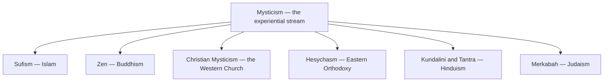

# Mysticism

> *Every religion has two rivers: the doctrine handed down, and the encounter sought directly. These are notes from the second river.*

---

Every major tradition carries a current of people who were not satisfied to be told about God. They wanted contact — union, vision, annihilation, awakening, the thing itself — and they built disciplines to get there: repetition, stillness, breath, ascent. **Mysticism** is the collective name for that experiential stream, and this folder collects its major expressions, one per tradition, each read against the religion that contains it.

The pattern repeats with uncanny consistency. A short sacred formula repeated until it prays itself: dhikr in [Sufism](/knowledge/spirituality/mysticism/sufism), the Jesus Prayer in [Hesychasm](/knowledge/spirituality/mysticism/hesychasm), the mantra practices gathered under [Meditation](/knowledge/spirituality/meditation). A mapped ascent through stages: the Sufi stations, the three ways of [Christian Mysticism](/knowledge/spirituality/mysticism/christian-mysticism), the seven palaces of [Merkabah](/knowledge/spirituality/mysticism/merkabah), the seven centres kundalini climbs in [Kundalini & Tantra](/knowledge/spirituality/mysticism/kundalini-and-tantra). A warning at the door — prelest, the dark night, the four who entered pardes, the serpent that rises too fast. And always the same friction with the institution: [Zen](/knowledge/spirituality/mysticism/zen) calling itself a transmission outside the scriptures while chanting the scriptures; the church canonizing Teresa and burning Marguerite Porete; the rabbis fencing the chariot; the orthodox eyeing the tantrikas sideways. Direct encounter and received doctrine need each other and never quite trust each other.

This vault leans toward the perennial reading — the [Ram Dass](/knowledge/spirituality/ram-dass) and [Vedanta](/knowledge/spirituality/vedanta) thread that hears one truth speaking many dialects — and the recurrences above are real evidence for it. But the counterpoints deserve to stay honest: [Calvinism](/knowledge/spirituality/calvinism) rejects the whole premise of mystical ascent on principled grounds, and each tradition insists its encounter is with *its* God, not a generic Absolute. The traditions rhyme; whether they are the same poem is exactly the open question worth keeping open.

---

## The Collection

**[Sufism](/knowledge/spirituality/mysticism/sufism)** — the mystical current of Islam. Dhikr, the whirling of the dervishes, fana and the return; Rumi, al-Hallaj, Ibn Arabi. The path of the lover and the Beloved.

**[Zen](/knowledge/spirituality/mysticism/zen)** — Buddhism's meditation school, the experiential stream declared openly. Zazen, the koan, kensho; Bodhidharma, Huineng, Dogen. A finger pointing at the moon.

**[Christian Mysticism](/knowledge/spirituality/mysticism/christian-mysticism)** — the Western contemplatives. The via negativa, the Interior Castle, the dark night of the soul; Eckhart, Julian of Norwich, Teresa and John of the Cross.

**[Hesychasm](/knowledge/spirituality/mysticism/hesychasm)** — the Eastern Orthodox branch. The Jesus Prayer, prayer of the heart, the uncreated light; Gregory Palamas and the rare case where the mystics won the doctrinal fight.

**[Kundalini & Tantra](/knowledge/spirituality/mysticism/kundalini-and-tantra)** — the somatic mysticism of Hinduism. Shiva and Shakti, the serpent rising through the chakras, the body as instrument rather than obstacle.

**[Merkabah](/knowledge/spirituality/mysticism/merkabah)** — the oldest Jewish mystical stream. The descent to the chariot, the seven palaces, Enoch become Metatron; the practical ancestor of the Kabbalah.

One experiential impulse recurs across the traditions, taking a different name inside each.

The vault holds close relatives elsewhere: [Kabbalah](/knowledge/spirituality/kabbalah) and [Gnosticism](/knowledge/spirituality/gnosticism) sit in the parent folder as the theoretical maps this stream travels by, [Hermeticism](/knowledge/spirituality/hermeticism) carries the Western esoteric synthesis, and the [Chakras](/knowledge/chakras) and [Eight Limbs of Yoga](/knowledge/spirituality/yoga/eight-limbs-of-yoga) folders detail the machinery Tantra runs on.

---

## Related

- [Spirituality](/knowledge/spirituality) — the parent domain
- [Religions of the World](/knowledge/religions-of-the-world) — the doctrinal rivers these streams run inside
- [Kabbalah](/knowledge/spirituality/kabbalah) — Jewish mystical theory; Merkabah is its experiential ancestor
- [Gnosticism](/knowledge/spirituality/gnosticism) — direct knowing taken outside the church
- [Hermeticism](/knowledge/spirituality/hermeticism) — the Western esoteric synthesis of the same currents
- [Meditation](/knowledge/spirituality/meditation) — the common toolkit of the whole collection
