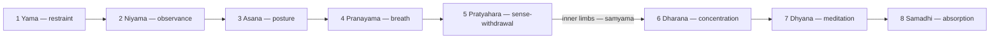

# Eight Limbs of Yoga

> *A ladder from ethics to absorption, built two thousand years ago and still load-bearing.*

---

The eight limbs — *ashtanga*, from *ashta* (eight) and *anga* (limb) — are Patanjali's map of the complete yogic path, laid out in the second and third chapters of the Yoga Sutras (c. 2nd century BCE–4th century CE). This is the methodology of Raja yoga, the "royal path" among the four described in [Yoga](/knowledge/spirituality/yoga): a systematic progression from how one treats the world, through the body and breath, to the deepest reaches of concentrated mind. The text opens by defining yoga as the stilling of the fluctuations of the mind (*yogash chitta vritti nirodhah*, I.2); the eight limbs are the answer to the obvious next question — how.

They are limbs rather than steps for a reason: like the limbs of a body, they grow together, and a practitioner works several at once. But the ordering is an argument about dependencies. Ethics before technique, body before breath, withdrawal before concentration — each limb quiets a layer of disturbance so the next can be attempted. The commentaries divide them into the five outer limbs (*bahiranga*), which work on life, body, and senses, and the three inner limbs (*antaranga*), which are depths of [Meditation](/knowledge/spirituality/meditation) itself — and which Patanjali, applied together, calls *samyama*.

---

## The Eight Limbs

| # | Limb | Meaning |
|---|------|---------|
| 1 | [Yama](/knowledge/spirituality/yoga/eight-limbs-of-yoga/yama) | Restraints — conduct toward the world |
| 2 | [Niyama](/knowledge/spirituality/yoga/eight-limbs-of-yoga/niyama) | Observances — conduct toward oneself |
| 3 | [Asana](/knowledge/spirituality/yoga/eight-limbs-of-yoga/asana) | Posture — the steady, comfortable seat |
| 4 | [Pranayama](/knowledge/spirituality/yoga/eight-limbs-of-yoga/pranayama) | Breath regulation — extension of the life-force |
| 5 | [Pratyahara](/knowledge/spirituality/yoga/eight-limbs-of-yoga/pratyahara) | Withdrawal of the senses |
| 6 | [Dharana](/knowledge/spirituality/yoga/eight-limbs-of-yoga/dharana) | Concentration — binding the mind to one place |
| 7 | [Dhyana](/knowledge/spirituality/yoga/eight-limbs-of-yoga/dhyana) | Meditation — the unbroken flow |
| 8 | [Samadhi](/knowledge/spirituality/yoga/eight-limbs-of-yoga/samadhi) | Absorption — the object alone shines |

The first two limbs order a life; the middle three quiet the instrument, from gross body to breath to senses; the final three are one act of attention at three depths — placed, flowing, dissolved. The scheme belongs to the broader current of [Hinduism](/knowledge/religions-of-the-world/hinduism) and shares its summit with the non-dual realization of [Vedanta](/knowledge/spirituality/vedanta), but its influence runs far past its origins: the seventh limb's name, *dhyana*, travelled through Buddhist Asia to become *jhana*, *chan*, and Zen.

The ladder runs in order — five outer limbs that quiet life, body, and senses, then three inner limbs that are meditation itself.

---

## Related

- [Spirituality](/knowledge/spirituality) — domain index
- [Yoga](/knowledge/spirituality/yoga) — the parent overview and the four paths
- [Meditation](/knowledge/spirituality/meditation) — the inner limbs in practice
- [Hinduism](/knowledge/religions-of-the-world/hinduism) — the tradition that produced the Sutras
- [Vedanta](/knowledge/spirituality/vedanta) — the philosophy of what samadhi reveals
