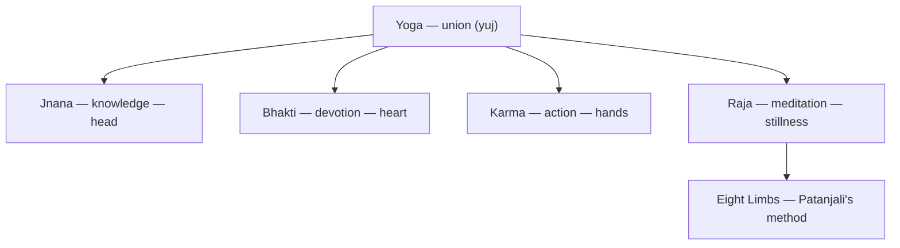

# Four Yogas

> *Four roads up the same mountain, cut to fit four kinds of walker.*

---

The four yogas are the classical paths of [Hinduism](/knowledge/religions-of-the-world/hinduism) to the realization that [Vedanta](/knowledge/spirituality/vedanta) states as philosophy: the individual self and the universal ground are not two. The paths differ not in destination but in instrument — each takes a fundamental human faculty and turns it all the way toward the divine. The framing that organizes this collection is Vivekananda's, who presented the four to the West in the 1890s as a psychology of temperament: every person leads with head, heart, hands, or stillness, and the tradition has a path shaped to each. The overview and the personal weaving live in [Yoga](/knowledge/spirituality/yoga); these notes go deep on the traditions themselves.

---

## The Four Paths

| Path | Faculty | Temperament | Scripture | Exemplar |
|------|---------|-------------|-----------|----------|
| [Jnana Yoga](/knowledge/spirituality/yoga/four-yogas/jnana-yoga) | Knowledge | Reflective | Upanishads | Shankara |
| [Bhakti Yoga](/knowledge/spirituality/yoga/four-yogas/bhakti-yoga) | Devotion | Emotional | Narada Bhakti Sutras, Gita XII | Ramakrishna |
| [Karma Yoga](/knowledge/spirituality/yoga/four-yogas/karma-yoga) | Action | Active | Bhagavad Gita | Gandhi |
| [Raja Yoga](/knowledge/spirituality/yoga/four-yogas/raja-yoga) | Meditation | Contemplative | Yoga Sutras | Patanjali |

A note on the name: the count of four is modern. The Bhagavad Gita teaches three yogas — karma, jnana, bhakti, the *trimarga* (three paths; *marga* is the traditional word for path). Vivekananda added Raja from Patanjali's Yoga Sutras in the 1890s, and his four books made "the Four Yogas" the standard framing. This collection follows him knowingly.

The paths are not exclusive — most practitioners walk more than one, and the exemplars overflow their columns: Ramakrishna practiced all four, Vivekananda wrote a book on each, and the Gita teaches three of them in a single conversation. [Raja Yoga](/knowledge/spirituality/yoga/four-yogas/raja-yoga)'s method is elaborated limb by limb in the sibling collection [Eight Limbs of Yoga](/knowledge/spirituality/yoga/eight-limbs-of-yoga); the devotional current of [Bhakti Yoga](/knowledge/spirituality/yoga/four-yogas/bhakti-yoga) runs far past its origins into the traditions gathered under [Mysticism](/knowledge/spirituality/mysticism).

The deeper claim of the four-path scheme is generous: there is no single door. The intellect that cannot believe, the heart that cannot argue, the hands that cannot sit still, the attention that wants only silence — each is already an adequate vehicle, if driven all the way.

Head, heart, hands, or stillness — each faculty becomes a path, and Raja's opens further into the eight limbs.

---

## Related

- [Spirituality](/knowledge/spirituality) — domain index
- [Yoga](/knowledge/spirituality/yoga) — the parent overview and the personal application
- [Vedanta](/knowledge/spirituality/vedanta) — the philosophy all four paths verify
- [Eight Limbs of Yoga](/knowledge/spirituality/yoga/eight-limbs-of-yoga) — Raja yoga's method in detail
- [Mysticism](/knowledge/spirituality/mysticism) — the devotional path in other traditions
- [Hinduism](/knowledge/religions-of-the-world/hinduism) — the tradition that produced the paths

---

*Head, heart, hands, or stillness — the mountain does not care which road you take.*
