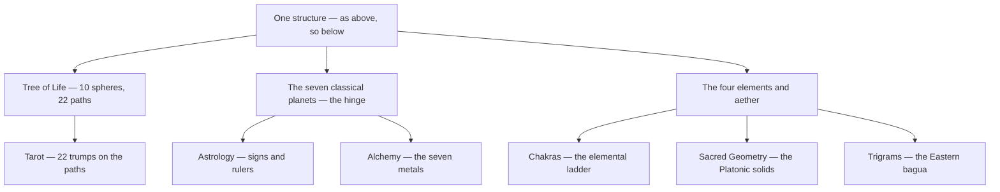

# Table of Correspondences

> *As above, so below — the single grid on which every system in this vault is a different reading.*

---

This is the vault's own *Liber 777*: the master table that shows how the separate collections — [Tarot](/knowledge/tarot), [Astrology](/knowledge/astrology), the [Kabbalah](/knowledge/spirituality/kabbalah) and its [Tree of Life](/knowledge/tree-of-life), the [Elements](/knowledge/elements), the [Chakras](/knowledge/chakras), [Alchemy](/knowledge/alchemy), and [Sacred Geometry](/knowledge/sacred-geometry) — are all readings of one structure. A planet is also a metal, a colour, an incense, a god, an archangel, a sphere of the Tree, and a card of the deck; a sign rules a part of the body; even the Chinese [trigrams](/knowledge/religions-of-the-world/taoism) echo the four elements. Read across any row and the whole web lights up.

Beneath the many named collections lie three connective spines — the Tree, the planets, and the elements — and every other system reads off one of them:

---

## The Tree of Life — The Master Glyph

Everything below is a table; this is the picture the tables describe. The ten [Sephiroth](/knowledge/tree-of-life) are the numbered circles — each a planet, a metal, a god, an archangel. The twenty-two lines joining them are the paths, and each path is a [Hebrew letter](/knowledge/hebrew-letters) (shown on the line) which is also a [tarot trump](/knowledge/tarot/major-arcana). To read a correspondence is to trace a route on this glyph: the Sun (6, Tiphareth) reaches the Moon (9, Yesod) along path ס — Samekh — which is [Temperance](/knowledge/tarot/major-arcana/temperance). The whole table is this diagram, unfolded into rows.

<svg viewBox="0 0 400 610" xmlns="http://www.w3.org/2000/svg" style="max-width:420px;width:100%;height:auto;color:var(--text-normal,currentColor);font-family:var(--font-text,serif);">
<line x1="200" y1="45" x2="305" y2="120" stroke="currentColor" stroke-width="1" opacity="0.55"/>
<circle cx="252.5" cy="82.5" r="9" fill="var(--background-primary,#fff)" stroke="currentColor" stroke-width="0.5" opacity="1"/>
<text x="252.5" y="86.5" text-anchor="middle" font-size="12" fill="currentColor">א</text>
<line x1="200" y1="45" x2="95" y2="120" stroke="currentColor" stroke-width="1" opacity="0.55"/>
<circle cx="147.5" cy="82.5" r="9" fill="var(--background-primary,#fff)" stroke="currentColor" stroke-width="0.5" opacity="1"/>
<text x="147.5" y="86.5" text-anchor="middle" font-size="12" fill="currentColor">ב</text>
<line x1="200" y1="45" x2="200" y2="315" stroke="currentColor" stroke-width="1" opacity="0.55"/>
<circle cx="200.0" cy="180.0" r="9" fill="var(--background-primary,#fff)" stroke="currentColor" stroke-width="0.5" opacity="1"/>
<text x="200.0" y="184.0" text-anchor="middle" font-size="12" fill="currentColor">ג</text>
<line x1="305" y1="120" x2="95" y2="120" stroke="currentColor" stroke-width="1" opacity="0.55"/>
<circle cx="200.0" cy="120.0" r="9" fill="var(--background-primary,#fff)" stroke="currentColor" stroke-width="0.5" opacity="1"/>
<text x="200.0" y="124.0" text-anchor="middle" font-size="12" fill="currentColor">ד</text>
<line x1="305" y1="120" x2="200" y2="315" stroke="currentColor" stroke-width="1" opacity="0.55"/>
<circle cx="252.5" cy="217.5" r="9" fill="var(--background-primary,#fff)" stroke="currentColor" stroke-width="0.5" opacity="1"/>
<text x="252.5" y="221.5" text-anchor="middle" font-size="12" fill="currentColor">ה</text>
<line x1="305" y1="120" x2="305" y2="240" stroke="currentColor" stroke-width="1" opacity="0.55"/>
<circle cx="305.0" cy="180.0" r="9" fill="var(--background-primary,#fff)" stroke="currentColor" stroke-width="0.5" opacity="1"/>
<text x="305.0" y="184.0" text-anchor="middle" font-size="12" fill="currentColor">ו</text>
<line x1="95" y1="120" x2="200" y2="315" stroke="currentColor" stroke-width="1" opacity="0.55"/>
<circle cx="147.5" cy="217.5" r="9" fill="var(--background-primary,#fff)" stroke="currentColor" stroke-width="0.5" opacity="1"/>
<text x="147.5" y="221.5" text-anchor="middle" font-size="12" fill="currentColor">ז</text>
<line x1="95" y1="120" x2="95" y2="240" stroke="currentColor" stroke-width="1" opacity="0.55"/>
<circle cx="95.0" cy="180.0" r="9" fill="var(--background-primary,#fff)" stroke="currentColor" stroke-width="0.5" opacity="1"/>
<text x="95.0" y="184.0" text-anchor="middle" font-size="12" fill="currentColor">ח</text>
<line x1="305" y1="240" x2="95" y2="240" stroke="currentColor" stroke-width="1" opacity="0.55"/>
<circle cx="200.0" cy="240.0" r="9" fill="var(--background-primary,#fff)" stroke="currentColor" stroke-width="0.5" opacity="1"/>
<text x="200.0" y="244.0" text-anchor="middle" font-size="12" fill="currentColor">ט</text>
<line x1="305" y1="240" x2="200" y2="315" stroke="currentColor" stroke-width="1" opacity="0.55"/>
<circle cx="252.5" cy="277.5" r="9" fill="var(--background-primary,#fff)" stroke="currentColor" stroke-width="0.5" opacity="1"/>
<text x="252.5" y="281.5" text-anchor="middle" font-size="12" fill="currentColor">י</text>
<line x1="305" y1="240" x2="305" y2="415" stroke="currentColor" stroke-width="1" opacity="0.55"/>
<circle cx="305.0" cy="327.5" r="9" fill="var(--background-primary,#fff)" stroke="currentColor" stroke-width="0.5" opacity="1"/>
<text x="305.0" y="331.5" text-anchor="middle" font-size="12" fill="currentColor">כ</text>
<line x1="95" y1="240" x2="200" y2="315" stroke="currentColor" stroke-width="1" opacity="0.55"/>
<circle cx="147.5" cy="277.5" r="9" fill="var(--background-primary,#fff)" stroke="currentColor" stroke-width="0.5" opacity="1"/>
<text x="147.5" y="281.5" text-anchor="middle" font-size="12" fill="currentColor">ל</text>
<line x1="95" y1="240" x2="95" y2="415" stroke="currentColor" stroke-width="1" opacity="0.55"/>
<circle cx="95.0" cy="327.5" r="9" fill="var(--background-primary,#fff)" stroke="currentColor" stroke-width="0.5" opacity="1"/>
<text x="95.0" y="331.5" text-anchor="middle" font-size="12" fill="currentColor">מ</text>
<line x1="200" y1="315" x2="305" y2="415" stroke="currentColor" stroke-width="1" opacity="0.55"/>
<circle cx="252.5" cy="365.0" r="9" fill="var(--background-primary,#fff)" stroke="currentColor" stroke-width="0.5" opacity="1"/>
<text x="252.5" y="369.0" text-anchor="middle" font-size="12" fill="currentColor">נ</text>
<line x1="200" y1="315" x2="200" y2="485" stroke="currentColor" stroke-width="1" opacity="0.55"/>
<circle cx="200.0" cy="400.0" r="9" fill="var(--background-primary,#fff)" stroke="currentColor" stroke-width="0.5" opacity="1"/>
<text x="200.0" y="404.0" text-anchor="middle" font-size="12" fill="currentColor">ס</text>
<line x1="200" y1="315" x2="95" y2="415" stroke="currentColor" stroke-width="1" opacity="0.55"/>
<circle cx="147.5" cy="365.0" r="9" fill="var(--background-primary,#fff)" stroke="currentColor" stroke-width="0.5" opacity="1"/>
<text x="147.5" y="369.0" text-anchor="middle" font-size="12" fill="currentColor">ע</text>
<line x1="305" y1="415" x2="95" y2="415" stroke="currentColor" stroke-width="1" opacity="0.55"/>
<circle cx="200.0" cy="415.0" r="9" fill="var(--background-primary,#fff)" stroke="currentColor" stroke-width="0.5" opacity="1"/>
<text x="200.0" y="419.0" text-anchor="middle" font-size="12" fill="currentColor">פ</text>
<line x1="305" y1="415" x2="200" y2="485" stroke="currentColor" stroke-width="1" opacity="0.55"/>
<circle cx="252.5" cy="450.0" r="9" fill="var(--background-primary,#fff)" stroke="currentColor" stroke-width="0.5" opacity="1"/>
<text x="252.5" y="454.0" text-anchor="middle" font-size="12" fill="currentColor">צ</text>
<line x1="305" y1="415" x2="200" y2="560" stroke="currentColor" stroke-width="1" opacity="0.55"/>
<circle cx="252.5" cy="487.5" r="9" fill="var(--background-primary,#fff)" stroke="currentColor" stroke-width="0.5" opacity="1"/>
<text x="252.5" y="491.5" text-anchor="middle" font-size="12" fill="currentColor">ק</text>
<line x1="95" y1="415" x2="200" y2="485" stroke="currentColor" stroke-width="1" opacity="0.55"/>
<circle cx="147.5" cy="450.0" r="9" fill="var(--background-primary,#fff)" stroke="currentColor" stroke-width="0.5" opacity="1"/>
<text x="147.5" y="454.0" text-anchor="middle" font-size="12" fill="currentColor">ר</text>
<line x1="95" y1="415" x2="200" y2="560" stroke="currentColor" stroke-width="1" opacity="0.55"/>
<circle cx="147.5" cy="487.5" r="9" fill="var(--background-primary,#fff)" stroke="currentColor" stroke-width="0.5" opacity="1"/>
<text x="147.5" y="491.5" text-anchor="middle" font-size="12" fill="currentColor">ש</text>
<line x1="200" y1="485" x2="200" y2="560" stroke="currentColor" stroke-width="1" opacity="0.55"/>
<circle cx="200.0" cy="522.5" r="9" fill="var(--background-primary,#fff)" stroke="currentColor" stroke-width="0.5" opacity="1"/>
<text x="200.0" y="526.5" text-anchor="middle" font-size="12" fill="currentColor">ת</text>
<circle cx="200" cy="45" r="26" fill="var(--background-primary,#fff)" stroke="currentColor" stroke-width="1.3"/>
<text x="200" y="41" text-anchor="middle" font-size="15" font-weight="700" fill="currentColor">1</text>
<text x="200" y="57" text-anchor="middle" font-size="9" fill="currentColor">—</text>
<text x="200" y="85" text-anchor="middle" font-size="10" fill="currentColor">Kether</text>
<circle cx="305" cy="120" r="26" fill="var(--background-primary,#fff)" stroke="currentColor" stroke-width="1.3"/>
<text x="305" y="116" text-anchor="middle" font-size="15" font-weight="700" fill="currentColor">2</text>
<text x="305" y="132" text-anchor="middle" font-size="9" fill="currentColor">✶</text>
<text x="305" y="160" text-anchor="middle" font-size="10" fill="currentColor">Chokmah</text>
<circle cx="95" cy="120" r="26" fill="var(--background-primary,#fff)" stroke="currentColor" stroke-width="1.3"/>
<text x="95" y="116" text-anchor="middle" font-size="15" font-weight="700" fill="currentColor">3</text>
<text x="95" y="132" text-anchor="middle" font-size="9" fill="currentColor">♄</text>
<text x="95" y="160" text-anchor="middle" font-size="10" fill="currentColor">Binah</text>
<circle cx="305" cy="240" r="26" fill="var(--background-primary,#fff)" stroke="currentColor" stroke-width="1.3"/>
<text x="305" y="236" text-anchor="middle" font-size="15" font-weight="700" fill="currentColor">4</text>
<text x="305" y="252" text-anchor="middle" font-size="9" fill="currentColor">♃</text>
<text x="305" y="280" text-anchor="middle" font-size="10" fill="currentColor">Chesed</text>
<circle cx="95" cy="240" r="26" fill="var(--background-primary,#fff)" stroke="currentColor" stroke-width="1.3"/>
<text x="95" y="236" text-anchor="middle" font-size="15" font-weight="700" fill="currentColor">5</text>
<text x="95" y="252" text-anchor="middle" font-size="9" fill="currentColor">♂</text>
<text x="95" y="280" text-anchor="middle" font-size="10" fill="currentColor">Geburah</text>
<circle cx="200" cy="315" r="26" fill="var(--background-primary,#fff)" stroke="currentColor" stroke-width="1.3"/>
<text x="200" y="311" text-anchor="middle" font-size="15" font-weight="700" fill="currentColor">6</text>
<text x="200" y="327" text-anchor="middle" font-size="9" fill="currentColor">☉</text>
<text x="200" y="355" text-anchor="middle" font-size="10" fill="currentColor">Tiphareth</text>
<circle cx="305" cy="415" r="26" fill="var(--background-primary,#fff)" stroke="currentColor" stroke-width="1.3"/>
<text x="305" y="411" text-anchor="middle" font-size="15" font-weight="700" fill="currentColor">7</text>
<text x="305" y="427" text-anchor="middle" font-size="9" fill="currentColor">♀</text>
<text x="305" y="455" text-anchor="middle" font-size="10" fill="currentColor">Netzach</text>
<circle cx="95" cy="415" r="26" fill="var(--background-primary,#fff)" stroke="currentColor" stroke-width="1.3"/>
<text x="95" y="411" text-anchor="middle" font-size="15" font-weight="700" fill="currentColor">8</text>
<text x="95" y="427" text-anchor="middle" font-size="9" fill="currentColor">☿</text>
<text x="95" y="455" text-anchor="middle" font-size="10" fill="currentColor">Hod</text>
<circle cx="200" cy="485" r="26" fill="var(--background-primary,#fff)" stroke="currentColor" stroke-width="1.3"/>
<text x="200" y="481" text-anchor="middle" font-size="15" font-weight="700" fill="currentColor">9</text>
<text x="200" y="497" text-anchor="middle" font-size="9" fill="currentColor">☽</text>
<text x="200" y="525" text-anchor="middle" font-size="10" fill="currentColor">Yesod</text>
<circle cx="200" cy="560" r="26" fill="var(--background-primary,#fff)" stroke="currentColor" stroke-width="1.3"/>
<text x="200" y="556" text-anchor="middle" font-size="15" font-weight="700" fill="currentColor">10</text>
<text x="200" y="572" text-anchor="middle" font-size="9" fill="currentColor">⊕</text>
<text x="200" y="600" text-anchor="middle" font-size="10" fill="currentColor">Malkuth</text>
</svg>

*The three pillars — Severity (left), Mildness (centre), Mercy (right) — and the descent from crown (1) to kingdom (10). Path letters run א (11) through ת (32); the [paths table below](#the-major-arcana-the-paths) gives each its trump.*

---

## The Elements

| Element | Qualities | Tarot Suit | Triplicity | Solid | Chakra | Direction | Jungian |
| --- | --- | --- | --- | --- | --- | --- | --- |
| [Fire](/knowledge/elements/fire) | Hot & dry | Wands | [Aries](/knowledge/astrology/signs/aries) · [Leo](/knowledge/astrology/signs/leo) · [Sagittarius](/knowledge/astrology/signs/sagittarius) | [Tetrahedron](/knowledge/sacred-geometry/tetrahedron) | [Manipura](/knowledge/chakras/manipura) | South | [Intuition](/knowledge/psychology/jungian/psychological-types) |
| [Water](/knowledge/elements/water) | Cold & wet | Cups | [Cancer](/knowledge/astrology/signs/cancer) · [Scorpio](/knowledge/astrology/signs/scorpio) · [Pisces](/knowledge/astrology/signs/pisces) | [Icosahedron](/knowledge/sacred-geometry/icosahedron) | [Svadhisthana](/knowledge/chakras/svadhisthana) | West | [Feeling](/knowledge/psychology/jungian/psychological-types) |
| [Air](/knowledge/elements/air) | Hot & wet | Swords | [Gemini](/knowledge/astrology/signs/gemini) · [Libra](/knowledge/astrology/signs/libra) · [Aquarius](/knowledge/astrology/signs/aquarius) | [Octahedron](/knowledge/sacred-geometry/octahedron) | [Anahata](/knowledge/chakras/anahata) | East | [Thinking](/knowledge/psychology/jungian/psychological-types) |
| [Earth](/knowledge/elements/earth) | Cold & dry | Pentacles | [Taurus](/knowledge/astrology/signs/taurus) · [Virgo](/knowledge/astrology/signs/virgo) · [Capricorn](/knowledge/astrology/signs/capricorn) | [Cube](/knowledge/sacred-geometry/cube) | [Muladhara](/knowledge/chakras/muladhara) | North | [Sensation](/knowledge/psychology/jungian/psychological-types) |
| [Aether](/knowledge/elements/aether) | Quintessence | Spirit | — | [Dodecahedron](/knowledge/sacred-geometry/dodecahedron) | [Vishuddha](/knowledge/chakras/vishuddha) | Centre | Transcendent |

## The Gemstones

Where the four elements are the abstract principles, the stones are those principles fallen all the way into matter — the correspondence web crystallized, each mineral a fixed point where a colour, a chakra, an element, and a planet meet in something you can hold in your hand.

| Stone | Chakra | Element | Planet / Zodiac |
| --- | --- | --- | --- |
| [Amethyst](/knowledge/crystals-and-gemstones/amethyst) | Third Eye ([Ajna](/knowledge/chakras/ajna)), Crown | [Air](/knowledge/elements/air) | [Jupiter](/knowledge/astrology/planets/jupiter-astrology), [Neptune](/knowledge/astrology/planets/neptune-astrology) / [Pisces](/knowledge/astrology/signs/pisces), [Aquarius](/knowledge/astrology/signs/aquarius) |
| [Aquamarine](/knowledge/crystals-and-gemstones/aquamarine) | Throat ([Vishuddha](/knowledge/chakras/vishuddha)) | [Water](/knowledge/elements/water) | [Neptune](/knowledge/astrology/planets/neptune-astrology) / [Pisces](/knowledge/astrology/signs/pisces) (March birthstone) |
| [Aventurine](/knowledge/crystals-and-gemstones/aventurine) | Heart ([Anahata](/knowledge/chakras/anahata)) | [Earth](/knowledge/elements/earth) | [Venus](/knowledge/astrology/planets/venus-astrology), [Mercury](/knowledge/astrology/planets/mercury-astrology) / [Aries](/knowledge/astrology/signs/aries), [Leo](/knowledge/astrology/signs/leo) |
| [Black Tourmaline](/knowledge/crystals-and-gemstones/black-tourmaline) | Root ([Muladhara](/knowledge/chakras/muladhara)) | [Earth](/knowledge/elements/earth) | [Saturn](/knowledge/astrology/planets/saturn-astrology) / [Capricorn](/knowledge/astrology/signs/capricorn) |
| [Bloodstone](/knowledge/crystals-and-gemstones/bloodstone) | Root ([Muladhara](/knowledge/chakras/muladhara)), Heart ([Anahata](/knowledge/chakras/anahata)) | [Fire](/knowledge/elements/fire) | [Mars](/knowledge/astrology/planets/mars-astrology) / [Aries](/knowledge/astrology/signs/aries), [Pisces](/knowledge/astrology/signs/pisces) |
| [Carnelian](/knowledge/crystals-and-gemstones/carnelian) | Sacral ([Svadhisthana](/knowledge/chakras/svadhisthana)) | [Fire](/knowledge/elements/fire) | [Mars](/knowledge/astrology/planets/mars-astrology), [Sun](/knowledge/astrology/planets/sun-astrology) / [Aries](/knowledge/astrology/signs/aries), [Leo](/knowledge/astrology/signs/leo) |
| [Citrine](/knowledge/crystals-and-gemstones/citrine) | Solar Plexus ([Manipura](/knowledge/chakras/manipura)) | [Fire](/knowledge/elements/fire) | [Sun](/knowledge/astrology/planets/sun-astrology) / [Leo](/knowledge/astrology/signs/leo) |
| [Clear Quartz](/knowledge/crystals-and-gemstones/clear-quartz) | Crown ([Sahasrara](/knowledge/chakras/sahasrara)), all | All | The [Sun](/knowledge/astrology/planets/sun-astrology) / all signs |
| [Fluorite](/knowledge/crystals-and-gemstones/fluorite) | Third Eye ([Ajna](/knowledge/chakras/ajna)), Heart | [Air](/knowledge/elements/air) | [Mercury](/knowledge/astrology/planets/mercury-astrology) / [Capricorn](/knowledge/astrology/signs/capricorn), [Pisces](/knowledge/astrology/signs/pisces) |
| [Garnet](/knowledge/crystals-and-gemstones/garnet) | Root ([Muladhara](/knowledge/chakras/muladhara)), Sacral ([Svadhisthana](/knowledge/chakras/svadhisthana)) | [Fire](/knowledge/elements/fire) | [Mars](/knowledge/astrology/planets/mars-astrology) / [Leo](/knowledge/astrology/signs/leo), [Scorpio](/knowledge/astrology/signs/scorpio), [Aquarius](/knowledge/astrology/signs/aquarius) |
| [Hematite](/knowledge/crystals-and-gemstones/hematite) | Root ([Muladhara](/knowledge/chakras/muladhara)) | [Earth](/knowledge/elements/earth) | [Mars](/knowledge/astrology/planets/mars-astrology), [Saturn](/knowledge/astrology/planets/saturn-astrology) / [Aries](/knowledge/astrology/signs/aries), [Aquarius](/knowledge/astrology/signs/aquarius) |
| [Kyanite](/knowledge/crystals-and-gemstones/kyanite) | Throat ([Vishuddha](/knowledge/chakras/vishuddha)), Third Eye ([Ajna](/knowledge/chakras/ajna)) | [Air](/knowledge/elements/air) | [Neptune](/knowledge/astrology/planets/neptune-astrology) / [Aries](/knowledge/astrology/signs/aries), [Taurus](/knowledge/astrology/signs/taurus), [Libra](/knowledge/astrology/signs/libra) |
| [Labradorite](/knowledge/crystals-and-gemstones/labradorite) | Third Eye ([Ajna](/knowledge/chakras/ajna)), Throat | [Water](/knowledge/elements/water) | [Uranus](/knowledge/astrology/planets/uranus-astrology) / [Leo](/knowledge/astrology/signs/leo), [Scorpio](/knowledge/astrology/signs/scorpio) |
| [Lapis Lazuli](/knowledge/crystals-and-gemstones/lapis-lazuli) | Third Eye ([Ajna](/knowledge/chakras/ajna)), Throat | [Air](/knowledge/elements/air) | [Jupiter](/knowledge/astrology/planets/jupiter-astrology), [Venus](/knowledge/astrology/planets/venus-astrology) / [Sagittarius](/knowledge/astrology/signs/sagittarius) |
| [Malachite](/knowledge/crystals-and-gemstones/malachite) | Heart ([Anahata](/knowledge/chakras/anahata)) | [Earth](/knowledge/elements/earth) | [Venus](/knowledge/astrology/planets/venus-astrology) / [Capricorn](/knowledge/astrology/signs/capricorn), [Scorpio](/knowledge/astrology/signs/scorpio) |
| [Moonstone](/knowledge/crystals-and-gemstones/moonstone) | Crown ([Sahasrara](/knowledge/chakras/sahasrara)), Sacral ([Svadhisthana](/knowledge/chakras/svadhisthana)) | [Water](/knowledge/elements/water) | [Moon](/knowledge/astrology/planets/moon-astrology) / [Cancer](/knowledge/astrology/signs/cancer) |
| [Obsidian](/knowledge/crystals-and-gemstones/obsidian) | Root ([Muladhara](/knowledge/chakras/muladhara)) | [Fire](/knowledge/elements/fire) / [Earth](/knowledge/elements/earth) | [Saturn](/knowledge/astrology/planets/saturn-astrology), [Pluto](/knowledge/astrology/planets/pluto-astrology) / [Scorpio](/knowledge/astrology/signs/scorpio) |
| [Pyrite](/knowledge/crystals-and-gemstones/pyrite) | Solar Plexus ([Manipura](/knowledge/chakras/manipura)) | [Fire](/knowledge/elements/fire) / [Earth](/knowledge/elements/earth) | [Sun](/knowledge/astrology/planets/sun-astrology), [Mars](/knowledge/astrology/planets/mars-astrology) / [Leo](/knowledge/astrology/signs/leo) |
| [Rhodonite](/knowledge/crystals-and-gemstones/rhodonite) | Heart ([Anahata](/knowledge/chakras/anahata)) | [Earth](/knowledge/elements/earth) | [Venus](/knowledge/astrology/planets/venus-astrology), [Mars](/knowledge/astrology/planets/mars-astrology) / [Taurus](/knowledge/astrology/signs/taurus) |
| [Rose Quartz](/knowledge/crystals-and-gemstones/rose-quartz) | Heart ([Anahata](/knowledge/chakras/anahata)) | [Water](/knowledge/elements/water) | [Venus](/knowledge/astrology/planets/venus-astrology) / [Taurus](/knowledge/astrology/signs/taurus), [Libra](/knowledge/astrology/signs/libra) |
| [Selenite](/knowledge/crystals-and-gemstones/selenite) | Crown ([Sahasrara](/knowledge/chakras/sahasrara)) | [Air](/knowledge/elements/air) | [Moon](/knowledge/astrology/planets/moon-astrology) / [Taurus](/knowledge/astrology/signs/taurus) |
| [Smoky Quartz](/knowledge/crystals-and-gemstones/smoky-quartz) | Root ([Muladhara](/knowledge/chakras/muladhara)) | [Earth](/knowledge/elements/earth) | [Saturn](/knowledge/astrology/planets/saturn-astrology) / [Capricorn](/knowledge/astrology/signs/capricorn), [Scorpio](/knowledge/astrology/signs/scorpio) |
| [Sodalite](/knowledge/crystals-and-gemstones/sodalite) | Throat ([Vishuddha](/knowledge/chakras/vishuddha)), Third Eye ([Ajna](/knowledge/chakras/ajna)) | [Air](/knowledge/elements/air) | [Jupiter](/knowledge/astrology/planets/jupiter-astrology) / [Sagittarius](/knowledge/astrology/signs/sagittarius) |
| [Tiger's Eye](/knowledge/crystals-and-gemstones/tigers-eye) | Solar Plexus ([Manipura](/knowledge/chakras/manipura)) | [Fire](/knowledge/elements/fire) / [Earth](/knowledge/elements/earth) | [Sun](/knowledge/astrology/planets/sun-astrology), [Mars](/knowledge/astrology/planets/mars-astrology) / [Leo](/knowledge/astrology/signs/leo), [Capricorn](/knowledge/astrology/signs/capricorn) |
| [Turquoise](/knowledge/crystals-and-gemstones/turquoise) | Throat ([Vishuddha](/knowledge/chakras/vishuddha)) | [Air](/knowledge/elements/air) | [Venus](/knowledge/astrology/planets/venus-astrology), [Neptune](/knowledge/astrology/planets/neptune-astrology) / [Sagittarius](/knowledge/astrology/signs/sagittarius), [Scorpio](/knowledge/astrology/signs/scorpio) |

## The Planets

The seven classical planets are the hinge of the whole table: each is one identity read seven ways — a wandering light, a metal, a god, an archangel, a sphere on the Tree, and a trump in the deck. Read a planet's row and you are reading a single power under all its names.

| Planet | Sephirah | Tarot | Metal | Colour | Incense | Deity | Archangel |
| --- | --- | --- | --- | --- | --- | --- | --- |
| [Sun (astrology)](/knowledge/astrology/planets/sun-astrology) | [Tiphareth](/knowledge/tree-of-life/tiphareth) | [The Sun](/knowledge/tarot/major-arcana/the-sun) | gold | Gold, orange | Frankincense, laurel, sunflower | [Apollo](/knowledge/mythology/greek-mythology/apollo) | [Michael](/knowledge/angels-and-demons/angels/michael) |
| [Moon (astrology)](/knowledge/astrology/planets/moon-astrology) | [Yesod](/knowledge/tree-of-life/yesod) | [The High Priestess](/knowledge/tarot/major-arcana/the-high-priestess) | silver | Silver, violet | Jasmine, willow, camphor | [Diana](/knowledge/mythology/roman-mythology/diana) | [Gabriel](/knowledge/angels-and-demons/angels/gabriel) |
| [Mercury (astrology)](/knowledge/astrology/planets/mercury-astrology) | [Hod](/knowledge/tree-of-life/hod) | [The Magician](/knowledge/tarot/major-arcana/the-magician) | quicksilver | Yellow, orange | Storax, fennel, mastic | [Mercury](/knowledge/mythology/roman-mythology/mercury) | [Raphael](/knowledge/angels-and-demons/angels/raphael) |
| [Venus (astrology)](/knowledge/astrology/planets/venus-astrology) | [Netzach](/knowledge/tree-of-life/netzach) | [The Empress](/knowledge/tarot/major-arcana/the-empress) | copper | Green, emerald | Rose, sandalwood, myrtle | [Venus](/knowledge/mythology/roman-mythology/venus) | [Haniel](/knowledge/angels-and-demons/angels/haniel) |
| [Mars (astrology)](/knowledge/astrology/planets/mars-astrology) | [Geburah](/knowledge/tree-of-life/geburah) | [The Tower](/knowledge/tarot/major-arcana/the-tower) | iron | Red, scarlet | Dragon's blood, tobacco, pepper | [Mars](/knowledge/mythology/roman-mythology/mars) | [Khamael](/knowledge/angels-and-demons/angels/khamael) |
| [Jupiter (astrology)](/knowledge/astrology/planets/jupiter-astrology) | [Chesed](/knowledge/tree-of-life/chesed) | [Wheel of Fortune](/knowledge/tarot/major-arcana/wheel-of-fortune) | tin | Blue, purple | Cedar, oak, sage | [Jupiter](/knowledge/mythology/roman-mythology/jupiter) | [Tzadkiel](/knowledge/angels-and-demons/angels/tzadkiel) |
| [Saturn (astrology)](/knowledge/astrology/planets/saturn-astrology) | [Binah](/knowledge/tree-of-life/binah) | [The World](/knowledge/tarot/major-arcana/the-world) | lead | Black, indigo | Myrrh, cypress, yew | [Saturn](/knowledge/mythology/roman-mythology/saturn) | [Tzaphkiel](/knowledge/angels-and-demons/angels/tzaphkiel) |
| [Uranus (astrology)](/knowledge/astrology/planets/uranus-astrology) | — | [The Fool](/knowledge/tarot/major-arcana/the-fool) | uranium | Electric blue | Clove, gum benzoin | [Uranus](/knowledge/mythology/greek-mythology/uranus) | — |
| [Neptune (astrology)](/knowledge/astrology/planets/neptune-astrology) | — | [The Hanged Man](/knowledge/tarot/major-arcana/the-hanged-man) | neptunium | Sea-green, mauve | Lotus, ambergris | [Neptune](/knowledge/mythology/roman-mythology/neptune) | — |
| [Pluto (astrology)](/knowledge/astrology/planets/pluto-astrology) | — | [Death](/knowledge/tarot/major-arcana/death) | plutonium | Deep red, black | Musk, patchouli | [Pluto](/knowledge/mythology/roman-mythology/pluto) | — |

*([Khamael](/knowledge/angels-and-demons/angels/khamael), [Tzadkiel](/knowledge/angels-and-demons/angels/tzadkiel), and [Tzaphkiel](/knowledge/angels-and-demons/angels/tzaphkiel) are the traditional archangels of Mars, Jupiter, and Saturn.)*

## The Zodiac

The twelve signs take those same planetary rulers and thread them through the elements and modalities — the wheel is where planet meets element meets season, each sign a specific weather of one of the four principles.

| Sign | Element | Modality | Ruler | Body | Tarot Trump |
| --- | --- | --- | --- | --- | --- |
| [Aries](/knowledge/astrology/signs/aries) | Fire | Cardinal | [Mars](/knowledge/astrology/planets/mars-astrology) | Head | [The Emperor](/knowledge/tarot/major-arcana/the-emperor) |
| [Taurus](/knowledge/astrology/signs/taurus) | Earth | Fixed | [Venus](/knowledge/astrology/planets/venus-astrology) | Throat & Neck | [The Hierophant](/knowledge/tarot/major-arcana/the-hierophant) |
| [Gemini](/knowledge/astrology/signs/gemini) | Air | Mutable | [Mercury](/knowledge/astrology/planets/mercury-astrology) | Hands, Arms & Lungs | [The Lovers](/knowledge/tarot/major-arcana/the-lovers) |
| [Cancer](/knowledge/astrology/signs/cancer) | Water | Cardinal | [Moon](/knowledge/astrology/planets/moon-astrology) | Chest & Stomach | [The Chariot](/knowledge/tarot/major-arcana/the-chariot) |
| [Leo](/knowledge/astrology/signs/leo) | Fire | Fixed | [Sun](/knowledge/astrology/planets/sun-astrology) | Heart & Spine | [Strength](/knowledge/tarot/major-arcana/strength) |
| [Virgo](/knowledge/astrology/signs/virgo) | Earth | Mutable | [Mercury](/knowledge/astrology/planets/mercury-astrology) | Digestive System | [The Hermit](/knowledge/tarot/major-arcana/the-hermit) |
| [Libra](/knowledge/astrology/signs/libra) | Air | Cardinal | [Venus](/knowledge/astrology/planets/venus-astrology) | Kidneys & Lower Back | [Justice](/knowledge/tarot/major-arcana/justice) |
| [Scorpio](/knowledge/astrology/signs/scorpio) | Water | Fixed | [Mars](/knowledge/astrology/planets/mars-astrology) (traditional) / [Pluto](/knowledge/astrology/planets/pluto-astrology) (modern) | Reproductive System | [Death](/knowledge/tarot/major-arcana/death) |
| [Sagittarius](/knowledge/astrology/signs/sagittarius) | Fire | Mutable | [Jupiter](/knowledge/astrology/planets/jupiter-astrology) | Hips & Thighs | [Temperance](/knowledge/tarot/major-arcana/temperance) |
| [Capricorn](/knowledge/astrology/signs/capricorn) | Earth | Cardinal | [Saturn](/knowledge/astrology/planets/saturn-astrology) | Bones, Knees & Skin | [The Devil](/knowledge/tarot/major-arcana/the-devil) |
| [Aquarius](/knowledge/astrology/signs/aquarius) | Air | Fixed | [Saturn](/knowledge/astrology/planets/saturn-astrology) (traditional) / [Uranus](/knowledge/astrology/planets/uranus-astrology) (modern) | Ankles & Circulation | [The Star](/knowledge/tarot/major-arcana/the-star) |
| [Pisces](/knowledge/astrology/signs/pisces) | Water | Mutable | [Jupiter](/knowledge/astrology/planets/jupiter-astrology) (traditional) / [Neptune](/knowledge/astrology/planets/neptune-astrology) (modern) | Feet | [The Moon](/knowledge/tarot/major-arcana/the-moon) |

## The 36 Decans

The deepest layer of the table is the one that ties the most systems together at once. Each ten-degree **decan** is simultaneously a third of a sign, a minor-arcana pip card, a planetary ruler, and a pair of [Shem angels](/knowledge/angels-and-demons/shem-ha-mephorash) and [Goetic spirits](/knowledge/angels-and-demons/ars-goetia) — the seventy-two of each filling the seventy-two half-decans exactly. The full thirty-six-row cross-index lives in [The 36 Decans](/knowledge/astrology/the-36-decans).

## The Eight Trigrams

The one Eastern system that maps cleanly onto the Western elemental grid is the *bagua* of the [I Ching](/knowledge/religions-of-the-world/taoism) (the eight [Trigrams](/knowledge/trigrams)) — eight three-line figures built from broken (yin) and solid (yang) lines, each a natural force and a member of the archetypal family. Where the West works in four elements, the Chinese scheme works in eight images and five phases, but the logic is the same: a small set of principles whose combinations describe everything.

| Symbol | Trigram | Image | Attribute | Family | Direction |
| --- | --- | --- | --- | --- | --- |
| ☰ | [Qian](/knowledge/trigrams/qian) | Heaven | Creative, strong | Father | Northwest |
| ☷ | [Kun](/knowledge/trigrams/kun) | Earth | Receptive, yielding | Mother | Southwest |
| ☳ | [Zhen](/knowledge/trigrams/zhen) | Thunder | Arousing, movement | Eldest son | East |
| ☵ | [Kan](/knowledge/trigrams/kan) | Water | Abysmal, danger | Middle son | North |
| ☶ | [Gen](/knowledge/trigrams/gen) | Mountain | Keeping still | Youngest son | Northeast |
| ☴ | [Xun](/knowledge/trigrams/xun) | Wind / Wood | Gentle, penetrating | Eldest daughter | Southeast |
| ☲ | [Li](/knowledge/trigrams/li) | Fire | Clinging, light | Middle daughter | South |
| ☱ | [Dui](/knowledge/trigrams/dui) | Lake | Joyous, open | Youngest daughter | West |

The directions given are the Later Heaven (King Wen) arrangement, the one used for feng shui and divination. A fuller [Taoist](/knowledge/religions-of-the-world/taoism) treatment — the 64 hexagrams, yin-yang, the five phases — is its own study; here the eight sit as the Eastern echo of the [Elements](/knowledge/elements).

## The Sephiroth

The Tree of Life is the skeleton the rest of the table hangs on: ten spheres of emanation onto which the planets, the metals, the gods, and the cards all map. Every other system in this vault is, in a sense, a way of walking this structure.

| # | Sphere | Planet | Minor Arcana |
| --- | --- | --- | --- |
| 1 | [Kether](/knowledge/tree-of-life/kether) | Primum Mobile | the four Aces — [W](/knowledge/tarot/minor-arcana/ace-of-wands) [C](/knowledge/tarot/minor-arcana/ace-of-cups) [S](/knowledge/tarot/minor-arcana/ace-of-swords) [P](/knowledge/tarot/minor-arcana/ace-of-pentacles) |
| 2 | [Chokmah](/knowledge/tree-of-life/chokmah) | the Zodiac | the four Twos — [W](/knowledge/tarot/minor-arcana/two-of-wands) [C](/knowledge/tarot/minor-arcana/two-of-cups) [S](/knowledge/tarot/minor-arcana/two-of-swords) [P](/knowledge/tarot/minor-arcana/two-of-pentacles) |
| 3 | [Binah](/knowledge/tree-of-life/binah) | [Saturn](/knowledge/astrology/planets/saturn-astrology) | the four Threes — [W](/knowledge/tarot/minor-arcana/three-of-wands) [C](/knowledge/tarot/minor-arcana/three-of-cups) [S](/knowledge/tarot/minor-arcana/three-of-swords) [P](/knowledge/tarot/minor-arcana/three-of-pentacles) |
| 4 | [Chesed](/knowledge/tree-of-life/chesed) | [Jupiter](/knowledge/astrology/planets/jupiter-astrology) | the four Fours — [W](/knowledge/tarot/minor-arcana/four-of-wands) [C](/knowledge/tarot/minor-arcana/four-of-cups) [S](/knowledge/tarot/minor-arcana/four-of-swords) [P](/knowledge/tarot/minor-arcana/four-of-pentacles) |
| 5 | [Geburah](/knowledge/tree-of-life/geburah) | [Mars](/knowledge/astrology/planets/mars-astrology) | the four Fives — [W](/knowledge/tarot/minor-arcana/five-of-wands) [C](/knowledge/tarot/minor-arcana/five-of-cups) [S](/knowledge/tarot/minor-arcana/five-of-swords) [P](/knowledge/tarot/minor-arcana/five-of-pentacles) |
| 6 | [Tiphareth](/knowledge/tree-of-life/tiphareth) | [Sun](/knowledge/astrology/planets/sun-astrology) | the four Sixes — [W](/knowledge/tarot/minor-arcana/six-of-wands) [C](/knowledge/tarot/minor-arcana/six-of-cups) [S](/knowledge/tarot/minor-arcana/six-of-swords) [P](/knowledge/tarot/minor-arcana/six-of-pentacles) |
| 7 | [Netzach](/knowledge/tree-of-life/netzach) | [Venus](/knowledge/astrology/planets/venus-astrology) | the four Sevens — [W](/knowledge/tarot/minor-arcana/seven-of-wands) [C](/knowledge/tarot/minor-arcana/seven-of-cups) [S](/knowledge/tarot/minor-arcana/seven-of-swords) [P](/knowledge/tarot/minor-arcana/seven-of-pentacles) |
| 8 | [Hod](/knowledge/tree-of-life/hod) | [Mercury](/knowledge/astrology/planets/mercury-astrology) | the four Eights — [W](/knowledge/tarot/minor-arcana/eight-of-wands) [C](/knowledge/tarot/minor-arcana/eight-of-cups) [S](/knowledge/tarot/minor-arcana/eight-of-swords) [P](/knowledge/tarot/minor-arcana/eight-of-pentacles) |
| 9 | [Yesod](/knowledge/tree-of-life/yesod) | [Moon](/knowledge/astrology/planets/moon-astrology) | the four Nines — [W](/knowledge/tarot/minor-arcana/nine-of-wands) [C](/knowledge/tarot/minor-arcana/nine-of-cups) [S](/knowledge/tarot/minor-arcana/nine-of-swords) [P](/knowledge/tarot/minor-arcana/nine-of-pentacles) |
| 10 | [Malkuth](/knowledge/tree-of-life/malkuth) | [Earth](/knowledge/elements/earth) | the four Tens — [W](/knowledge/tarot/minor-arcana/ten-of-wands) [C](/knowledge/tarot/minor-arcana/ten-of-cups) [S](/knowledge/tarot/minor-arcana/ten-of-swords) [P](/knowledge/tarot/minor-arcana/ten-of-pentacles) |

## The Major Arcana & the Paths

The twenty-two trumps are the twenty-two paths that join the Sephiroth, each a Hebrew letter and an astrological attribution.

| Trump | Hebrew Letter | Path | Attribution |
| --- | --- | --- | --- |
| [The Fool](/knowledge/tarot/major-arcana/the-fool) | [Aleph](/knowledge/hebrew-letters/aleph) א | 11 | [Air](/knowledge/elements/air) |
| [The Magician](/knowledge/tarot/major-arcana/the-magician) | [Beth](/knowledge/hebrew-letters/bet) ב | 12 | [Mercury](/knowledge/astrology/planets/mercury-astrology) |
| [The High Priestess](/knowledge/tarot/major-arcana/the-high-priestess) | [Gimel](/knowledge/hebrew-letters/gimel) ג | 13 | [Moon](/knowledge/astrology/planets/moon-astrology) |
| [The Empress](/knowledge/tarot/major-arcana/the-empress) | [Daleth](/knowledge/hebrew-letters/dalet) ד | 14 | [Venus](/knowledge/astrology/planets/venus-astrology) |
| [The Emperor](/knowledge/tarot/major-arcana/the-emperor) | [Heh](/knowledge/hebrew-letters/he) ה | 15 | [Aries](/knowledge/astrology/signs/aries) |
| [The Hierophant](/knowledge/tarot/major-arcana/the-hierophant) | [Vav](/knowledge/hebrew-letters/vav) ו | 16 | [Taurus](/knowledge/astrology/signs/taurus) |
| [The Lovers](/knowledge/tarot/major-arcana/the-lovers) | [Zayin](/knowledge/hebrew-letters/zayin) ז | 17 | [Gemini](/knowledge/astrology/signs/gemini) |
| [The Chariot](/knowledge/tarot/major-arcana/the-chariot) | [Cheth](/knowledge/hebrew-letters/chet) ח | 18 | [Cancer](/knowledge/astrology/signs/cancer) |
| [Strength](/knowledge/tarot/major-arcana/strength) | [Teth](/knowledge/hebrew-letters/tet) ט | 19 | [Leo](/knowledge/astrology/signs/leo) |
| [The Hermit](/knowledge/tarot/major-arcana/the-hermit) | [Yod](/knowledge/hebrew-letters/yod) י | 20 | [Virgo](/knowledge/astrology/signs/virgo) |
| [Wheel of Fortune](/knowledge/tarot/major-arcana/wheel-of-fortune) | [Kaph](/knowledge/hebrew-letters/kaf) כ | 21 | [Jupiter](/knowledge/astrology/planets/jupiter-astrology) |
| [Justice](/knowledge/tarot/major-arcana/justice) | [Lamed](/knowledge/hebrew-letters/lamed) ל | 22 | [Libra](/knowledge/astrology/signs/libra) |
| [The Hanged Man](/knowledge/tarot/major-arcana/the-hanged-man) | [Mem](/knowledge/hebrew-letters/mem) מ | 23 | [Water](/knowledge/elements/water) |
| [Death](/knowledge/tarot/major-arcana/death) | [Nun](/knowledge/hebrew-letters/nun) נ | 24 | [Scorpio](/knowledge/astrology/signs/scorpio) |
| [Temperance](/knowledge/tarot/major-arcana/temperance) | [Samekh](/knowledge/hebrew-letters/samekh) ס | 25 | [Sagittarius](/knowledge/astrology/signs/sagittarius) |
| [The Devil](/knowledge/tarot/major-arcana/the-devil) | [Ayin](/knowledge/hebrew-letters/ayin) ע | 26 | [Capricorn](/knowledge/astrology/signs/capricorn) |
| [The Tower](/knowledge/tarot/major-arcana/the-tower) | [Peh](/knowledge/hebrew-letters/pe) פ | 27 | [Mars](/knowledge/astrology/planets/mars-astrology) |
| [The Star](/knowledge/tarot/major-arcana/the-star) | [Tzaddi](/knowledge/hebrew-letters/tzadi) צ | 28 | [Aquarius](/knowledge/astrology/signs/aquarius) |
| [The Moon](/knowledge/tarot/major-arcana/the-moon) | [Qoph](/knowledge/hebrew-letters/qof) ק | 29 | [Pisces](/knowledge/astrology/signs/pisces) |
| [The Sun](/knowledge/tarot/major-arcana/the-sun) | [Resh](/knowledge/hebrew-letters/resh) ר | 30 | [Sun](/knowledge/astrology/planets/sun-astrology) |
| [Judgement](/knowledge/tarot/major-arcana/judgement) | [Shin](/knowledge/hebrew-letters/shin) ש | 31 | [Fire](/knowledge/elements/fire) |
| [The World](/knowledge/tarot/major-arcana/the-world) | [Tav](/knowledge/hebrew-letters/tav) ת | 32 | [Saturn](/knowledge/astrology/planets/saturn-astrology) |

---

## As Above, So Below

This table runs on one axiom, the one the epigraph borrows from [the Emerald Tablet](/knowledge/alchemy/the-emerald-tablet) by way of [Hermeticism](/knowledge/spirituality/hermeticism): *as above, so below*. The [Kabbalistic](/knowledge/spirituality/kabbalah) cosmos does not stay singular — it unfolds, sphere into sphere down the [Tree of Life](/knowledge/tree-of-life), the one light differentiating into the many orders. Every row above is a slice of that descent.

System 777 carries the living counterpart to this grid. Its Personal Angels framework reads the same emanationist logic *inward*: if the macrocosm is structured as a descending host of intelligences — archangels at the cardinal points, and on down — then *as above, so below* holds for the microcosm too, and a single soul carries the same architecture in miniature, its own inner celestial entourage. Where this table maps the orders of the cosmos, that framework maps the daimones of one interior — the [Shekhinah](/knowledge/spirituality/the-shekhinah) in her indwelling aspect, the presence that dwells within rather than beyond.

Held, as that note holds itself, as worldview and meaning — a way of understanding the shape of an inner life — and not as clinical or metaphysical proof. The same correspondence web, read once toward the heavens and once toward home.

---

## Related

- Liber 777 — Crowley's master table, the model for this one
- [Tarot](/knowledge/tarot) · [Astrology](/knowledge/astrology) · [Kabbalah](/knowledge/spirituality/kabbalah) · [Tree of Life](/knowledge/tree-of-life) · [Elements](/knowledge/elements) · [Chakras](/knowledge/chakras) · [Numerology](/knowledge/numerology) · [Alchemy](/knowledge/alchemy)
- [Spirituality Hub](/knowledge/spirituality)
