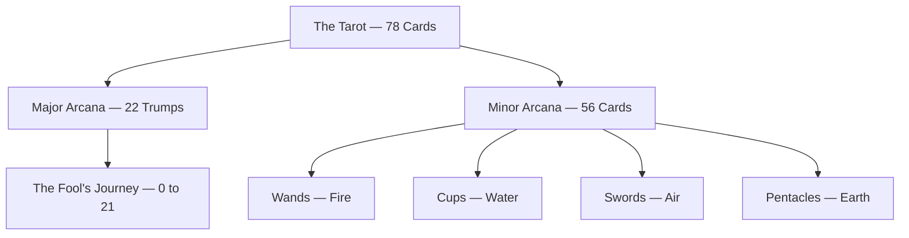

# Tarot

> *Archetypal wisdom through the cards.*

---

## Tarot Practice

Tarot serves as a tool for accessing archetypal wisdom and intuitive insight. The practice sits at the intersection of Jungian psychology, mythology, and personal spirituality — using 78 cards as mirrors for the psyche and guides through life's complexities.

The approach tends toward the intuitive rather than strictly traditional. While honoring the established meanings and symbolism, the cards speak most powerfully when their archetypal images resonate with immediate psychological truth. Each reading becomes a conversation between conscious intention and unconscious wisdom.

Every card below has its own page — imagery, upright and reversed meaning, correspondence, archetype, mythological echoes, and how it tends to land in a reading.

At a glance, the deck divides cleanly into its two arcana and the four elemental suits beneath the minor.

---

## The Major Arcana

The 22 trumps trace the [Fool's Journey](/knowledge/tarot/major-arcana/the-fool) — a path of spiritual development through archetypal stages, mapping onto Jung's [individuation](/knowledge/psychology/jungian/individuation) from innocent unknowing to realized [Self](/knowledge/psychology/jungian/the-self). They live in the [Major Arcana](/knowledge/tarot/major-arcana) folder.

**[The Fool](/knowledge/tarot/major-arcana/the-fool)** *(0)* — New beginnings, innocence, leap of faith
**[The Magician](/knowledge/tarot/major-arcana/the-magician)** *(I)* — Manifestation, skill, "as above, so below"
**[The High Priestess](/knowledge/tarot/major-arcana/the-high-priestess)** *(II)* — Intuition, mystery, the unconscious
**[The Empress](/knowledge/tarot/major-arcana/the-empress)** *(III)* — Abundance, nurturing, fertility
**[The Emperor](/knowledge/tarot/major-arcana/the-emperor)** *(IV)* — Authority, structure, father figure
**[The Hierophant](/knowledge/tarot/major-arcana/the-hierophant)** *(V)* — Tradition, spiritual teaching, conformity
**[The Lovers](/knowledge/tarot/major-arcana/the-lovers)** *(VI)* — Union, choice, relationships
**[The Chariot](/knowledge/tarot/major-arcana/the-chariot)** *(VII)* — Willpower, control, victory
**[Strength](/knowledge/tarot/major-arcana/strength)** *(VIII)* — Inner strength, courage, compassion
**[The Hermit](/knowledge/tarot/major-arcana/the-hermit)** *(IX)* — Solitude, introspection, wisdom
**[Wheel of Fortune](/knowledge/tarot/major-arcana/wheel-of-fortune)** *(X)* — Cycles, fate, change
**[Justice](/knowledge/tarot/major-arcana/justice)** *(XI)* — Balance, karma, truth
**[The Hanged Man](/knowledge/tarot/major-arcana/the-hanged-man)** *(XII)* — Surrender, new perspective, sacrifice
**[Death](/knowledge/tarot/major-arcana/death)** *(XIII)* — Transformation, endings, rebirth
**[Temperance](/knowledge/tarot/major-arcana/temperance)** *(XIV)* — Balance, moderation, alchemy
**[The Devil](/knowledge/tarot/major-arcana/the-devil)** *(XV)* — Bondage, materialism, shadow
**[The Tower](/knowledge/tarot/major-arcana/the-tower)** *(XVI)* — Sudden change, revelation, breakdown
**[The Star](/knowledge/tarot/major-arcana/the-star)** *(XVII)* — Hope, inspiration, healing
**[The Moon](/knowledge/tarot/major-arcana/the-moon)** *(XVIII)* — Illusion, intuition, the unconscious
**[The Sun](/knowledge/tarot/major-arcana/the-sun)** *(XIX)* — Joy, success, clarity
**[Judgement](/knowledge/tarot/major-arcana/judgement)** *(XX)* — Awakening, renewal, reckoning
**[The World](/knowledge/tarot/major-arcana/the-world)** *(XXI)* — Completion, integration, wholeness

---

## The Minor Arcana

The 56 cards of the Minor Arcana address the everyday experiences and challenges of life, organized into four suits that correspond to the classical elements. Each suit carries its own energy and domain of experience. They live in the [Minor Arcana](/knowledge/tarot/minor-arcana) folder.

### Wands · Fire

Passion, creativity, and action. Willpower and energy. Spiritual matters and inspiration.

[Ace of Wands](/knowledge/tarot/minor-arcana/ace-of-wands) · [Two of Wands](/knowledge/tarot/minor-arcana/two-of-wands) · [Three of Wands](/knowledge/tarot/minor-arcana/three-of-wands) · [Four of Wands](/knowledge/tarot/minor-arcana/four-of-wands) · [Five of Wands](/knowledge/tarot/minor-arcana/five-of-wands) · [Six of Wands](/knowledge/tarot/minor-arcana/six-of-wands) · [Seven of Wands](/knowledge/tarot/minor-arcana/seven-of-wands) · [Eight of Wands](/knowledge/tarot/minor-arcana/eight-of-wands) · [Nine of Wands](/knowledge/tarot/minor-arcana/nine-of-wands) · [Ten of Wands](/knowledge/tarot/minor-arcana/ten-of-wands) · [Page of Wands](/knowledge/tarot/minor-arcana/page-of-wands) · [Knight of Wands](/knowledge/tarot/minor-arcana/knight-of-wands) · [Queen of Wands](/knowledge/tarot/minor-arcana/queen-of-wands) · [King of Wands](/knowledge/tarot/minor-arcana/king-of-wands)

### Cups · Water

Emotions, relationships, and intuition. The heart and feelings. Love and connection.

[Ace of Cups](/knowledge/tarot/minor-arcana/ace-of-cups) · [Two of Cups](/knowledge/tarot/minor-arcana/two-of-cups) · [Three of Cups](/knowledge/tarot/minor-arcana/three-of-cups) · [Four of Cups](/knowledge/tarot/minor-arcana/four-of-cups) · [Five of Cups](/knowledge/tarot/minor-arcana/five-of-cups) · [Six of Cups](/knowledge/tarot/minor-arcana/six-of-cups) · [Seven of Cups](/knowledge/tarot/minor-arcana/seven-of-cups) · [Eight of Cups](/knowledge/tarot/minor-arcana/eight-of-cups) · [Nine of Cups](/knowledge/tarot/minor-arcana/nine-of-cups) · [Ten of Cups](/knowledge/tarot/minor-arcana/ten-of-cups) · [Page of Cups](/knowledge/tarot/minor-arcana/page-of-cups) · [Knight of Cups](/knowledge/tarot/minor-arcana/knight-of-cups) · [Queen of Cups](/knowledge/tarot/minor-arcana/queen-of-cups) · [King of Cups](/knowledge/tarot/minor-arcana/king-of-cups)

### Swords · Air

Thoughts, communication, and conflict. The mind and intellect. Mental clarity and struggle.

[Ace of Swords](/knowledge/tarot/minor-arcana/ace-of-swords) · [Two of Swords](/knowledge/tarot/minor-arcana/two-of-swords) · [Three of Swords](/knowledge/tarot/minor-arcana/three-of-swords) · [Four of Swords](/knowledge/tarot/minor-arcana/four-of-swords) · [Five of Swords](/knowledge/tarot/minor-arcana/five-of-swords) · [Six of Swords](/knowledge/tarot/minor-arcana/six-of-swords) · [Seven of Swords](/knowledge/tarot/minor-arcana/seven-of-swords) · [Eight of Swords](/knowledge/tarot/minor-arcana/eight-of-swords) · [Nine of Swords](/knowledge/tarot/minor-arcana/nine-of-swords) · [Ten of Swords](/knowledge/tarot/minor-arcana/ten-of-swords) · [Page of Swords](/knowledge/tarot/minor-arcana/page-of-swords) · [Knight of Swords](/knowledge/tarot/minor-arcana/knight-of-swords) · [Queen of Swords](/knowledge/tarot/minor-arcana/queen-of-swords) · [King of Swords](/knowledge/tarot/minor-arcana/king-of-swords)

### Pentacles · Earth

Material world, body, and resources. Practicality and manifestation. Work, health, and finances.

[Ace of Pentacles](/knowledge/tarot/minor-arcana/ace-of-pentacles) · [Two of Pentacles](/knowledge/tarot/minor-arcana/two-of-pentacles) · [Three of Pentacles](/knowledge/tarot/minor-arcana/three-of-pentacles) · [Four of Pentacles](/knowledge/tarot/minor-arcana/four-of-pentacles) · [Five of Pentacles](/knowledge/tarot/minor-arcana/five-of-pentacles) · [Six of Pentacles](/knowledge/tarot/minor-arcana/six-of-pentacles) · [Seven of Pentacles](/knowledge/tarot/minor-arcana/seven-of-pentacles) · [Eight of Pentacles](/knowledge/tarot/minor-arcana/eight-of-pentacles) · [Nine of Pentacles](/knowledge/tarot/minor-arcana/nine-of-pentacles) · [Ten of Pentacles](/knowledge/tarot/minor-arcana/ten-of-pentacles) · [Page of Pentacles](/knowledge/tarot/minor-arcana/page-of-pentacles) · [Knight of Pentacles](/knowledge/tarot/minor-arcana/knight-of-pentacles) · [Queen of Pentacles](/knowledge/tarot/minor-arcana/queen-of-pentacles) · [King of Pentacles](/knowledge/tarot/minor-arcana/king-of-pentacles)

---

## Spreads & Methods

The way cards are laid out and interpreted varies with the question and context. Some spreads are classic and time-tested, while others emerge organically from the moment's needs.

### Common Spreads

**Single card** draws offer daily reflection and focus. **Three-card** spreads address past/present/future or situation/action/outcome. The **Celtic Cross** provides a comprehensive 10-card spread for complex questions.

### Reading Approach

Readings begin with clear intention and question framing. The cards themselves speak through both traditional meanings and immediate intuitive impressions. The most powerful readings emerge when book knowledge and spontaneous insight work together. Journaling the readings preserves them for later reflection and tracks patterns over time.

---

## Tarot and Jungian Psychology

The correspondence between tarot and Jungian psychology runs deep. The Major Arcana represents archetypal forces from the collective unconscious — universal patterns of human experience that appear across cultures and eras. Court cards embody different personality aspects and ways of engaging with the world. Reading tarot becomes a journey through the unconscious mind, making the invisible visible through symbolic imagery.

### The Fool's Journey as Individuation

The 22 cards of the Major Arcana map onto Jung's concept of [individuation](/knowledge/psychology/jungian/individuation) — the process of becoming psychologically whole. [The Fool](/knowledge/tarot/major-arcana/the-fool) begins the journey in innocent unknowing, encounters archetypal forces ([The Magician](/knowledge/tarot/major-arcana/the-magician), [The High Priestess](/knowledge/tarot/major-arcana/the-high-priestess), [The Empress](/knowledge/tarot/major-arcana/the-empress), [The Emperor](/knowledge/tarot/major-arcana/the-emperor)), faces trials and transformations ([Death](/knowledge/tarot/major-arcana/death), [The Tower](/knowledge/tarot/major-arcana/the-tower)), and ultimately achieves integration ([The World](/knowledge/tarot/major-arcana/the-world)). Death represents ego death — the necessary destruction of old patterns. The World represents realization of [the Self](/knowledge/psychology/jungian/the-self) — the union of conscious and unconscious into wholeness.

Even the "negative" cards serve the individuation process. [The Devil](/knowledge/tarot/major-arcana/the-devil) forces confrontation with shadow material. [The Tower](/knowledge/tarot/major-arcana/the-tower) breaks down false structures. [The Hanged Man](/knowledge/tarot/major-arcana/the-hanged-man) demands surrender of control. Growth comes through the entire cycle, not just the pleasant cards.

### Specific Correspondences

- **[The High Priestess](/knowledge/tarot/major-arcana/the-high-priestess)** — Anima, the feminine soul-image
- **[The Emperor](/knowledge/tarot/major-arcana/the-emperor)** — Animus, the masculine soul-image
- **[The Devil](/knowledge/tarot/major-arcana/the-devil)** — Shadow, the repressed or rejected self
- **[The Hermit](/knowledge/tarot/major-arcana/the-hermit)** — Wise Old Man, inner guidance
- **[The Empress](/knowledge/tarot/major-arcana/the-empress)** — Great Mother, nurturing archetype
- **[The Tower](/knowledge/tarot/major-arcana/the-tower)** — Confrontation with the unconscious, necessary breakdown

See: Jungian Archetypes

---

## Tarot and Mythology

The archetypal images in tarot echo mythological figures across cultures. [The Fool](/knowledge/tarot/major-arcana/the-fool) embodies the universal Trickster — boundary-crossing, rule-breaking, paradoxical wisdom through apparent foolishness. [Death](/knowledge/tarot/major-arcana/death) channels deities of transformation and the underworld: [Hades](/knowledge/mythology/greek-mythology/hades) guiding souls through transition, Kali destroying to create anew. [The Empress](/knowledge/tarot/major-arcana/the-empress) resonates with nurturing goddesses like [Demeter](/knowledge/mythology/greek-mythology/demeter) and Venus. [The Emperor](/knowledge/tarot/major-arcana/the-emperor) carries the authority of Zeus and Jupiter. [The Hermit](/knowledge/tarot/major-arcana/the-hermit) appears as the wise counselor found in countless myths — the guide who offers truth to those who seek it in solitude.

These connections aren't arbitrary. Tarot and mythology both draw from the same wellspring — the collective unconscious and its archetypal patterns. The cards give form to forces that myths have always personified.

See: [Mythology Hub](/knowledge/mythology)

---

## Ethical Reading

Tarot is not fortune-telling in the deterministic sense — it doesn't predict an inevitable future but illuminates present energies and potential paths. The cards serve as tools for reflection and insight, offering guidance rather than commands. Free will remains central. Readings show possibilities and patterns, not certainties.

When reading for others, boundaries matter. Always approach with permission and respect. The cards don't replace medical, legal, or professional advice. The goal is empowerment, not dependence — helping people access their own wisdom, not creating reliance on the reader. Every reading should leave the querent with greater clarity and agency, not diminished autonomy.

### Key Principles

- Readings illuminate, they don't determine
- Respect boundaries and consent
- Empower rather than create dependence
- Never replace professional help when needed

---

## Related

- [Spirituality Hub](/knowledge/spirituality)
- [Synchronicity](/knowledge/psychology/jungian/synchronicity)
- [Archetypal Patterns](/knowledge/mythology)
- [Kabbalah](/knowledge/spirituality/kabbalah) — Major Arcana maps to the 22 paths on the Tree of Life
- [Hermeticism](/knowledge/spirituality/hermeticism) — "As above, so below" in [The Magician](/knowledge/tarot/major-arcana/the-magician)
- [Alchemy](/knowledge/alchemy) — [Temperance](/knowledge/tarot/major-arcana/temperance) and transformation symbolism
- The Shadow — [The Devil](/knowledge/tarot/major-arcana/the-devil) card as shadow confrontation
- [Individuation](/knowledge/psychology/jungian/individuation) — The Fool's Journey as individuation process
