# Major Arcana

> *The twenty-two trumps — the soul's journey from innocence to wholeness.*

---

The Major Arcana are the twenty-two trump cards, the spine of the deck. Where the [Minor Arcana](/knowledge/tarot/minor-arcana) handle the texture of daily life, the trumps map the great archetypal forces — the ones that move a life rather than a moment. Read in sequence they trace the [Fool's Journey](/knowledge/tarot/major-arcana/the-fool), a path that Jung would recognize as [individuation](/knowledge/psychology/jungian/individuation): the movement from innocent unknowing, through encounter and trial, to the realized [Self](/knowledge/psychology/jungian/the-self) pictured in [The World](/knowledge/tarot/major-arcana/the-world).

**[The Fool](/knowledge/tarot/major-arcana/the-fool)** *(0)* — New beginnings, innocence, leap of faith
**[The Magician](/knowledge/tarot/major-arcana/the-magician)** *(I)* — Manifestation, skill, "as above, so below"
**[The High Priestess](/knowledge/tarot/major-arcana/the-high-priestess)** *(II)* — Intuition, mystery, the unconscious
**[The Empress](/knowledge/tarot/major-arcana/the-empress)** *(III)* — Abundance, nurturing, fertility
**[The Emperor](/knowledge/tarot/major-arcana/the-emperor)** *(IV)* — Authority, structure, father figure
**[The Hierophant](/knowledge/tarot/major-arcana/the-hierophant)** *(V)* — Tradition, spiritual teaching, conformity
**[The Lovers](/knowledge/tarot/major-arcana/the-lovers)** *(VI)* — Union, choice, relationships
**[The Chariot](/knowledge/tarot/major-arcana/the-chariot)** *(VII)* — Willpower, control, victory
**[Strength](/knowledge/tarot/major-arcana/strength)** *(VIII)* — Inner strength, courage, compassion
**[The Hermit](/knowledge/tarot/major-arcana/the-hermit)** *(IX)* — Solitude, introspection, wisdom
**[Wheel of Fortune](/knowledge/tarot/major-arcana/wheel-of-fortune)** *(X)* — Cycles, fate, change
**[Justice](/knowledge/tarot/major-arcana/justice)** *(XI)* — Balance, karma, truth
**[The Hanged Man](/knowledge/tarot/major-arcana/the-hanged-man)** *(XII)* — Surrender, new perspective, sacrifice
**[Death](/knowledge/tarot/major-arcana/death)** *(XIII)* — Transformation, endings, rebirth
**[Temperance](/knowledge/tarot/major-arcana/temperance)** *(XIV)* — Balance, moderation, alchemy
**[The Devil](/knowledge/tarot/major-arcana/the-devil)** *(XV)* — Bondage, materialism, shadow
**[The Tower](/knowledge/tarot/major-arcana/the-tower)** *(XVI)* — Sudden change, revelation, breakdown
**[The Star](/knowledge/tarot/major-arcana/the-star)** *(XVII)* — Hope, inspiration, healing
**[The Moon](/knowledge/tarot/major-arcana/the-moon)** *(XVIII)* — Illusion, intuition, the unconscious
**[The Sun](/knowledge/tarot/major-arcana/the-sun)** *(XIX)* — Joy, success, clarity
**[Judgement](/knowledge/tarot/major-arcana/judgement)** *(XX)* — Awakening, renewal, reckoning
**[The World](/knowledge/tarot/major-arcana/the-world)** *(XXI)* — Completion, integration, wholeness

Read as an ordered progression, the key stations of the journey run from innocence through encounter and trial to wholeness.

```mermaid
flowchart LR
    F["The Fool — 0"] --> M["The Magician — I"]
    M --> HP["The High Priestess — II"]
    HP --> L["The Lovers — VI"]
    L --> WF["Wheel of Fortune — X"]
    WF --> D["Death — XIII"]
    D --> T["The Tower — XVI"]
    T --> St["The Star — XVII"]
    St --> Su["The Sun — XIX"]
    Su --> Wo["The World — XXI"]
```

---

## Related

- [Tarot](/knowledge/tarot)
- [Minor Arcana](/knowledge/tarot/minor-arcana)
- [Individuation](/knowledge/psychology/jungian/individuation) — the Fool's Journey as the path to wholeness
- [Kabbalah](/knowledge/spirituality/kabbalah) — the trumps map to the 22 paths on the Tree of Life
