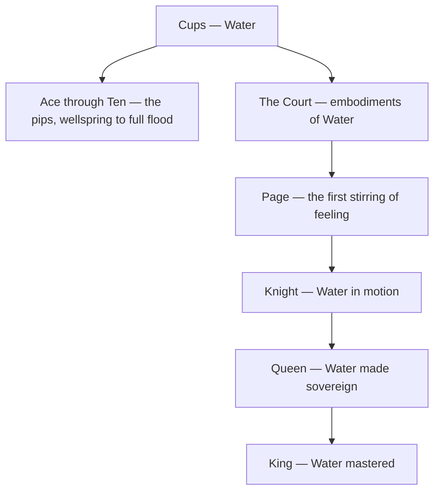

# Cups

> *Every cup is a small argument that the sea can be held.*

---

## The Element

Cups is the suit of [Water](/knowledge/elements/water) — the element of feeling, love, and the unconscious. These are the cards of the heart: emotion in all its tides, relationship and connection, intuition, dream, and the deep inward currents that move beneath the deliberate mind. The suit takes its name from the chalice, the vessel that receives and contains — the shape that lets formless water be held, offered, shared, or spilled. Its domain is everything that flows between people and everything that rises unbidden from within: attraction and grief, imagination and longing, the sympathetic ache that tells you what you feel before you can name it. Every Cups card asks whether you are willing to feel what you have kept submerged.

## The Aces Through Tens

The pips of Cups trace the arc of feeling from first wellspring to full flood. The [Ace of Cups](/knowledge/tarot/minor-arcana/ace-of-cups) is the pure source — the Root of the Powers of Water, an overflowing chalice offered from the clouds, grace arriving unearned. From there emotion takes shape and finds its objects: the mirrored union of the Two, the joyful communion of the Three, the withdrawn discontent of the Four, the mourning over spilt cups in the Five, the tender nostalgia of the Six. Then feeling turns inward and is tested — the fantasy and choice of the Seven, the walking-away of the Eight, the satisfied wish of the Nine — until it arrives at the [Ten of Cups](/knowledge/tarot/minor-arcana/ten-of-cups), the rainbow over a family, emotional fulfillment made whole and shared. The arc is the education of the heart: it opens, it bonds, it grieves and imagines, and it learns at last what lasting contentment actually feels like.

## The Court Cards

The four courts personify ways of embodying Water. The [Page of Cups](/knowledge/tarot/minor-arcana/page-of-cups) is the first stirring of feeling — the dreamy messenger, imaginative and tender, a fish surfacing unexpectedly in the cup. The [Knight of Cups](/knowledge/tarot/minor-arcana/knight-of-cups) is Water in motion, the romantic and the idealist, offering his heart like a grail, beautiful and prone to drifting on his own moods. The [Queen of Cups](/knowledge/tarot/minor-arcana/queen-of-cups) is Water made sovereign — the empath enthroned at the shore, feeling everything without drowning, compassion grown into wisdom. The [King of Cups](/knowledge/tarot/minor-arcana/king-of-cups) is Water mastered — emotion held in mature balance, the calm counselor who rules the tides of feeling rather than being ruled by them. Together they run from the dreaming child to the steady, feeling adult.

The suit's shape, from its element down through the pips and the rising court, looks like this.

## Correspondence

In the Golden Dawn system, Cups answers to the first **Heh** of the Tetragrammaton — the receptive, maternal letter of the divine name, the waters that the primal spark impregnates. Its direction is **West**, the quarter of sunset and the returning tide, where the day sinks back into the deep. In [Astrology](/knowledge/astrology) the suit governs the watery triplicity — the cardinal tide of [Cancer](/knowledge/astrology/signs/cancer), the fixed depth of [Scorpio](/knowledge/astrology/signs/scorpio), and the mutable ocean of [Pisces](/knowledge/astrology/signs/pisces). See the [Table of Correspondences](/knowledge/table-of-correspondences) for the full grid of associations.

## In Reading

When Cups dominate a spread, the reading is about the emotional life — love, relationship, intuition, and the state of the heart. Cups ask what is being felt and whether feeling is flowing freely or dammed; they favour attunement over analysis and connection over control. Their shadow is the same as Water's: overwhelm, illusion, escapism, the loss of any shore to stand on.

## Related

- [Ace of Cups](/knowledge/tarot/minor-arcana/ace-of-cups)
- [Ten of Cups](/knowledge/tarot/minor-arcana/ten-of-cups)
- [Page of Cups](/knowledge/tarot/minor-arcana/page-of-cups)
- [Knight of Cups](/knowledge/tarot/minor-arcana/knight-of-cups)
- [Queen of Cups](/knowledge/tarot/minor-arcana/queen-of-cups)
- [King of Cups](/knowledge/tarot/minor-arcana/king-of-cups)
- [Water](/knowledge/elements/water)
- [Elements](/knowledge/elements)
- [Minor Arcana](/knowledge/tarot/minor-arcana)
- [Tarot](/knowledge/tarot)
- [Table of Correspondences](/knowledge/table-of-correspondences)
- [Wands](/knowledge/tarot/minor-arcana/wands), [Swords](/knowledge/tarot/minor-arcana/swords), [Pentacles](/knowledge/tarot/minor-arcana/pentacles)
