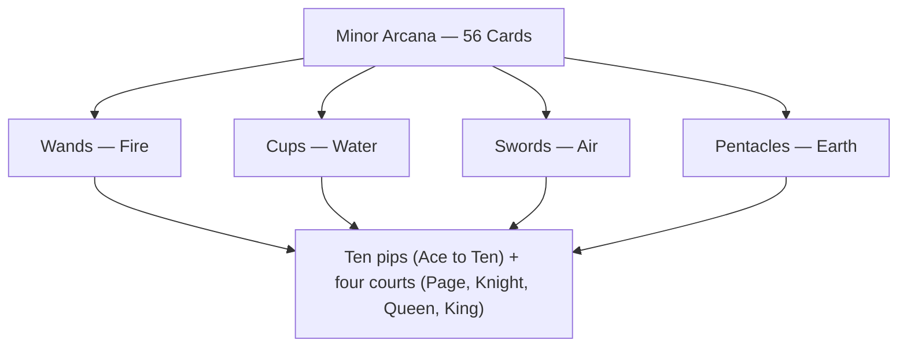

# Minor Arcana

> *The fifty-six cards of daily life — the four suits and their elements.*

---

The Minor Arcana are the fifty-six cards that handle the texture of ordinary experience — the choices, moods, labors, and encounters that fill the space between the great turnings of the [Major Arcana](/knowledge/tarot/major-arcana). They divide into four suits, each tied to one of the classical elements and one domain of life. The numbered pips (Ace through Ten) trace a situation from seed to fruition; the court cards — Page, Knight, Queen, King — personify ways of embodying the suit's energy.

Each suit has its own overview page tracing the element, the arc of the pips, the courts, and the astrological and Kabbalistic correspondence: [Wands](/knowledge/tarot/minor-arcana/wands) · Fire, [Cups](/knowledge/tarot/minor-arcana/cups) · Water, [Swords](/knowledge/tarot/minor-arcana/swords) · Air, and [Pentacles](/knowledge/tarot/minor-arcana/pentacles) · Earth.

The four suits share one architecture — an element apiece, the same ten pips, and the same four courts.

### Wands · Fire

Passion, creativity, and action. Willpower and energy. Spiritual matters and inspiration.

[Ace of Wands](/knowledge/tarot/minor-arcana/ace-of-wands) · [Two of Wands](/knowledge/tarot/minor-arcana/two-of-wands) · [Three of Wands](/knowledge/tarot/minor-arcana/three-of-wands) · [Four of Wands](/knowledge/tarot/minor-arcana/four-of-wands) · [Five of Wands](/knowledge/tarot/minor-arcana/five-of-wands) · [Six of Wands](/knowledge/tarot/minor-arcana/six-of-wands) · [Seven of Wands](/knowledge/tarot/minor-arcana/seven-of-wands) · [Eight of Wands](/knowledge/tarot/minor-arcana/eight-of-wands) · [Nine of Wands](/knowledge/tarot/minor-arcana/nine-of-wands) · [Ten of Wands](/knowledge/tarot/minor-arcana/ten-of-wands) · [Page of Wands](/knowledge/tarot/minor-arcana/page-of-wands) · [Knight of Wands](/knowledge/tarot/minor-arcana/knight-of-wands) · [Queen of Wands](/knowledge/tarot/minor-arcana/queen-of-wands) · [King of Wands](/knowledge/tarot/minor-arcana/king-of-wands)

### Cups · Water

Emotions, relationships, and intuition. The heart and feelings. Love and connection.

[Ace of Cups](/knowledge/tarot/minor-arcana/ace-of-cups) · [Two of Cups](/knowledge/tarot/minor-arcana/two-of-cups) · [Three of Cups](/knowledge/tarot/minor-arcana/three-of-cups) · [Four of Cups](/knowledge/tarot/minor-arcana/four-of-cups) · [Five of Cups](/knowledge/tarot/minor-arcana/five-of-cups) · [Six of Cups](/knowledge/tarot/minor-arcana/six-of-cups) · [Seven of Cups](/knowledge/tarot/minor-arcana/seven-of-cups) · [Eight of Cups](/knowledge/tarot/minor-arcana/eight-of-cups) · [Nine of Cups](/knowledge/tarot/minor-arcana/nine-of-cups) · [Ten of Cups](/knowledge/tarot/minor-arcana/ten-of-cups) · [Page of Cups](/knowledge/tarot/minor-arcana/page-of-cups) · [Knight of Cups](/knowledge/tarot/minor-arcana/knight-of-cups) · [Queen of Cups](/knowledge/tarot/minor-arcana/queen-of-cups) · [King of Cups](/knowledge/tarot/minor-arcana/king-of-cups)

### Swords · Air

Thoughts, communication, and conflict. The mind and intellect. Mental clarity and struggle.

[Ace of Swords](/knowledge/tarot/minor-arcana/ace-of-swords) · [Two of Swords](/knowledge/tarot/minor-arcana/two-of-swords) · [Three of Swords](/knowledge/tarot/minor-arcana/three-of-swords) · [Four of Swords](/knowledge/tarot/minor-arcana/four-of-swords) · [Five of Swords](/knowledge/tarot/minor-arcana/five-of-swords) · [Six of Swords](/knowledge/tarot/minor-arcana/six-of-swords) · [Seven of Swords](/knowledge/tarot/minor-arcana/seven-of-swords) · [Eight of Swords](/knowledge/tarot/minor-arcana/eight-of-swords) · [Nine of Swords](/knowledge/tarot/minor-arcana/nine-of-swords) · [Ten of Swords](/knowledge/tarot/minor-arcana/ten-of-swords) · [Page of Swords](/knowledge/tarot/minor-arcana/page-of-swords) · [Knight of Swords](/knowledge/tarot/minor-arcana/knight-of-swords) · [Queen of Swords](/knowledge/tarot/minor-arcana/queen-of-swords) · [King of Swords](/knowledge/tarot/minor-arcana/king-of-swords)

### Pentacles · Earth

Material world, body, and resources. Practicality and manifestation. Work, health, and finances.

[Ace of Pentacles](/knowledge/tarot/minor-arcana/ace-of-pentacles) · [Two of Pentacles](/knowledge/tarot/minor-arcana/two-of-pentacles) · [Three of Pentacles](/knowledge/tarot/minor-arcana/three-of-pentacles) · [Four of Pentacles](/knowledge/tarot/minor-arcana/four-of-pentacles) · [Five of Pentacles](/knowledge/tarot/minor-arcana/five-of-pentacles) · [Six of Pentacles](/knowledge/tarot/minor-arcana/six-of-pentacles) · [Seven of Pentacles](/knowledge/tarot/minor-arcana/seven-of-pentacles) · [Eight of Pentacles](/knowledge/tarot/minor-arcana/eight-of-pentacles) · [Nine of Pentacles](/knowledge/tarot/minor-arcana/nine-of-pentacles) · [Ten of Pentacles](/knowledge/tarot/minor-arcana/ten-of-pentacles) · [Page of Pentacles](/knowledge/tarot/minor-arcana/page-of-pentacles) · [Knight of Pentacles](/knowledge/tarot/minor-arcana/knight-of-pentacles) · [Queen of Pentacles](/knowledge/tarot/minor-arcana/queen-of-pentacles) · [King of Pentacles](/knowledge/tarot/minor-arcana/king-of-pentacles)

---

## Related

- [Wands](/knowledge/tarot/minor-arcana/wands), [Cups](/knowledge/tarot/minor-arcana/cups), [Swords](/knowledge/tarot/minor-arcana/swords), [Pentacles](/knowledge/tarot/minor-arcana/pentacles)
- [Tarot](/knowledge/tarot)
- [Major Arcana](/knowledge/tarot/major-arcana)
