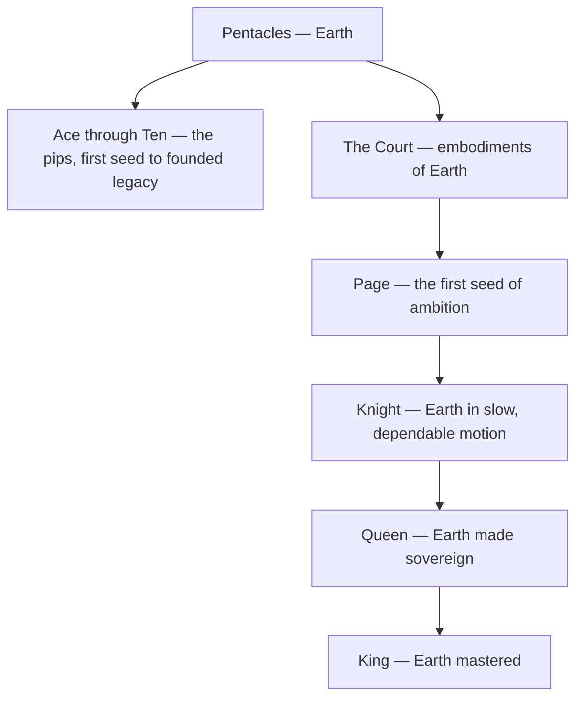

# Pentacles

> *Everything true must eventually agree to have a price, a weight, and a place to be kept.*

---

## The Element

Pentacles is the suit of [Earth](/knowledge/elements/earth) — the element of body, matter, and manifestation. Also called Coins or Disks, these are the cards where intention finally takes a form you can touch: money and work, health and the body, home and craft, the slow accrual of what actually lasts. The suit takes its name from the coin or disk, the minted round of value — spirit pressed into substance, the abstract made countable. Its domain is the material world in all its plainness and dignity: the harvest that answers the season's labour, the wealth that shelters, the skill perfected by patient repetition. Where the other suits aspire, Pentacles abide. Every Pentacles card asks the plainest and hardest question of all: what have you actually built.

## The Aces Through Tens

The pips of Pentacles trace the arc of manifestation from first seed to founded legacy. The [Ace of Pentacles](/knowledge/tarot/minor-arcana/ace-of-pentacles) is the pure gift of matter — the Root of the Powers of Earth, a single coin held out from the clouds above a fertile garden, opportunity made tangible. From there the seed is worked into wealth: the juggled balance of the Two, the collaborative craft of the Three, the clutching security of the Four, the cold exclusion of the Five, the measured charity of the Six. Then labour meets the long test of time — the patient waiting of the Seven, the diligent mastery of the Eight, the earned abundance of the Nine — until it arrives at the [Ten of Pentacles](/knowledge/tarot/minor-arcana/ten-of-pentacles), generations gathered in a courtyard of established wealth, legacy and belonging made solid. The arc is the education of the hands: it plants, it labours, it hoards and shares, and it learns that what endures is not the coin but the house, the craft, and the family the coin was always meant to serve.

## The Court Cards

The four courts personify ways of embodying Earth. The [Page of Pentacles](/knowledge/tarot/minor-arcana/page-of-pentacles) is the first seed of ambition — the studious messenger, contemplating a single coin, eager to learn a trade or begin a practical venture. The [Knight of Pentacles](/knowledge/tarot/minor-arcana/knight-of-pentacles) is Earth in its slow, dependable motion — the only still knight in the deck, unglamorous and utterly reliable, plodding steadily toward what he has promised to complete. The [Queen of Pentacles](/knowledge/tarot/minor-arcana/queen-of-pentacles) is Earth made sovereign — the nurturing provider enthroned in a garden, generous and grounded, tending body, home, and living things with quiet abundance. The [King of Pentacles](/knowledge/tarot/minor-arcana/king-of-pentacles) is Earth mastered — the steady patriarch of accumulated wealth, secure and munificent, the builder whose enterprise supports everyone around him. Together they run from the studious beginner to the settled, providing master.

The suit's shape, from its element down through the pips and the rising court, looks like this.

## Correspondence

In the Golden Dawn system, Pentacles answers to the final **Heh** of the Tetragrammaton — the last letter of the divine name, the daughter, the material world in which spirit at last comes to rest and completion. Its direction is **North**, the quarter of midnight, cold and stable, the ground that holds. In [Astrology](/knowledge/astrology) the suit governs the earthy triplicity — the fixed ground of [Taurus](/knowledge/astrology/signs/taurus), the mutable hand of [Virgo](/knowledge/astrology/signs/virgo), and the cardinal summit of [Capricorn](/knowledge/astrology/signs/capricorn). See the [Table of Correspondences](/knowledge/table-of-correspondences) for the full grid of associations.

## In Reading

When Pentacles dominate a spread, the reading is about the material and practical life — work, money, health, home, and the tangible results of effort. Pentacles ask what is being built and whether it stands on solid ground; they favour patience over impulse and substance over promise. Their shadow is the same as Earth's: greed, inertia, materialism, the density that forgets it was ever meant to move.

## Related

- [Ace of Pentacles](/knowledge/tarot/minor-arcana/ace-of-pentacles)
- [Ten of Pentacles](/knowledge/tarot/minor-arcana/ten-of-pentacles)
- [Page of Pentacles](/knowledge/tarot/minor-arcana/page-of-pentacles)
- [Knight of Pentacles](/knowledge/tarot/minor-arcana/knight-of-pentacles)
- [Queen of Pentacles](/knowledge/tarot/minor-arcana/queen-of-pentacles)
- [King of Pentacles](/knowledge/tarot/minor-arcana/king-of-pentacles)
- [Earth](/knowledge/elements/earth)
- [Elements](/knowledge/elements)
- [Minor Arcana](/knowledge/tarot/minor-arcana)
- [Tarot](/knowledge/tarot)
- [Table of Correspondences](/knowledge/table-of-correspondences)
- [Wands](/knowledge/tarot/minor-arcana/wands), [Cups](/knowledge/tarot/minor-arcana/cups), [Swords](/knowledge/tarot/minor-arcana/swords)
