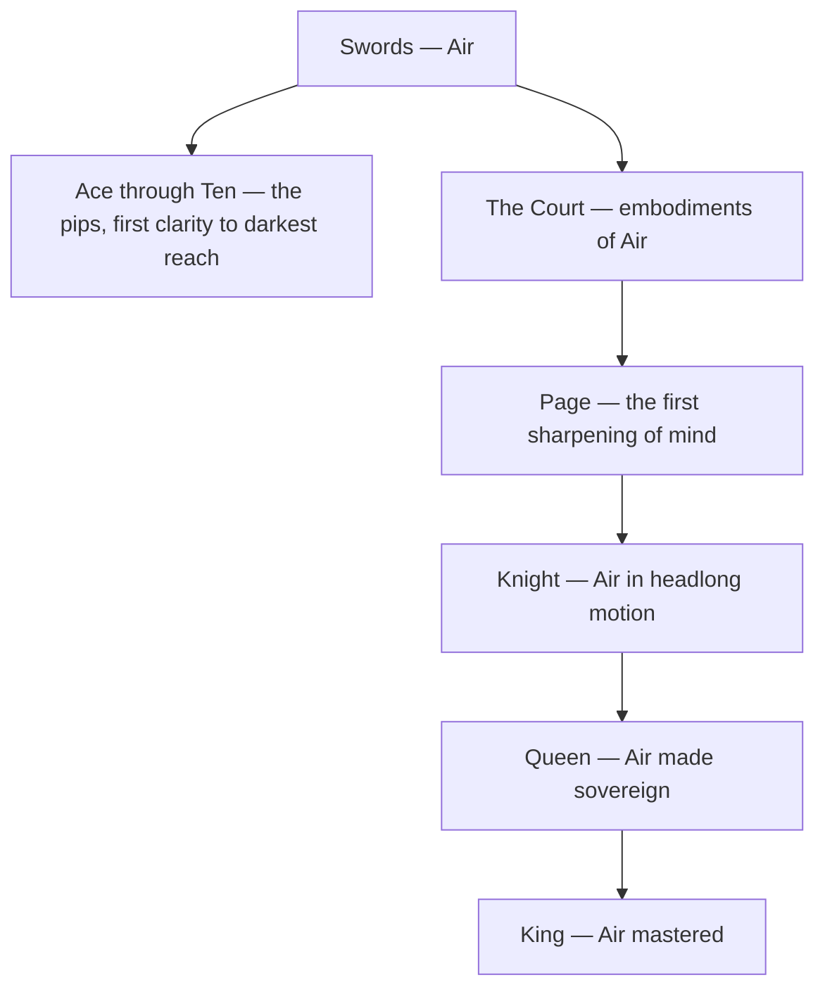

# Swords

> *The blade cuts cleanest, which is why it wounds even when it tells the truth.*

---

## The Element

Swords is the suit of [Air](/knowledge/elements/air) — the element of intellect, thought, and speech. These are the cards of the mind: reason and clarity, conflict and truth, communication, decision, and the struggle that thinking inevitably produces when it meets a world that will not hold still. The suit takes its name from the blade, the instrument that separates — that divides one thing from another in order to understand it, and that can cut through illusion at the cost of comfort. Its domain is the sharp faculty that names and distinguishes, and also the anguish that follows when the mind turns against itself: anxiety, grief, conflict, and the cruelty of thought severed from feeling. Every Swords card asks whether you can think clearly without losing your heart.

## The Aces Through Tens

The pips of Swords trace the arc of the mind from first clarity to its darkest reach — and this is the suit's reputation, the "difficult" suit, because the intellect's honest journey passes through more suffering than the others. The [Ace of Swords](/knowledge/tarot/minor-arcana/ace-of-swords) is the pure edge — the Root of the Powers of Air, a crowned sword rising through the clouds, truth in its keenest form. From there thought meets the world's resistance: the stalemate of the Two, the pierced heart of the Three, the enforced rest of the Four, the hollow victory of the Five, the passage toward calmer water in the Six. Then the mind turns on itself — the stealth of the Seven, the self-made prison of the Eight, the nightmare of the Nine — until it arrives at the [Ten of Swords](/knowledge/tarot/minor-arcana/ten-of-swords), rock bottom, the mind's catastrophe complete, and with it the strange dawn that only the very bottom permits. The arc is the education of the intellect: it clarifies, it fights, it deceives and despairs, and it learns that the blade which cuts through illusion can also turn inward and bleed the one who holds it.

## The Court Cards

The four courts personify ways of embodying Air. The [Page of Swords](/knowledge/tarot/minor-arcana/page-of-swords) is the first sharpening of mind — the vigilant messenger, curious and quick-tongued, alert for truth and prone to using it carelessly. The [Knight of Swords](/knowledge/tarot/minor-arcana/knight-of-swords) is Air in headlong motion, the crusader who charges into conflict with brilliant, reckless force, all argument and no patience. The [Queen of Swords](/knowledge/tarot/minor-arcana/queen-of-swords) is Air made sovereign — clarity earned through loss, perceptive and unsentimental, honest to the point of severity. The [King of Swords](/knowledge/tarot/minor-arcana/king-of-swords) is Air mastered — the judge and strategist, intellect married to ethics, the mind that rules with disciplined, impartial authority. Together they run from the eager wit to the seasoned, exacting mind.

The suit's shape, from its element down through the pips and the rising court, looks like this.

## Correspondence

In the Golden Dawn system, Swords answers to the **Vau** of the Tetragrammaton — the connecting letter of the divine name, the offspring of the primal spark and the receptive waters, mind born of will and feeling. Its direction is **East**, the quarter of dawn and the rising wind, where light first breaks over the horizon. In [Astrology](/knowledge/astrology) the suit governs the airy triplicity — the cardinal wind of [Gemini](/knowledge/astrology/signs/gemini), the fixed sky of [Libra](/knowledge/astrology/signs/libra), and the mutable current of [Aquarius](/knowledge/astrology/signs/aquarius). See the [Table of Correspondences](/knowledge/table-of-correspondences) for the full grid of associations.

## In Reading

When Swords dominate a spread, the reading is about the mind — thought, communication, conflict, and the ways clarity both frees and cuts. Swords ask what is being thought and whether the intellect serves the heart or overrides it; they favour truth over comfort and often name the struggles a person would rather not look at directly. Their shadow is the same as Air's: cruelty, anxiety, overthinking, the blade of judgment turned against oneself.

## Related

- [Ace of Swords](/knowledge/tarot/minor-arcana/ace-of-swords)
- [Ten of Swords](/knowledge/tarot/minor-arcana/ten-of-swords)
- [Page of Swords](/knowledge/tarot/minor-arcana/page-of-swords)
- [Knight of Swords](/knowledge/tarot/minor-arcana/knight-of-swords)
- [Queen of Swords](/knowledge/tarot/minor-arcana/queen-of-swords)
- [King of Swords](/knowledge/tarot/minor-arcana/king-of-swords)
- [Air](/knowledge/elements/air)
- [Elements](/knowledge/elements)
- [Minor Arcana](/knowledge/tarot/minor-arcana)
- [Tarot](/knowledge/tarot)
- [Table of Correspondences](/knowledge/table-of-correspondences)
- [Wands](/knowledge/tarot/minor-arcana/wands), [Cups](/knowledge/tarot/minor-arcana/cups), [Pentacles](/knowledge/tarot/minor-arcana/pentacles)
