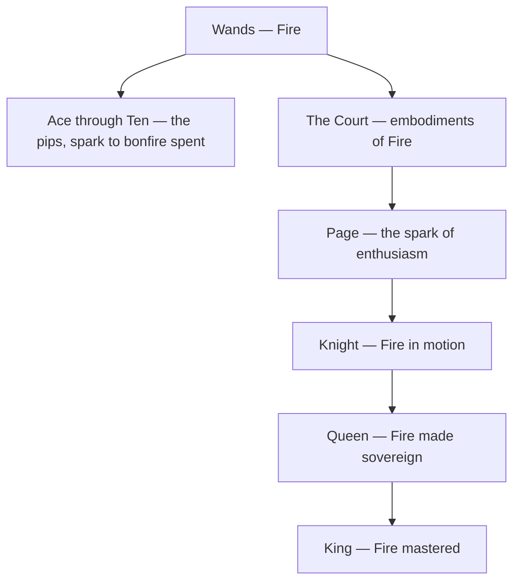

# Wands

> *The staff is only a stick until someone decides to walk somewhere with it.*

---

## The Element

Wands is the suit of [Fire](/knowledge/elements/fire) — the element of will, passion, and spirit. Where the other suits describe how life is felt, thought, or built, Wands describes why anything is attempted at all. These are the cards of drive and desire, of the spark that leaps ahead of caution: creativity, enterprise, ambition, and the restless energy that will not sit still. The suit takes its name from the wand or staff, the living branch cut for a purpose — a growing thing turned into an instrument of intention. Its domain is the spiritual and the vital, the fire in the belly that decides a person is going to act. Every Wands card asks, in one form or another, what are you willing to spend yourself on.

## The Aces Through Tens

The pips of Wands trace the arc of a fire from first spark to bonfire spent. The [Ace of Wands](/knowledge/tarot/minor-arcana/ace-of-wands) is the pure ignition — the Root of the Powers of Fire, a torch offered from the clouds before it knows what it will burn for. From there the flame gathers structure and reach: the surveying ambition of the [Two of Wands](/knowledge/tarot/minor-arcana/two-of-wands), the merchant's foresight of the Three, the celebration of the Four, the scrappy competition of the Five, the triumphal parade of the Six. Then the fire meets resistance and cost — the defense of the Seven, the hurtling momentum of the Eight, the wounded vigilance of the Nine — until it arrives at the [Ten of Wands](/knowledge/tarot/minor-arcana/ten-of-wands), where the whole harvest of enterprise has become a burden too heavy to carry alone. The arc is the life of will itself: it kindles, it expands, it fights for its ground, and it learns that ambition unshared eventually breaks the back that bears it.

## The Court Cards

The four courts personify ways of embodying Fire. The [Page of Wands](/knowledge/tarot/minor-arcana/page-of-wands) is the spark of enthusiasm — the messenger of a new passion, curious and unguarded, ready to be set alight. The [Knight of Wands](/knowledge/tarot/minor-arcana/knight-of-wands) is Fire in motion, all charge and charisma and forward rush, magnificent and prone to burning out mid-gallop. The [Queen of Wands](/knowledge/tarot/minor-arcana/queen-of-wands) is Fire made sovereign and warm — confident, magnetic, radiant with a self-possession that draws others in without consuming them. The [King of Wands](/knowledge/tarot/minor-arcana/king-of-wands) is Fire mastered into vision and command, the leader who turns raw enthusiasm into enterprise and points the flame at a horizon worth reaching. Together they run from the untried spark to the disciplined blaze.

The suit's shape, from its element down through the pips and the rising court, looks like this.

## Correspondence

In the Golden Dawn system, Wands answers to the **Yod** of the Tetragrammaton — the primal spark of the divine name, the first stroke from which the other three letters descend. Its direction is **South**, the quarter of noon and greatest heat, and its season is spring, the surge of new growth. In [Astrology](/knowledge/astrology) the suit governs the fiery triplicity — the cardinal spark of [Aries](/knowledge/astrology/signs/aries), the fixed flame of [Leo](/knowledge/astrology/signs/leo), and the mutable blaze of [Sagittarius](/knowledge/astrology/signs/sagittarius). See the [Table of Correspondences](/knowledge/table-of-correspondences) for the full grid of associations.

## In Reading

When Wands dominate a spread, the reading is about energy, motivation, and creative or spiritual momentum — what a person is driven toward and whether the fire is aimed or scattered. Wands ask about passion and purpose; they favour action over deliberation and boldness over comfort. Their shadow is the same as Fire's: burnout, recklessness, the flame that consumes what it was meant to warm.

## Related

- [Ace of Wands](/knowledge/tarot/minor-arcana/ace-of-wands)
- [Ten of Wands](/knowledge/tarot/minor-arcana/ten-of-wands)
- [Page of Wands](/knowledge/tarot/minor-arcana/page-of-wands)
- [Knight of Wands](/knowledge/tarot/minor-arcana/knight-of-wands)
- [Queen of Wands](/knowledge/tarot/minor-arcana/queen-of-wands)
- [King of Wands](/knowledge/tarot/minor-arcana/king-of-wands)
- [Fire](/knowledge/elements/fire)
- [Elements](/knowledge/elements)
- [Minor Arcana](/knowledge/tarot/minor-arcana)
- [Tarot](/knowledge/tarot)
- [Table of Correspondences](/knowledge/table-of-correspondences)
- [Cups](/knowledge/tarot/minor-arcana/cups), [Swords](/knowledge/tarot/minor-arcana/swords), [Pentacles](/knowledge/tarot/minor-arcana/pentacles)
