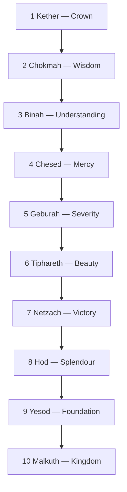

# Tree of Life

> *The lightning-flash from crown to kingdom — the map of how the One becomes the many.*

---

The Tree of Life (*Etz Chaim*) is the central glyph of the [Kabbalah](/knowledge/spirituality/kabbalah): ten spheres of divine emanation, the **Sephiroth**, joined by twenty-two paths. Read from the top down it charts the descent of the infinite into form — the lightning-flash from [Kether](/knowledge/tree-of-life/kether) to [Malkuth](/knowledge/tree-of-life/malkuth); read from the bottom up it is the ladder of return, the soul's climb back toward the source. The same structure underwrites Hermetic and alchemical thought, and it is the skeleton on which the [Tarot](/knowledge/tarot) is hung.

---

## The Ten Sephiroth

| # | Sphere | Meaning | Sphere / Planet |
|---|--------|---------|-----------------|
| 1 | [Kether](/knowledge/tree-of-life/kether) | Crown | Primum Mobile |
| 2 | [Chokmah](/knowledge/tree-of-life/chokmah) | Wisdom | the Zodiac |
| 3 | [Binah](/knowledge/tree-of-life/binah) | Understanding | Saturn |
| 4 | [Chesed](/knowledge/tree-of-life/chesed) | Mercy | Jupiter |
| 5 | [Geburah](/knowledge/tree-of-life/geburah) | Severity | Mars |
| 6 | [Tiphareth](/knowledge/tree-of-life/tiphareth) | Beauty | the Sun |
| 7 | [Netzach](/knowledge/tree-of-life/netzach) | Victory | Venus |
| 8 | [Hod](/knowledge/tree-of-life/hod) | Splendour | Mercury |
| 9 | [Yesod](/knowledge/tree-of-life/yesod) | Foundation | the Moon |
| 10 | [Malkuth](/knowledge/tree-of-life/malkuth) | Kingdom | Earth |

The lightning-flash traces that descent in order, from crown to kingdom:

## The Three Pillars

The spheres arrange into three columns. The **Pillar of Mercy** on the right ([Chokmah](/knowledge/tree-of-life/chokmah), [Chesed](/knowledge/tree-of-life/chesed), [Netzach](/knowledge/tree-of-life/netzach)) is expansive and active; the **Pillar of Severity** on the left ([Binah](/knowledge/tree-of-life/binah), [Geburah](/knowledge/tree-of-life/geburah), [Hod](/knowledge/tree-of-life/hod)) is restrictive and form-giving; the **Middle Pillar** ([Kether](/knowledge/tree-of-life/kether), [Tiphareth](/knowledge/tree-of-life/tiphareth), [Yesod](/knowledge/tree-of-life/yesod), [Malkuth](/knowledge/tree-of-life/malkuth)) is the pillar of balance and consciousness, the trunk down which the current runs.

## The Paths and the Tarot

The twenty-two paths that connect the spheres correspond to the twenty-two trumps of the [Major Arcana](/knowledge/tarot/major-arcana) — each Hebrew letter a path, each path a card. The four suits of the [Minor Arcana](/knowledge/tarot/minor-arcana) descend the Tree by number: the Aces at [Kether](/knowledge/tree-of-life/kether), the Twos at [Chokmah](/knowledge/tree-of-life/chokmah), and so on down to the Tens at [Malkuth](/knowledge/tree-of-life/malkuth). Each card's Correspondence names its path or sphere.

---

## Related

- [Kabbalah](/knowledge/spirituality/kabbalah) — the tradition the Tree belongs to
- [Tarot](/knowledge/tarot) — the 22 paths are the Major Arcana
- [Hermeticism](/knowledge/spirituality/hermeticism) — "as above, so below"
- [Alchemy](/knowledge/alchemy) — the Great Work climbs the same ladder
- [Spirituality Hub](/knowledge/spirituality)
