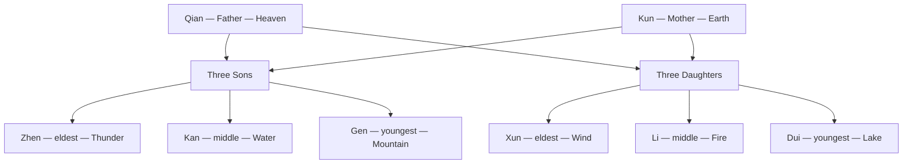

# Trigrams

> *Eight small figures of broken and unbroken lines — the smallest grammar with which the world can describe its own changing.*

---

The eight trigrams — the **bagua** — are the elementary vocabulary of Chinese cosmology. Each is a stack of three lines, and every line is one of two things: an unbroken solid line (**yang**, the active, light, giving) or a broken line with a gap at its center (**yin**, the receptive, dark, yielding). Three lines, two possibilities each, yields exactly eight figures — no more, no less — and those eight are the building blocks from which the whole of the [I Ching](/knowledge/religions-of-the-world/taoism) is assembled. Stack any two trigrams and you get one of the sixty-four **hexagrams** of the *Book of Changes*: eight times eight, the full alphabet of situations through which yin and yang can move in time.

Where the West divided nature into the four [Elements](/knowledge/elements) plus a fifth essence, the East divided its permutations of yin and yang into these eight images — heaven and earth, thunder and wind, water and fire, mountain and lake. The two systems are cousins rather than translations: the elements are substances a thing is *made of*, while the trigrams are phases and forces a situation is *doing*. Still, each trigram leans toward a natural element, and reading them side by side lets one language check the other.

The bagua is traditionally laid out in two arrangements. The **Earlier Heaven** sequence, attributed to the mythic sage **Fu Xi**, is the ideal cosmos in perfect symmetry — heaven above and earth below, every trigram facing its exact opposite across the circle, a picture of the world before it began to move. The **Later Heaven** sequence, attributed to **King Wen** of the Zhou, is the world in motion — the trigrams arranged around the compass to describe the turning of the seasons and the flow of energy through actual time and space. The directions given in these notes follow the Later Heaven arrangement, the one used in feng shui and most divination.

The eight also form a single symbolic family: [Qian](/knowledge/trigrams/qian) the father and [Kun](/knowledge/trigrams/kun) the mother, and between them their six children — three sons ([Zhen](/knowledge/trigrams/zhen), [Kan](/knowledge/trigrams/kan), [Gen](/knowledge/trigrams/gen)) and three daughters ([Xun](/knowledge/trigrams/xun), [Li](/knowledge/trigrams/li), [Dui](/knowledge/trigrams/dui)) — each distinguished by which single line makes it different from the pure parent.

Read as a household, the eight fall into two parents and their six children:

---

## The Eight

| Trigram | Symbol | Image | Attribute | Family | Direction |
| --- | --- | --- | --- | --- | --- |
| [Qian](/knowledge/trigrams/qian) | ☰ | Heaven | Creative, strong | Father | Northwest |
| [Kun](/knowledge/trigrams/kun) | ☷ | Earth | Receptive, yielding | Mother | Southwest |
| [Zhen](/knowledge/trigrams/zhen) | ☳ | Thunder | Arousing, movement | Eldest son | East |
| [Kan](/knowledge/trigrams/kan) | ☵ | Water | Abysmal, danger | Middle son | North |
| [Gen](/knowledge/trigrams/gen) | ☶ | Mountain | Keeping still | Youngest son | Northeast |
| [Xun](/knowledge/trigrams/xun) | ☴ | Wind / Wood | Gentle, penetrating | Eldest daughter | Southeast |
| [Li](/knowledge/trigrams/li) | ☲ | Fire | Clinging, light | Middle daughter | South |
| [Dui](/knowledge/trigrams/dui) | ☱ | Lake | Joyous, open | Youngest daughter | West |

---

## Related

- [Taoism](/knowledge/religions-of-the-world/taoism) — the tradition that reads these figures most naturally
- [Elements](/knowledge/elements) — the Western four-element system, the trigrams' cousin
- [Table of Correspondences](/knowledge/table-of-correspondences) — the full cross-tradition grid
- [Qian](/knowledge/trigrams/qian), [Kun](/knowledge/trigrams/kun), [Zhen](/knowledge/trigrams/zhen), [Kan](/knowledge/trigrams/kan), [Gen](/knowledge/trigrams/gen), [Xun](/knowledge/trigrams/xun), [Li](/knowledge/trigrams/li), [Dui](/knowledge/trigrams/dui)
- [Spirituality Hub](/knowledge/spirituality)
